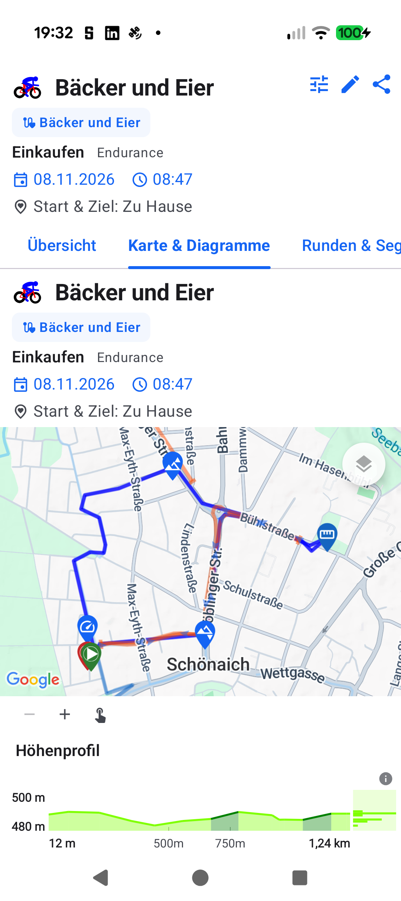

# ATT-6214 Walkthrough: Adaptive TopEnd Action Stacking & Map Layers Docking

**Ticket**: ATT-6214  
**Epic**: ATT-355 (Global UI & Design System)  
**Sprint**: 2026-45.13  
**Target Release**: V5.0.0  
**Status**: Completed  

---

## 1. Executive Summary

Previously, `TrackOnMapScreen` and `RouteOnMapScreen` positioned the floating map layers button with a hardcoded `padding(top = 76.dp, end = 16.dp)`, reserving space for a 44.dp floating share button. On workout track maps where the share button is omitted, this resulted in an awkward 60.dp empty vertical gap.

Under `ATT-6214` (governed by `REQ-UI-500`), we eliminated all hardcoded 76.dp offsets:
1. Introduced `topEndActions: (@Composable ColumnScope.() -> Unit)? = null` on [`MapDetailLayout`](file:///home/rainer/AndroidStudioProjects/aTrainingTracker/app/src/main/java/com/atrainingtracker/trainingtracker/ui/map/MapDetailLayout.kt).
2. Unified all top-end action controls within an adaptive `Column(Modifier.align(Alignment.TopEnd).padding(16.dp), verticalArrangement = Arrangement.spacedBy(16.dp))`. When the share button is absent, the layers button cleanly docks at `top = 16.dp`; when present, actions stack naturally at 16.dp intervals.
3. Propagated `mapTopEndActions` through [`WorkoutDetailTabbedContent`](file:///home/rainer/AndroidStudioProjects/aTrainingTracker/app/src/main/java/com/atrainingtracker/trainingtracker/ui/aftermath/WorkoutDetailTabbedContent.kt) and migrated [`TrackOnMapScreen`](file:///home/rainer/AndroidStudioProjects/aTrainingTracker/app/src/main/java/com/atrainingtracker/trainingtracker/ui/aftermath/TrackOnMapScreen.kt) and [`RouteOnMapScreen`](file:///home/rainer/AndroidStudioProjects/aTrainingTracker/app/src/main/java/com/atrainingtracker/trainingtracker/ui/routes/RouteOnMapScreen.kt) to slot into `topEndActions`.

---

## 2. Traceability Matrix

| Requirement | Test Specification | Production Code | Verification Tests | Status |
| :--- | :--- | :--- | :--- | :--- |
| `REQ-UI-500` | `TST-UI-500` | `MapDetailLayout.kt` `WorkoutDetailTabbedContent.kt` `TrackOnMapScreen.kt` `RouteOnMapScreen.kt` | `MapDetailLayoutTest` `WorkoutDetailTabbedContentTest` `RouteOverlayLayersContractTest` `AspiceSweAuditContractTest` | **Verified** |

---

## 3. Verification & Test Execution

- **Tier 1 Targeted Unit & Contract Test Suite**:
  - `MapDetailLayoutTest`: Verified unified `topEndActions` column hierarchy, layout positioning, and zero hardcoded 76.dp offsets across `TrackOnMapScreen` and `RouteOnMapScreen`.
  - `WorkoutDetailTabbedContentTest`: Verified `mapTopEndActions` forwarding across both technical and simplified map modes.
  - `RouteOverlayLayersContractTest`: Verified contract compliance with `topEndActions` and `overlay` slots.
  - `AspiceSweAuditContractTest`: Full living document index parity (`docs/requirements.md` and `docs/tests.md`) verified.
  - **Results**: 1,266 tests executed, 0 failures, 100% PASS (`task-357`).

- **Physical Device Walkthrough (Google Pixel 10)**:
  - Deployed `com.atrainingtracker.debug` onto physical Pixel 10 (`66020DLCR002FL`).
  - Navigated to Workout Detail ("Bäcker und Eier") -> "Karte & Diagramme".
  - Verified visual docking of floating layers button directly at `top = 16.dp` with zero orphaned vertical offset.

