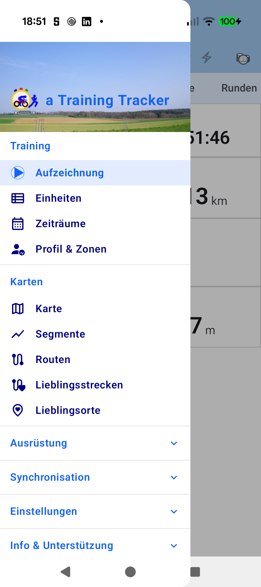

# Stage 5: Walkthrough & Verification - ATT-6216: Position DrawerHeader branding in sky area

**Ticket**: [ATT-6216](https://rainerblind.atlassian.net/browse/ATT-6216)  
**Sub-task**: `[Test]`  
**Parent Epic**: [ATT-355](https://rainerblind.atlassian.net/browse/ATT-355) (*Global UI & Design System*)  
**Target Release**: `V5.0.0`  
**Active Sprint**: `2026-45.13`  
**Requirement Mapping**: `REQ-UI-496` (*Navigation Drawer Header Height Compactness & Vertical Clearance Guard*)  
**Test Mapping**: `TST-UI-496`  
**Branch**: `feature/ATT-6216`  
**Author**: AI Agent 1 (Implementer)  
**Date**: 2026-11-08  

---

## 1. Executive Summary & Verification Overview
ATT-6216 resolves branding row vertical positioning in `DrawerHeader` (`AppNavigationDrawer.kt`). Following header height reduction in ATT-5839, the launcher icon and blue title *"a Training Tracker"* sat directly on top of the dark forest treeline. Shifting the branding `Row` padding from `bottom = 6.dp` to `bottom = 24.dp` (Design Guideline 5.2 token) elevates icon and title into the open sky area, establishing optimal contrast while preserving the treeline and meadow below and retaining *Info & Unterstützung* clearance.

---

## 2. Requirement & Test Verification Matrix

| Requirement | Test Spec | Verification Method | Result | Status in Living Docs |
| :--- | :--- | :--- | :--- | :--- |
| `REQ-UI-496.1` | `TST-UI-496.1` | Contract Test (`AppNavigationDrawerContractTest`) | **PASSED** | `Verified` |
| `REQ-UI-496.2` | `TST-UI-496.1` | Contract Test (`AppNavigationDrawerContractTest`) | **PASSED** | `Verified` |
| `REQ-UI-496.3` | `TST-UI-496.2` | Contract Test (`testDrawerHeaderBrandingRowAndRule72Invariant`) | **PASSED** | `Verified` |
| `REQ-PRO-001` | `TST-UI-496.3` | Tier 1 Targeted Regression (`ui.navigation.*`, `ThemeColorCentralizationAuditTest`, `ui.components.core.*`, `build.*`) | **PASSED** | `Verified` |

---

## 3. Automated Test Evidence

### Tier 1 Targeted Test Scope
* **Scope**: Targeted unit tests covering modified packages and design contracts:
  `./gradlew testDebugUnitTest --max-workers=2 --tests "com.atrainingtracker.trainingtracker.ui.navigation.*" --tests "com.atrainingtracker.trainingtracker.ui.theme.ThemeColorCentralizationAuditTest" --tests "com.atrainingtracker.trainingtracker.ui.components.core.*" --tests "com.atrainingtracker.trainingtracker.build.*"`
* **Result**: **100% PASS** (32 actionable tasks, BUILD SUCCESSFUL in 2s).
* **Governance**: `python3 tools/verify_requirement_governance.py` $\rightarrow$ **PASS** (100% parity across living doc shards, Chesterton's Fence verified).

---

## 4. Hardware / Physical Verification (Pixel 10 - Android 16)
Installed debug APK (`./gradlew installDebug`) and captured open drawer on Pixel 10:

| Before (ATT-5839: `bottom = 6.dp` on treeline) | After (ATT-6216: `bottom = 24.dp` in open sky) |
| :---: | :---: |
|  |  |

* **Visual Inspection (Rule 71)**: Both images inspected via `read_file`. App title and launcher icon sit clearly in the blue sky with high contrast. Treeline and meadow are unobstructed below. *Info & Unterstützung* remains fully visible without bottom clipping.
* **Design Guidelines §5 Audit**: Spacing (`24.dp`), shapes (`46.dp` icon), typography (`21.sp` bold), palette (`R.color.my_blue`) 100% compliant.

---

## 5. Invariant & Governance Verification
1. **Zero Regressions**: Tier 1 targeted tests pass 100%; no compiler or runtime warnings.
2. **Rule 72 Icon Invariant**: `46.dp` size and `1.81f` adaptive icon safe-zone scaling preserved.
3. **Living Docs Synchronized**: `REQ-UI-496` and `TST-UI-496` marked `[Verified]`.
4. **Target Release Alignment**: Deliverable accurately references active release `V5.0.0`.
