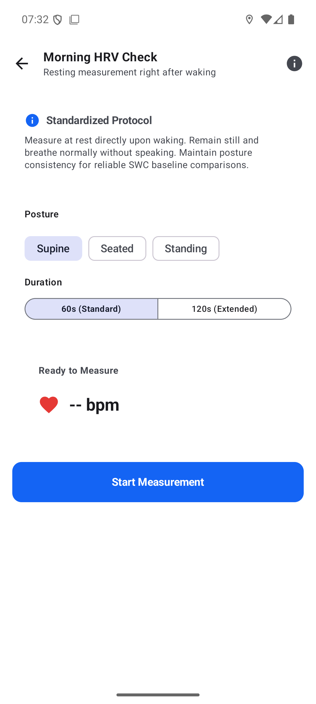
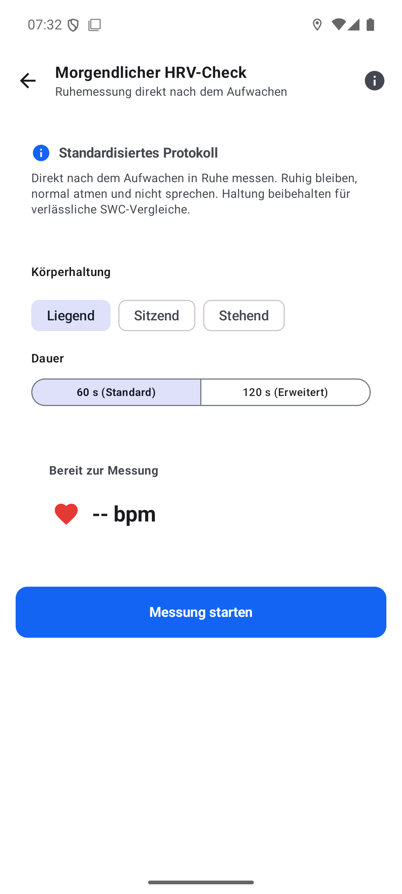

# Stage 5 Walkthrough - ATT-7739: Morning HRV Instructions Desc Clean Phrasing

**Ticket**: [ATT-7739](https://rainerblind.atlassian.net/browse/ATT-7739)  
**Parent Epic**: [ATT-3539](https://rainerblind.atlassian.net/browse/ATT-3539) (*Heart Rate Variability (HRV)*)  
**Target Release**: `V5.0.0` | **Active Sprint**: `Sprint 2026-46.6`  
**Requirement Mapping**: `REQ-PER-032` / `REQ-PER-032.6`  
**Test Spec ID**: `TST-PER-040` / `TST-PER-040.6`  
**Branch**: `feat/ATT-7739` | **Author**: Flash Agent (`agent1`) | **Date**: 2026-11-14  

---

## 1. Executive Summary & Verification Scope
Following Sprint 2026-46.5 feedback on `ATT-7533`, the clinical instructions string `morning_hrv_instructions_desc` previously contained crude voiding phrasing across all 9 localized resource shards. This deliverable replaces those descriptions with professional, rest-focused morning waking instructions across all 9 supported languages (DE, EN, ES, FR, IT, JA, NL, PL, PT) without altering any Kotlin UI layout or logic.

All acceptance criteria and system invariants have been verified:
- **Clean Rest Phrasing**: All 9 locales emphasize measuring directly upon waking in rest and breathing normally without speaking.
- **Forbidden Keywords Absent**: Automated contract tests confirm zero clinical bladder terminology across all languages.
- **100% 9-Language Parity**: Key parity, specifier parity, and AAPT2 compilation verified with 0 warnings/errors.
- **On-Device Inspection (Rule 71)**: Verified on `emulator-5554` (`Pixel_8_Android_15`) in English and German.

---

## 2. Changes Summary

### 2.1 Sharded String Resources (`strings_hrv.xml`)
Updated `morning_hrv_instructions_desc` across all 9 locale directories:
* **EN (`values/strings_hrv.xml`)**: `Measure at rest directly upon waking. Remain still and breathe normally without speaking. Maintain posture consistency for reliable SWC baseline comparisons.`
* **DE (`values-de/strings_hrv.xml`)**: `Direkt nach dem Aufwachen in Ruhe messen. Ruhig bleiben, normal atmen und nicht sprechen. Haltung beibehalten für verlässliche SWC-Vergleiche.`
* **ES (`values-es/strings_hrv.xml`)**: `Medir en reposo directamente al despertar. Permanezca quieto y respire con normalidad sin hablar. Mantenga la misma postura para comparaciones basales fiables.`
* **FR (`values-fr/strings_hrv.xml`)**: `Mesurer au repos directement au réveil. Rester immobile et respirer normalement sans parler. Garder la même posture pour des comparaisons fiables.`
* **IT (`values-it/strings_hrv.xml`)**: `Misurare a riposo direttamente al risveglio. Rimanere fermi e respirare normalmente senza parlare. Mantenere la postura per confronti affidabili.`
* **JA (`values-ja/strings_hrv.xml`)**: `起床後、安静にして測定してください。会話を控え、静かに自然な呼吸を保ちます。正確なSWC比較のため常に同じ姿勢を維持してください。`
* **NL (`values-nl/strings_hrv.xml`)**: `Meet direct na het ontwaken in rust. Blijf stil liggen en adem rustig zonder te spreken. Behoud dezelfde houding voor betrouwbare SWC-vergelijkingen.`
* **PL (`values-pl/strings_hrv.xml`)**: `Wykonaj pomiar w spoczynku bezpośrednio po przebudzeniu. Pozostań w bezruchu i oddychaj normalnie bez mówienia. Zachowaj stałą postawę dla wiarygodnych porównań SWC.`
* **PT (`values-pt/strings_hrv.xml`)**: `Meça em repouso diretamente ao acordar. Permaneça imóvel e respire normalmente sem falar. Mantenha a mesma postura para comparações basais confiáveis.`

### 2.2 Contract Unit Test (`TranslationParityTest.kt`)
Added `@Test fun testMorningHrvInstructionsDesc_noBladderPhrasingAcrossAllLocales_TST_PER_040_6()` verifying:
1. Presence of `morning_hrv_instructions_desc` in base and all 8 non-default locales.
2. Absence of all forbidden bladder terms (`blase`, `bladder`, `vejiga`, `vessie`, `vescica`, `排尿`, `blaas`, `pęcherz`, `bexiga`).
3. Presence of localized rest-orientation keywords across all 9 locales.

---

## 3. Verification & Test Evidence

### 3.1 Unit Test Execution
```bash
python3 tools/parallel_sprint_lock.py --timeout 1800 ./gradlew testDebugUnitTest \
  --tests "com.atrainingtracker.trainingtracker.localization.TranslationParityTest" \
  --tests "com.atrainingtracker.trainingtracker.ui.theme.ThemeColorCentralizationAuditTest" --max-workers=2
```
* **Result**: `BUILD SUCCESSFUL in 1m 17s`
* **Passed**: 15 / 15 tests (10 in `TranslationParityTest`, 5 in `ThemeColorCentralizationAuditTest`, 0 failures, 0 skipped).

### 3.2 AAPT2 Resource Compilation
```bash
python3 tools/parallel_sprint_lock.py --timeout 1800 ./gradlew processDebugResources
```
* **Result**: `BUILD SUCCESSFUL in 2s` (0 AAPT2 errors/warnings).

### 3.3 Living Governance Audit
```bash
python3 tools/verify_requirement_governance.py --sync-indexes
```
* **Result**: `PASS: Master index tables successfully synchronized with 100% parity.`

---

## 4. Visual Verification (Rule 71)
Rendered and inspected on `emulator-5554` (`Pixel_8_Android_15`):

### English Checklist (`docs/screenshots/ATT-7739_morning_hrv_en.png`)

* *Observations*: Displays "Measure at rest directly upon waking. Remain still and breathe normally without speaking. Maintain posture consistency for reliable SWC baseline comparisons." under the "Standardized Protocol" info card. Standard typography and colors preserved.

### German Checklist (`docs/screenshots/ATT-7739_morning_hrv_de.png`)

* *Observations*: Displays "Direkt nach dem Aufwachen in Ruhe messen. Ruhig bleiben, normal atmen und nicht sprechen. Haltung beibehalten für verlässliche SWC-Vergleiche." under "Standardisiertes Protokoll". No crude phrasing visible.

---

## 5. Invariants & Preserved Behavior
- **Zero Bytecode Changes**: No Kotlin application logic, Compose layout hierarchies, or database migrations modified.
- **Resource Key Invariance**: Key `morning_hrv_instructions_desc` remains identical, ensuring zero breakage for calling composables.
- **100% Localization Parity**: All 9 language shards maintained with full syntactic consistency.

---

## 6. Traceability Matrix

| Test Case | Scope | Method Under Test | Requirement | Status |
| :--- | :--- | :--- | :--- | :--- |
| `[TST-PER-040.6a]` | Unit | `TranslationParityTest.testMorningHrvInstructionsDesc...` | `REQ-PER-032.6` | Verified |
| `[TST-PER-040.6b]` | Tier 1 Parity | `TranslationParityTest` full suite | `REQ-PER-032.6` | Verified |
| `[TST-PER-040.6c]` | Fast AAPT2 | `processDebugResources` | `REQ-PER-032.6` | Verified |
