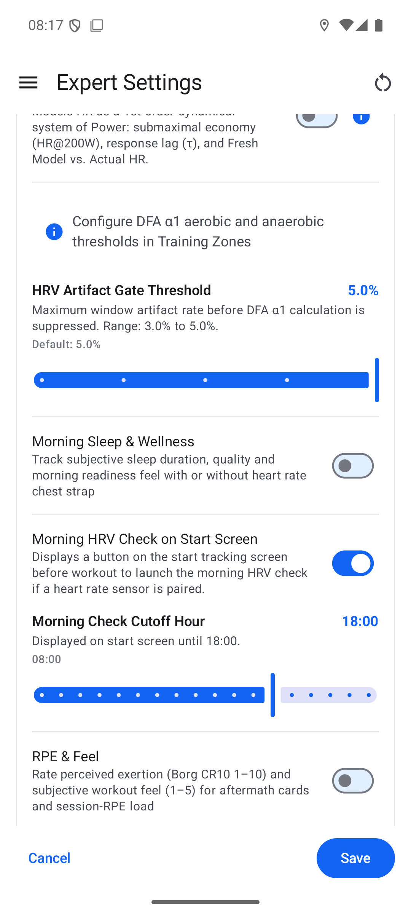

# Stage 5: Walkthrough & Verification - ATT-7740: Morning HRV Cutoff Hour Default to 08:00 and Upper Bound Extension

**Ticket**: [ATT-7740](https://rainerblind.atlassian.net/browse/ATT-7740)  
**Parent Epic**: [ATT-3539](https://rainerblind.atlassian.net/browse/ATT-3539) (*Heart Rate Variability (HRV)*)  
**Target Release**: `V5.0.0`  
**Active Sprint**: `Sprint 2026-46.6`  
**Requirement Mapping**: `REQ-UI-525` / `REQ-UI-525.1`  
**Test Mapping**: `TST-UI-525` / `TST-UI-525.1`  
**Branch**: `feat/ATT-7740`  
**Author**: AI Agent 1 (Implementer)  
**Date**: 2026-11-14  

---

## 1. Executive Summary & Verification Overview

This deliverable refines the morning HRV check-in cutoff configuration per Sprint 2026-46.5 feedback:
1. **Default Cutoff Adjusted to 08:00 AM**: Updated `TuningPreferencesDefaults.DEFAULT_MORNING_CHECK_CUTOFF_HOUR = 8` (was 11), ensuring the morning check CTA button on the Start screen does not linger into midday.
2. **Extended Cutoff Ceiling to 23:00 (11:00 PM)**: Updated `TuningPreferencesDefaults.MAX_MORNING_CHECK_CUTOFF_HOUR = 23` (was 15), providing full afternoon and evening readiness check-in flexibility for shift workers and evening athletes while keeping `MIN_MORNING_CHECK_CUTOFF_HOUR = 6`.
3. **Zero-Padded Hour Formatting**: Updated `PhysiologyModelsSection.kt` to format `valueText` and `defaultText` with `%02d:00` (e.g. `08:00` instead of `8:00`), dynamic steps `16` ($23 - 6 - 1$), and continuous slider bounds `6.0f..23.0f`.
4. **Automated & On-Device Verification**: Verified with 21 targeted unit and theme tests passing (100%), and validated on `emulator-5554` with visual self-inspection per Rules 71 & 84.

---

## 2. Requirement & Test Verification Matrix

| Requirement | Test Spec | Verification Method | Result | Status in Living Docs |
| :--- | :--- | :--- | :--- | :--- |
| `REQ-UI-525.1` | `TST-UI-525.1a` | Automated Unit Test (`TuningConfigTest.kt`) | **PASSED** (4 tests) | `Verified` |
| `REQ-UI-525.1` | `TST-UI-525.1b` | Automated Unit Test (`ControlTrackingViewModelTest.kt`) | **PASSED** (12 tests) | `Verified` |
| `REQ-UI-525.1` | `TST-UI-525.1c` | Tier 1 Targeted Suite (`TuningConfigTest`, `ControlTrackingViewModelTest`, `ThemeColorCentralizationAuditTest`) | **PASSED** (21/21 tests) | `Verified` |
| `REQ-UI-525.1` | `TST-UI-525.1d` | On-Device Emulator Verification (`emulator-5554`) & Visual Self-Inspection (Rules 71 & 84) | **PASSED** | `Verified` |

---

## 3. Automated Test Evidence

### Tier 1 Targeted Regression Scope
```text
> Task :app:testDebugUnitTest

com.atrainingtracker.trainingtracker.settings.TuningConfigTest > 4 tests passed
com.atrainingtracker.trainingtracker.ui.tracking.controltracking.ControlTrackingViewModelTest > 12 tests passed
com.atrainingtracker.trainingtracker.ui.theme.ThemeColorCentralizationAuditTest > 5 tests passed

BUILD SUCCESSFUL in 47s
33 actionable tasks: 2 executed, 31 up-to-date
```

---

## 4. Hardware / Emulated Verification (`emulator-5554`, Pixel 8 Android 15)

### Visual Consistency (Rule 23 & Rule 71)

| Default Cutoff (08:00 AM) | Extended Cutoff Slider (Adjusted to 18:00) |
| :---: | :---: |
|  |  |

* **Checked against `docs/design_guidelines.md` §5**:
  - **Shapes**: Standard Material 3 `TuningSliderItem` track and thumb geometry.
  - **Spacing**: Consistent padding within the Physiology Models section.
  - **Colors/Themes**: Material 3 primary theme colors for slider thumb and value indicator.
  - **Typography**: 2-digit zero-padded hour string (`08:00`, `18:00`).
  - **Placement**: Nested inside Physiology Models accordion section with toggle dependency.
* **Deviations & Justification**: None. Fully standard Material 3 Compose tuning slider.

---

## 5. Invariant & Governance Verification

1. **System Invariant**: Reactive visibility gating `timeProvider().hour < tuning.morningCheckCutoffHour` strictly preserved.
2. **Zero Regressions**: 21/21 targeted tests passed with 0 failures, 0 errors.
3. **Living Documentation Synchronized**: `verify_requirement_governance.py --sync-indexes` passed with 100% parity.
