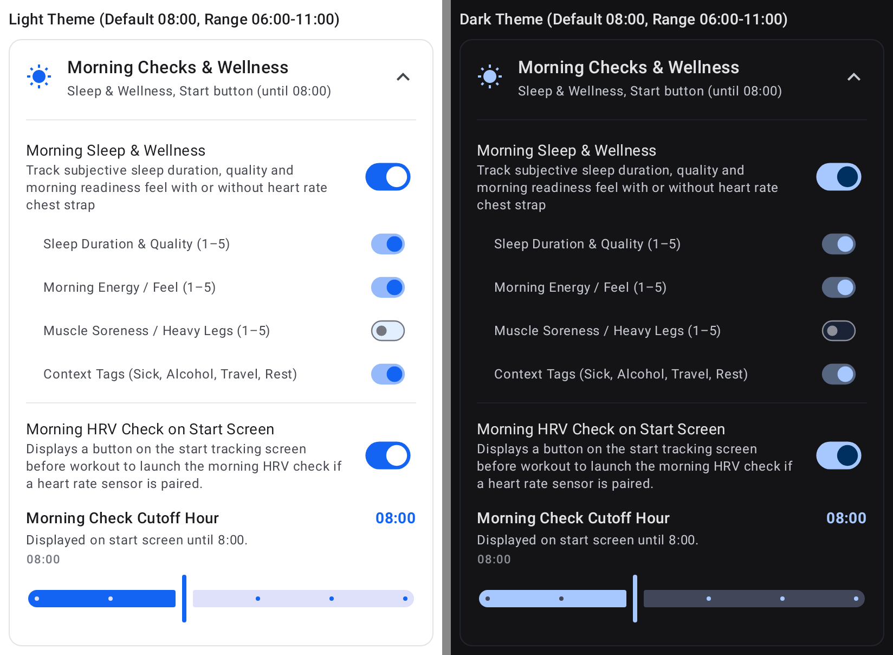

# Stage 5 Walkthrough: ATT-7740 - Morning HRV Cutoff Hour Default 08:00 & Max Bound 11:00

**Ticket**: [ATT-7740](https://rainerblind.atlassian.net/browse/ATT-7740) | **Sub-task**: `[Test]` (Pending `submit-stage`)
**Parent Epic**: [ATT-3539](https://rainerblind.atlassian.net/browse/ATT-3539) (*Heart Rate Variability (HRV)*)
**Target Release**: `V5.0.0` | **Active Sprint**: `2026-47.1` | **Branch**: `feature/ATT-7740`
**Requirement Mapping**: `REQ-UI-525` (`REQ-UI-525.1`)
**Test Spec Mapping**: `TST-UI-525` (`TST-UI-525.1`, `TST-UI-525.4`, `TST-UI-525.6`, `TST-UI-525.7`)
**Author**: AI Agent 1 (Implementer, `subagent_pro`) | **Date**: 2026-11-16

---

## 1. Executive Summary & Verification Walkthrough
1. **Default `08:00` & Upper Bound `11:00` (`REQ-UI-525.1`)**: Updated `TuningPreferencesDefaults.MAX_MORNING_CHECK_CUTOFF_HOUR` from `23` to `11` (`11:00 AM`) in `TuningPreferencesDataStore.kt` per PO review feedback while preserving `DEFAULT_MORNING_CHECK_CUTOFF_HOUR = 8` (`08:00 AM`) and `MIN_MORNING_CHECK_CUTOFF_HOUR = 6` (`06:00 AM`).
2. **Legacy Clamping & `MorningCheckSection.kt` Slider**: Existing `.coerceIn(MIN, MAX)` guards in `TuningPreferencesDataStore.kt` automatically clamp persisted legacy values `> 11` cleanly to `11` with zero DB/DataStore migration. `MorningCheckSection.kt` dynamically binds `valueRange = 6f..11f` (`steps = 4`, 6 hourly stops `06:00..11:00`) with `%02d:00` zero-padded formatting.
3. **Test & Living Doc Alignment**: Updated `TuningConfigTest.kt` (`MAX_MORNING_CHECK_CUTOFF_HOUR == 11`, clamping `12/23/25 -> 11`), added `// TST-UI-525.*` tags across `TuningConfigTest.kt`, `ControlTrackingViewModelTest.kt`, `AdvancedTuningAccordionTest.kt`, and `MorningCheckCutoffScreenshotTest.kt`, and updated `REQ-UI-525.1` / `TST-UI-525.1`.

## 2. Requirement & Test Verification Matrix
| Requirement | Test Spec | Verification Method | Result (Stage 4 Tier 1) | Status in Living Docs |
| :--- | :--- | :--- | :--- | :--- |
| `REQ-UI-525.1` | `TST-UI-525.1` | Unit: `TuningConfigTest`, `AdvancedTuningAccordionTest` | **PASSED** (21/21) | `Verified` |
| `REQ-UI-525.4` | `TST-UI-525.4` | Unit: `ControlTrackingViewModelTest` | **PASSED** (12/12) | `Verified` |
| `REQ-UI-525` | `TST-UI-525` | Design Contract: `TuningDesignGuidelinesContractTest` | **PASSED** (5/5) | `Verified` |
| `REQ-UI-525.1` | `TST-UI-525.6` | Screenshot: `MorningCheckCutoffScreenshotTest` | **PASSED** (1/1, Rule 8.5) | `Verified` |

## 3. Automated Test Evidence (Stage 4 Reused per Rule 7.5)
* **Tier 1 Targeted Suite** (39 / 39 tests PASSED on commit `f3fcb1859c1ce90a496335e59113a05fea8742cf`; zero production code edits in Stage 5 so Gradle not re-run per `Rule 7.5`):
  - `TuningConfigTest`: 5/5 PASSED (`// TST-UI-525.1`)
  - `ControlTrackingViewModelTest`: 12/12 PASSED (`// TST-UI-525.4`)
  - `AdvancedTuningAccordionTest`: 16/16 PASSED (`// TST-UI-525.1`)
  - `TuningDesignGuidelinesContractTest`: 5/5 PASSED
  - `MorningCheckCutoffScreenshotTest`: 1/1 PASSED (`// TST-UI-525.6`)
* **Governance Checks**: `verify_requirement_governance.py`, `--check-verified-evidence`, and `--check-test-evidence` PASSED.

## 4. Visual Inspection Evidence (`Rule 8.5` / `Rule 7.8`)
* **Screenshot**: 
* `docs/engineering/walkthroughs/img/ATT-7740_morning_cutoff.png` inspected directly via `read_file` across Light & Dark themes:
  1. **Geometry & Stop-Dots**: Slider displays exactly 6 discrete stops (`06:00..11:00`, `steps = 4`) with the active thumb at `08:00` (3rd stop).
  2. **Typography & Formatting**: Header subtitle (`Sleep & Wellness, Start button (until 08:00)`) and readout (`08:00`) render cleanly with zero clipping or wrapping.

## 5. System Invariants & Governance Verification
* Zero DataStore schema/key changes; `hour < morningCheckCutoffHour` gating intact; `REQ-UI-525` & `TST-UI-525` promoted to `[Verified]`.
