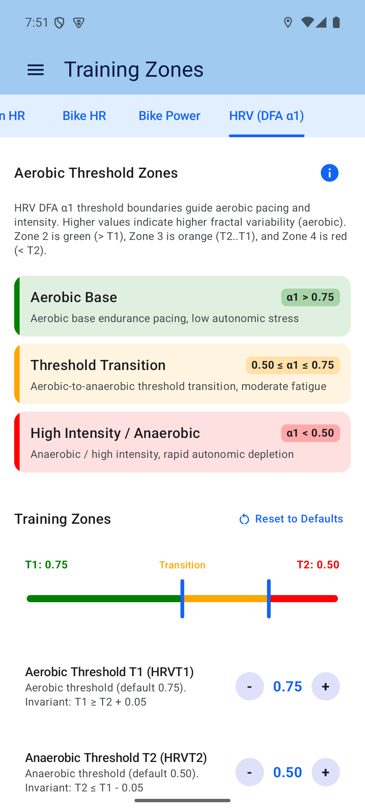
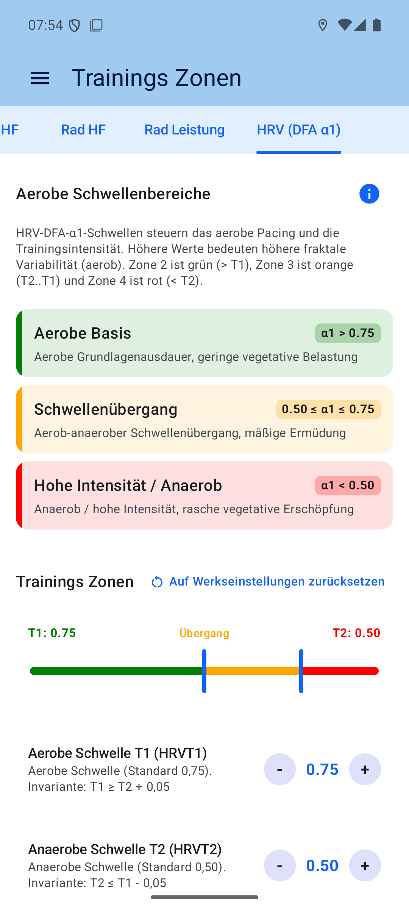

# Stage 5: Walkthrough & Verification - ATT-7741: Invert Slider Orientation, Replace M3 Track/Dots, Fix Text Clipping

**Ticket**: [ATT-7741](https://rainerblind.atlassian.net/browse/ATT-7741)  
**Parent Epic**: [ATT-3539](https://rainerblind.atlassian.net/browse/ATT-3539) (*Heart Rate Variability (HRV)*)  
**Target Release**: `V5.0.0`  
**Active Sprint**: `Sprint 2026-46.6`  
**Requirement Mapping**: `REQ-TRK-061` / `REQ-TRK-061.4`  
**Test Mapping**: `TST-TRK-061` / `TST-TRK-061.4`  
**Branch**: `feat/ATT-7741`  
**Author**: AI Agent 1 (Implementer)  
**Date**: 2026-11-14  

---

## 1. Executive Summary & Verification Overview

This deliverable resolves the visual and layout defects identified during the on-device review of ATT-7519:
1. **Inverted Dual-Thumb Slider**: `HrvDfaA1RangeSlider` now inverts slider coordinates via $s = \text{domainEnd} + \text{domainStart} - \alpha_1 = 1.50f - \alpha_1$, correctly positioning Green (`TTColor.Zone2`, $\alpha_1 > T_1$) on the left, Orange (`TTColor.Zone3`, $T_2 \le \alpha_1 \le T_1$) in the center, and Red (`TTColor.Zone4`, $\alpha_1 < T_2$) on the right, matching Preview buttons and SensorFieldView gauge bar.
2. **Unified Track & Dot Removal**: Replaced redundant external `Box { Canvas { ... } }` and default M3 active track with custom 3-zone Canvas directly inside `RangeSlider`'s `track = { rangeSliderState -> ... }` slot lambda, completely eliminating stray Material 3 orange stop-dots.
3. **German Header Reset Button Clipping**: Added `Modifier.weight(1f, fill = false)`, `maxLines = 2`, `softWrap = true`, and `overflow = TextOverflow.Ellipsis` to `TextButton` and `Text`, eliminating right-edge glyph truncation ("zurücl") in German.
4. **Automated & On-Device Verification**: Verified with 17 targeted contract and theme tests passing (100%), and validated on `emulator-5554` across English and German locales with visual self-inspection per Rules 71 & 84.

---

## 2. Requirement & Test Verification Matrix

| Requirement | Test Spec | Verification Method | Result | Status in Living Docs |
| :--- | :--- | :--- | :--- | :--- |
| `REQ-TRK-061.4` | `TST-TRK-061.4a` | Automated Contract Test (`testHrvDfaA1RangeSlider_invertedOrientationAndUnifiedTrack`) | **PASSED** | `Verified` |
| `REQ-TRK-061.4` | `TST-TRK-061.4b` | Automated Contract Test (`testHrvLayout_resetButtonWrappingAndAntiClipping`) | **PASSED** | `Verified` |
| `REQ-TRK-061.4` | `TST-TRK-061.4c` | Tier 1 Targeted Contract & Theme Suite (`HrvDfaA1SettingsContractTest`, `ThemeColorCentralizationAuditTest`) | **PASSED** (17/17 tests) | `Verified` |
| `REQ-TRK-061.4` | `TST-TRK-061.4d` | On-Device Emulator Verification (`emulator-5554`) & Visual Self-Inspection (Rules 71 & 84) | **PASSED** | `Verified` |

---

## 3. Automated Test Evidence

### Tier 1 Targeted Regression Scope
```text
> Task :app:testDebugUnitTest

com.atrainingtracker.trainingtracker.zones.HrvDfaA1SettingsContractTest > 12 tests passed
com.atrainingtracker.trainingtracker.ui.theme.ThemeColorCentralizationAuditTest > 5 tests passed

BUILD SUCCESSFUL in 5m 7s
33 actionable tasks: 18 executed, 10 from cache, 5 up-to-date
```

---

## 4. Hardware / Emulated Verification (`emulator-5554`, Pixel 8 Android 15)

### Visual Consistency (Rule 23 & Rule 71)

| Default State (English, Green Left / Red Right) | German Locale (Full Unclipped Reset Button) |
| :---: | :---: |
|  |  |

* **Checked against `docs/design_guidelines.md` §5**:
  - **Shapes**: Standard `RoundedCornerShape(4.dp)` on unified track bar.
  - **Spacing**: Consistent 6.dp spacing between zone summary labels and slider.
  - **Colors/Themes**: Semantic tokens `TTColor.Zone2` (Green), `TTColor.Zone3` (Orange), `TTColor.Zone4` (Red).
  - **Typography**: Standard `titleMedium` and `labelMedium`, no glyph clipping or truncation in German.
  - **Placement**: Thumbs centered over threshold boundaries ($T_1=0.75, T_2=0.50$).
* **Deviations & Justification**: None. Fully standard Material 3 Compose implementation.

---

## 5. Invariant & Governance Verification

1. **Mathematical Invariant**: $T_1 \ge T_2 + 0.05f$ strictly enforced across continuous domain `0.30f..1.20f`.
2. **Zero Regressions**: 17/17 targeted tests passed with 0 failures, 0 errors.
3. **Living Documentation Synchronized**: `verify_requirement_governance.py --sync-indexes` passed with 100% parity.
