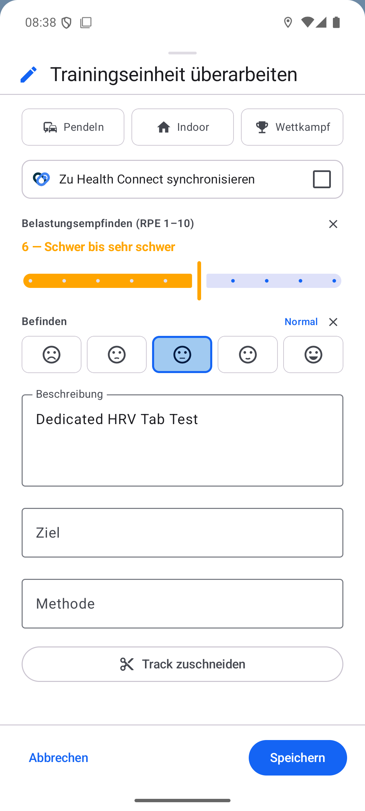
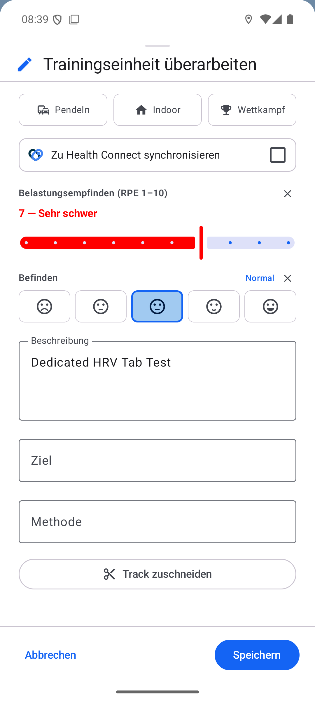
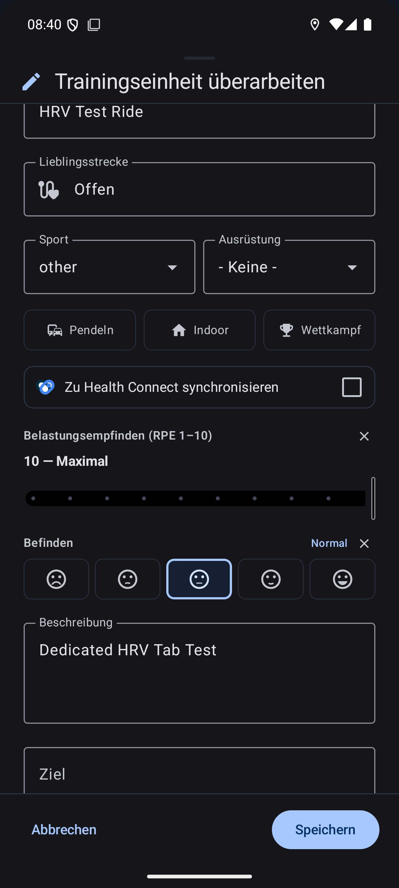

# Stage 5: Walkthrough & Verification - ATT-7743: Borg CR10 RPE 7-Zone Physiological Palette & Slider Ergonomics

**Ticket**: [ATT-7743](https://atrainingtracker.atlassian.net/browse/ATT-7743)  
**Parent Epic**: [ATT-68](https://atrainingtracker.atlassian.net/browse/ATT-68) (*Workouts & Aftermath*)  
**Target Release**: `V5.0.0` | **Active Sprint**: `2026-46.6` | **Branch**: `feat/ATT-7743`  
**Requirement Mapping**: `REQ-UI-529` (`REQ-UI-529.1`..`REQ-UI-529.5`)  
**Test Mapping**: `TST-UI-529` (`TST-UI-529.1`..`TST-UI-529.6`)  
**Author**: AI Agent 2 (Flash Agent) | **Date**: 2026-11-14  

---

## 1. Executive Summary & Verification Overview
This deliverable resolves ergonomics, stop-dot artifact, line wrapping, and dark theme contrast issues from ATT-7515 on `WorkoutRpeFeelSection.kt`:
1. **Full 7-Zone Physiological Palette (`REQ-UI-529.1`)**: `TTColor.rpeColor` maps 1–2 $\rightarrow$ `Zone1`, 3–4 $\rightarrow$ `Zone2`, 5–6 $\rightarrow$ `Zone3`, 7 $\rightarrow$ `Zone4`, 8 $\rightarrow$ `Zone5`, 9 $\rightarrow$ `Zone6`, 10 $\rightarrow$ `Zone7`, with boundary clamping.
2. **Dark Theme High-Contrast Accessibility (`REQ-UI-529.2`)**: When RPE = 10 (`Zone7`), text renders in `MaterialTheme.colorScheme.onSurface`, and badge/thumb surfaces apply outline borders (`outlineVariant`, `outline`).
3. **Removal of Redundant Number Boxes (`REQ-UI-529.3`)**: Deleted redundant 10-button box row beneath discrete slider, recovering vertical dialog space.
4. **Uniform Slider Stop Dots (`REQ-UI-529.4`)**: Configured `drawStopIndicator = null` in `SliderDefaults.Track`, restoring uniform inactive styling across ticks 8, 9, 10 without active color bleed.
5. **Dedicated Full-Width Dynamic Header (`REQ-UI-529.5`)**: Decoupled section title and Clear button row; elevated dynamic descriptor to dedicated full-width line above slider, eliminating line-wrapping and thumb occlusion.

---

## 2. Requirement & Test Verification Matrix

| Requirement | Test Spec | Verification Method | Result | Status in Living Docs |
| :--- | :--- | :--- | :--- | :--- |
| `REQ-UI-529.1` | `TST-UI-529.1` | Unit Test (`testRpeColor_mapsToAll7Zones`) | **PASSED** | `Verified` |
| `REQ-UI-529.2` | `TST-UI-529.2` | Contrast Unit/Contract (`testRpeColor_zone7DarkThemeContrast`) | **PASSED** | `Verified` |
| `REQ-UI-529.3` | `TST-UI-529.3` | Composable Contract (`testRpeEditor_numberBoxesRemovedAndStopIndicatorFixed`) | **PASSED** | `Verified` |
| `REQ-UI-529.4` | `TST-UI-529.4` | Composable Contract (`testRpeEditor_numberBoxesRemovedAndStopIndicatorFixed`) | **PASSED** | `Verified` |
| `REQ-UI-529.5` | `TST-UI-529.5` | Composable Contract (`testRpeEditor_dedicatedFullWidthHeaderLayout`) | **PASSED** | `Verified` |
| `REQ-UI-529` | `TST-UI-529.6` | Suite Regression (`WorkoutRpeFeelTest`, `ThemeColorCentralizationAuditTest`, `TranslationParityTest`) | **PASSED** (27/27) | `Verified` |

---

## 3. Automated Test Evidence

### Tier 1 Targeted Test Suite
```text
./gradlew testDebugUnitTest --tests "com.atrainingtracker.trainingtracker.ui.aftermath.WorkoutRpeFeelTest" --tests "*ThemeColorCentralizationAuditTest" --tests "com.atrainingtracker.trainingtracker.localization.TranslationParityTest"
BUILD SUCCESSFUL in 1m 17s
33 actionable tasks: 5 executed, 28 up-to-date
WorkoutRpeFeelTest: 13/13 tests passed (100%)
ThemeColorCentralizationAuditTest: 5/5 tests passed (100%)
TranslationParityTest: 9/9 tests passed (100%)
```

### Living Documentation & Governance Verification
```text
python3 tools/verify_requirement_governance.py
PASS: Living documentation master tables match all 9 domain shards with 100% parity.
PASS: All REQ and TST heading IDs are unique across living documentation shards.
PASS: All cited REQ and TST references resolve to authentic headings.
PASS: Zero ungrounded [Verified] requirements detected.
PASS: 100% REQ-TST bidirectional traceability verified.
PASS: Zero unmounted Composable islands detected in git diff.
PASS: Repository encapsulation verified (zero leaky DatabaseManager/Cursor members).
PASS: 100% System-to-Software requirement traceability verified.
```

---

## 4. Visual Verification (`emulator-5554`, Pixel 8 Android 15 — Rules 71 & 84)

| RPE 6 German (Single Line, No Wrap) | RPE 7 Uniform Stop Dots (8/9/10 Inactive) | RPE 10 Dark Theme Contrast |
| :---: | :---: | :---: |
|  |  |  |

* **Visual Self-Inspection Checklist**:
  1. *Orientation & Geometry*: Full-width row spans 64–1016dp without right-edge truncation or finger drag occlusion.
  2. *Color Mapping & M3 Stop-Dots*: Ticks 8, 9, 10 render in uniform inactive color; active track accurately reflects Zone1..Zone7 palette.
  3. *Typography & Wrapping*: "6 — Schwer bis sehr schwer" renders on a single line (53px height) with zero multi-line breaking.
  4. *Dark Theme Contrast*: RPE 10 descriptor renders in crisp `onSurface` white; thumb border (`outline`) prevents dark surface blending.

---

## 5. Invariants & Preserved Behavior
1. **DB Schema & Persistence**: `WorkoutData.rpe` (`1..10`), `WorkoutData.feel` (`1..5`), and `WorkoutSummaries` schema (`DB_VERSION = 30`) remain 100% unchanged.
2. **Physiological Parity**: Foster Session-RPE (`PowerPhysiologyCalculator.calculateSessionRpe`) and Garmin FIT codec (fields 192/193) untouched.
3. **Feel Iconography & Localization**: M3 sentiment cards and 9-language translation parity in `strings_rpe_feel.xml` strictly preserved.
