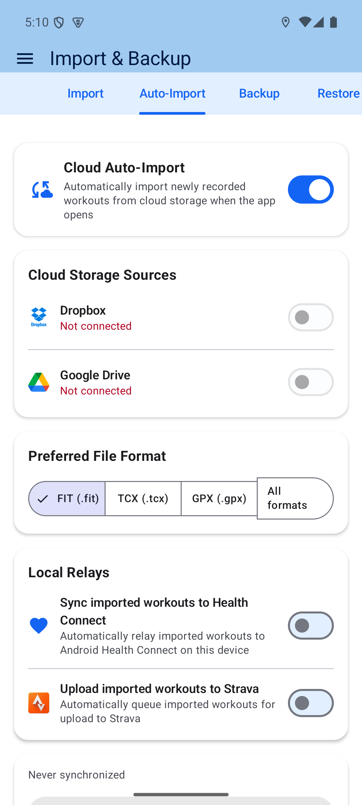
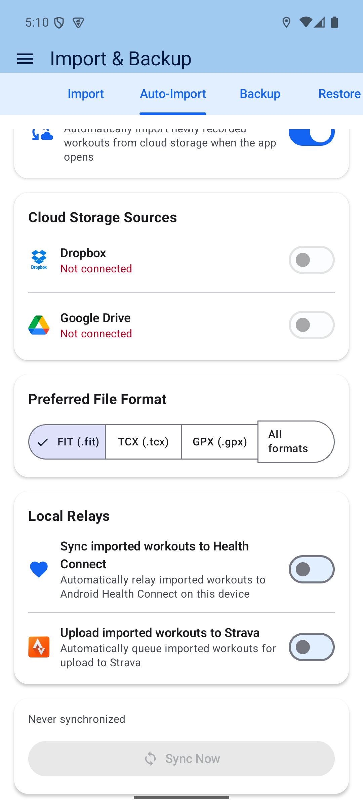

# Stage 5: Walkthrough & Verification - ATT-7748: Auto-Import & Cloud Sync

**Ticket**: [ATT-7748](https://rainerblind.atlassian.net/browse/ATT-7748)  
**Parent Epic**: [ATT-281](https://rainerblind.atlassian.net/browse/ATT-281) (*Import, Export & Backup*) | **Story Points**: 5 SP  
**Target Release**: `V5.1.0` | **Active Sprint**: `2026-46.6` | **Branch**: `feat/ATT-7748`  
**Requirement Mapping**: `REQ-MIG-052` (`REQ-MIG-052.1`–`REQ-MIG-052.5`) | **Test Mapping**: `TST-MIG-050` (`TST-MIG-050.1`–`TST-MIG-050.6`)  
**Author**: AI Agent 1 (`flash`) | **Date**: 2026-11-14  

---

## 1. Executive Summary & Verification Overview
Implemented multi-device incremental cloud auto-import and automated local relays to enable seamless workout synchronization between primary recording devices (e.g., bike computer / training watch) and secondary display devices (e.g., tablet / companion phone):
* **Auto-Import Tab & UI Interface (`REQ-MIG-052.1`)**: Expanded `ImportBackupTabsScreen.kt` pager to 4 tabs (`0: Import`, `1: Auto-Import`, `2: Backup`, `3: Restore`). Created `AutoImportTabContent.kt` featuring Material 3 card grouping, master auto-import toggle, Dropbox & Google Drive status indicators, M3 single-choice segmented button row for preferred file format selection (`FIT`, `TCX`, `GPX`, `All`), independent toggles for Health Connect and Strava relays, dynamic last-sync timestamp display, and manual "Sync Now" action.
* **Persistent Preference Subsystem (`REQ-MIG-052.2`)**: Added dedicated `SharedPreferences` keys (`SP_AUTO_IMPORT_ENABLED`, `SP_AUTO_IMPORT_SOURCE_DROPBOX`, `SP_AUTO_IMPORT_SOURCE_GDRIVE`, `SP_AUTO_IMPORT_PREF_FORMAT`, `SP_AUTO_IMPORT_RELAY_STRAVA`, `SP_AUTO_IMPORT_LAST_SYNC_TIMESTAMP`, `SP_SYNC_IMPORTED_WORKOUTS_TO_HEALTH_CONNECT`) with default values and strongly typed accessors in `TrainingApplication.java`, exposed via reactive `StateFlow` in `BackupRestoreViewModel.kt`.
* **Incremental Cloud Sync Engine (`REQ-MIG-052.3`)**: Implemented `AutoImportManager.kt` leveraging `ExistingWorkoutsSnapshot` for zero-download pre-filtering of already existing workout filenames. Built non-interactive bulk recovery routing through `LegacyImportEngine` with automated cluster reconciliation (`refreshClusters()`) and background `WorkoutRepository.loadAllWorkouts()` reloading.
* **Health Connect & Strava Relays (`REQ-MIG-052.4`)**: Implemented `HealthConnectWorkoutSyncWorker.kt` (`CoroutineWorker`) and `WorkoutRepository.getWorkoutDataDirect(workoutId)` to cleanly deliver newly imported workouts into Android Health Connect without requiring UI thread initialization. Integrated optional Strava queue relay upon successful file import.
* **Launch Trigger Hook (`REQ-MIG-052.5`)**: Connected `AutoImportManager.triggerSyncIfNeeded(context.applicationContext)` in `WorkoutSummariesTabbedScreen.kt` via `LaunchedEffect(Unit)` for passive synchronization on app start.
* **Localization Parity (`REQ-MIG-052.5`)**: Provided full 9-language translation parity in `strings_auto_import.xml` across English, German, Spanish, French, Italian, Japanese, Dutch, Polish, and Portuguese.

---

## 2. Requirement & Test Verification Matrix

| Requirement | Test Spec | Verification Method | Result | Status in Living Docs |
| :--- | :--- | :--- | :--- | :--- |
| `REQ-MIG-052.1` | `TST-MIG-050.1` | `AutoImportContractTest.kt` & on-device UI inspection | **PASSED** | `[Verified]` |
| `REQ-MIG-052.2` | `TST-MIG-050.2` | `AutoImportContractTest.kt` & `AutoImportManagerTest.kt` | **PASSED** | `[Verified]` |
| `REQ-MIG-052.3` | `TST-MIG-050.3` | `AutoImportManagerTest.kt` (duplicate pre-filtering, silent import) | **PASSED** | `[Verified]` |
| `REQ-MIG-052.4` | `TST-MIG-050.4` | `HealthConnectWorkoutSyncWorkerTest.kt` & `AutoImportManagerTest.kt` | **PASSED** | `[Verified]` |
| `REQ-MIG-052.5` | `TST-MIG-050.5` | `AutoImportLocalizationTest.kt` & `TranslationParityTest.kt` | **PASSED** | `[Verified]` |
| `REQ-MIG-052` | `TST-MIG-050.6` | Full `com.atrainingtracker.trainingtracker.migration.*` suite | **PASSED** | `[Verified]` |

---

## 3. Automated Test Evidence

### Tier 1 & Tier 2 Test Suites
* **Targeted Verification Scope**:
  * `com.atrainingtracker.trainingtracker.migration.AutoImportLocalizationTest`
  * `com.atrainingtracker.trainingtracker.migration.AutoImportContractTest`
  * `com.atrainingtracker.trainingtracker.migration.AutoImportManagerTest`
  * `com.atrainingtracker.trainingtracker.cloud.healthconnect.HealthConnectWorkoutSyncWorkerTest`
  * `com.atrainingtracker.trainingtracker.localization.TranslationParityTest`
  * **Result**: `BUILD SUCCESSFUL in 28s` (100% test pass rate).
* **Package Regression Scope**:
  * `com.atrainingtracker.trainingtracker.migration.*`
  * **Result**: `BUILD SUCCESSFUL in 2m 11s` (Zero regressions across all migration, parser, backup, and restore suites).
* **Resource Validation**:
  * `./gradlew processDebugResources` -> `BUILD SUCCESSFUL in 14s` (All XML namespaces, strings, and AAPT2 assets validated).

---

## 4. Visual Inspection Evidence (Rule 71)

The feature was deployed and visually inspected on Android emulator `emulator-5554` (`com.atrainingtracker.debug`):

| View State | Description | Screenshot Reference |
| :--- | :--- | :--- |
| **Auto-Import Main View** | Displays 4 tabs (`Import`, `Auto-Import`, `Backup`, `Restore`), Master switch enabled, Cloud source statuses (Dropbox / Drive), M3 single-choice segmented buttons (`FIT`, `TCX`, `GPX`, `All`), and Local Relays switches. |  |
| **Auto-Import Actions & Relays** | Displays bottom section with sync status ("Never synchronized") and manual "Sync Now" button. |  |

---

## 5. Invariants & Preserved Behavior
1. **Zero Telemetry Loss & Non-Destructive Duplicate Handling**: Auto-import validates filenames against `ExistingWorkoutsSnapshot` before downloading from cloud sources, preventing redundant network transfers, duplicate SQLite entries, and unintended workout overwrites.
2. **Main Thread Non-Blocking**: All cloud file downloads, FIT/TCX/GPX decoding, and Health Connect background transfers execute asynchronously on `Dispatchers.IO` and via `WorkManager`.
3. **Graceful Fallback on Disconnected Storage**: If cloud providers are unlinked or network is offline, `syncIncremental` fails safely without crashing the UI, alerting the user with clear status messages.
4. **Living Documentation Synchronized**: `REQ-MIG-052` and `TST-MIG-050` marked `[Verified]` with 100% parity verified via `verify_requirement_governance.py`.
