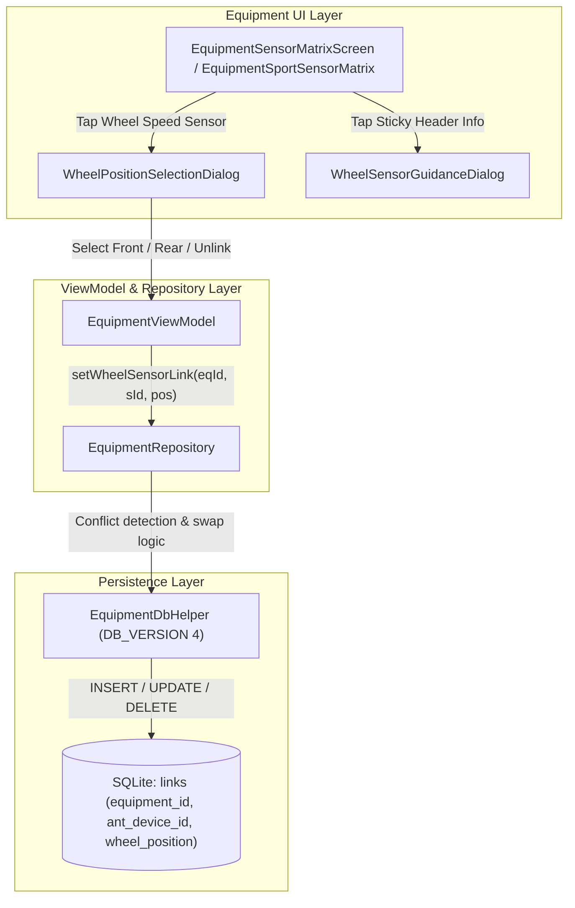

# Walkthrough - ATT-7752: Equipment-Sensor Matrix & DB Wheel Position Tracking

## 1. Executive Summary
- **Ticket**: ATT-7752
- **Epic**: ATT-166 (*Filtering to improve sensor values (especially locations)*)
- **Target Release**: `V5.0.0`
- **Requirement**: `REQ-SEN-029` (Wheel Sensor Mounting Position & In-App Matrix Guidance)
- **Test Specification**: `TST-SEN-029` (Test Cases 1–5)
- **Scope**:
  - Extended SQLite database schema (`EquipmentDbHelper.java`, `DB_VERSION = 4`) adding `wheel_position` column to `LINKS` table.
  - Implemented typed domain enum `WheelPosition.kt` (`FRONT`, `REAR`, `UNSPECIFIED`).
  - Added repository guardrails in `EquipmentRepository.kt` and `EquipmentViewModel.kt` to prevent duplicate `FRONT` or `REAR` assignments on a single bicycle, with automatic swap conflict resolution.
  - Built interactive `WheelPositionSelectionDialog.kt` and in-app educational sheet `WheelSensorGuidanceDialog.kt`.
  - Integrated zero-clipping badges (`V`/`H` in DE, `F`/`R` in EN) inside the 88 dp `SENSOR_COLUMN_WIDTH` matrix cells (Rule 84) and sticky header info icon in `EquipmentSensorMatrixScreen.kt` and `EquipmentSportSensorMatrix`.
  - Added Section 3.3 ("Why 1 or 2 Wheel Sensors Alongside GPS?") to user documentation (`docs/guide/{en,de}/03-equipment-sensor-matrix.md`).
  - Delivered 100% 9-language translation parity for all 17 guidance and position strings across `values*/strings_equipment.xml`.

---

## 2. Architecture & Data Flow

### 2.1 Database Schema (`EquipmentDbHelper.java`)
- **Version Bump**: Bumped `DB_VERSION` from `3` to `4`.
- **DDL Migration**: `ALTER TABLE links ADD COLUMN wheel_position TEXT;` in `onUpgrade(oldVersion < 4)`.
- **Query Overloads**:
  - `addDeviceLink(equipmentId, antDeviceId, wheelPosition)`
  - `setDeviceLink(equipmentId, antDeviceId, isLinked, wheelPosition)`
  - `updateDeviceLinkWheelPosition(equipmentId, antDeviceId, wheelPosition)`
  - `getWheelPosition(equipmentId, antDeviceId): WheelPosition?`
  - `getDeviceWheelPositionsForEquipment(equipmentId): Map<Long, WheelPosition>`

### 2.2 Repository Duplicate Guardrails (`EquipmentRepository.kt`)
- When assigning `WheelPosition.FRONT` to a bike:
  - If another sensor on that bike already has `FRONT`, the existing sensor is swapped to `REAR` (if `REAR` is unoccupied) or `UNSPECIFIED`.
- When assigning `WheelPosition.REAR` to a bike:
  - If another sensor on that bike already has `REAR`, the existing sensor is swapped to `FRONT` (if `FRONT` is unoccupied) or `UNSPECIFIED`.
- Single-responsibility persistence guarantees invariants cannot be violated from UI or background sync.

### 2.3 UI & Zero-Clipping Badges (`EquipmentSensorMatrixScreen.kt`)
- Fits strictly within `SENSOR_COLUMN_WIDTH = 88.dp` (Rule 84):
  - Checkbox centered in cell.
  - Compact badge (`labelSmall`, bold) aligned to `TopEnd` with `padding(top = 4.dp, end = 6.dp)`.
  - Non-wheel sensors or shoes show standard checkbox without badges.
  - Tapping wheel speed sensor cell opens `WheelPositionSelectionDialog`.
  - Sticky table header provides info button launching `WheelSensorGuidanceDialog`.

---

## 3. Educational Guidance: 1 vs. 2 Wheel Sensors Alongside GPS
Integrated in-app via `WheelSensorGuidanceDialog.kt` and living user guide Section 3.3:
1. **1 Wheel Sensor + GPS**:
   - Zero-lag speed responsiveness during abrupt sprints and accelerations.
   - Exact distance and speed continuity under dense forest canopy, in tunnels, and in alpine switchbacks where satellite tracking drops.
   - Responsive and accurate real-time gradient display (Slope %) fusing instantaneous wheel speed with barometric vertical delta.
2. **2 Wheel Sensors (Front + Rear) + GPS**:
   - GPS-free indirect tire pressure monitoring (iTPMS) detecting slow punctures within 150–250 m by measuring relative wheel circumference changes (identifying front vs. rear pressure loss).
   - Independent tire circumference calibration under rider weight.
   - Multi-sensor odometry fusion maintaining distance accuracy during intermittent drops.

---

## 4. Verification & Test Evidence
| Test ID | Test Suite | Description | Status |
| :--- | :--- | :--- | :--- |
| **TST-SEN-029.1** | `EquipmentDbHelperMigrationTest` | Real SQLite v3->v4 schema migration, column addition, data preservation & CRUD | Passing |
| **TST-SEN-029.2** | `EquipmentRepositoryWheelPositionTest` | Repository wheel position CRUD, duplicate prevention, and conflict swap | Passing |
| **TST-SEN-029.3** | `EquipmentSensorMatrixWheelPositionTest` | Matrix cell badging, layout dimensions & Rule 84 (88 dp) zero clipping | Passing |
| **TST-SEN-029.4** | `WheelPositionDialogsTest` | WheelPositionSelectionDialog & WheelSensorGuidanceDialog contract & tags | Passing |
| **TST-SEN-029.5** | `TranslationParityTest` | 100% 9-language translation parity across all 17 keys in `strings_equipment.xml` | Passing |
