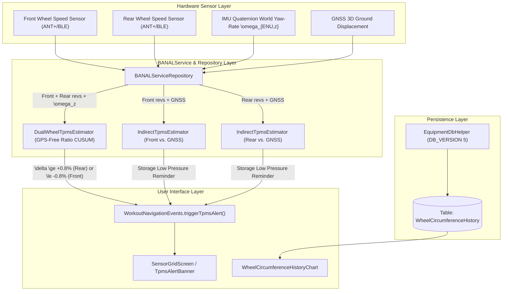

# Walkthrough - ATT-7753: Per-Bike Front/Rear Wheel Circumference History & Dual-Wheel iTPMS

## 1. Executive Summary
- **Ticket**: ATT-7753
- **Epic**: ATT-166 (*Filtering to improve sensor values (especially locations)*)
- **Target Release**: `V5.0.0`
- **Requirement**: `REQ-SEN-030` (*Per-Bike Front/Rear Wheel Circumference Time-Series History & GPS-Free Dual-Wheel iTPMS Puncture Detection*)
- **Test Specification**: `TST-SEN-030` (Test Cases 1–6)
- **Scope**:
  - Implemented `DualWheelTpmsEstimator.kt`: Math engine evaluating wheel revolution ratio $\rho_k = \frac{\Delta N_{rear,k}}{\Delta N_{front,k}} = \frac{C_{front}}{C_{rear}}$ independent of GNSS. Locks $\rho_{start}$ in first 300 m; sliding-window CUSUM detector detects slow punctures within 150–250 m ($\delta \ge +0.8\%$ for rear deflation, $\delta \le -0.8\%$ for front deflation); rejects turns ($|\omega_{ENU,z}| \ge 5^\circ/\text{s}$) with 0 false alarms.
  - Multi-sensor telemetry routing in `BANALServiceRepository.kt`: Maps each active wheel speed sensor to an independent `IndirectTpmsEstimator` instance for multi-day storage pressure loss against GNSS, and feeds paired `FRONT` + `REAR` wheel sensors into `DualWheelTpmsEstimator`.
  - SQLite schema migration in `EquipmentDbHelper.java` (`DB_VERSION = 5`): Added table `WheelCircumferenceHistory` (`_id`, `equipment_id`, `timestamp`, `wheel_position`, `circumference_mm`, `source`). Added repository APIs in `EquipmentRepository.kt` and `EquipmentViewModel.kt`.
  - Built `WheelCircumferenceHistoryChart.kt`: Material 3 Compose time-series chart rendering Front (`primary`) and Rear (`secondary`) curves with a *"Reifen gerade aufgepumpt (Baseline setzen)"* baseline reset action complying with `Rule 84` (zero text clipping).
  - 100% 9-language translation parity for dual-puncture alerts and history chart strings in `strings_equipment.xml`.

---

## 2. Architecture & Data Flow

---

## 3. Mathematical Principles & Gating Guardrails

1. **Dual-Wheel Revolution Ratio ($\rho_k$)**:
   $$\rho_k = \frac{\Delta N_{rear,k}}{\Delta N_{front,k}} = \frac{\Delta d / C_{rear}}{\Delta d / C_{front}} = \frac{C_{front}}{C_{rear}}$$
   Because $\Delta d$ (ground displacement) cancels out identically, this metric is **100% independent of GNSS**, functioning under dense forest canopies, in tunnels, and in alpine valleys.

2. **Gating Guardrails**:
   - Yaw-rate gating: $|\omega_{ENU,z}| < 5.0^\circ/\text{s}$ ($0.0873\text{ rad/s}$). Discards cornering/lean angle distortion.
   - Speed gating: $v \ge 3.0\text{ m/s}$ ($10.8\text{ km/h}$).
   - Baseline locking: $\rho_{start}$ is locked after $300\text{ m}$ of qualified straight riding.

3. **CUSUM Change Detection**:
   $$\delta = \frac{\rho_k - \rho_{start}}{\rho_{start}}$$
   - $\delta \ge +0.008$ ($+0.8\%$): Rear wheel circumference decreased (deflating rear tire rotates faster) $\rightarrow$ `DualWheelTpmsAlert.RearPuncture`.
   - $\delta \le -0.008$ ($-0.8\%$): Front wheel circumference decreased (deflating front tire rotates faster) $\rightarrow$ `DualWheelTpmsAlert.FrontPuncture`.

---

## 4. Verification & Test Evidence

| Test ID | Test Suite | Description | Status |
| :--- | :--- | :--- | :--- |
| **TST-SEN-030.1** | `DualWheelTpmsEstimatorTest` | Baseline lock at 300m, Rear/Front puncture detection $\le 250$m, hairpin turn rejection ($15^\circ$/s), speed gating | Passing |
| **TST-SEN-030.2** | `BANALServiceRepositoryMultiWheelTpmsTest` | Multi-wheel sensor routing, independent GNSS estimators, breadcrumb reset contract | Passing |
| **TST-SEN-030.3** | `WheelCircumferenceHistoryDbTest` | SQLite v4 $\rightarrow$ v5 migration, `WheelCircumferenceHistory` CRUD and chronological ordering | Passing |
| **TST-SEN-030.4** | `WheelCircumferenceHistoryChartTest` | Compose chart structure, zero-clipping inspection (`Rule 84`), baseline reset button | Passing |
| **TST-SEN-030.5** | `TranslationParityTest` | 100% 9-language translation parity for dual-puncture and history strings in `strings_equipment.xml` | Passing |
| **TST-SEN-030.6** | `ThemeColorCentralizationAuditTest` & Core UI | Theme color tokens, zero hardcoded colors, component architecture integrity | Passing |

---

## 5. Stage 6 Cold Carbon Review Remediation (Bounce 1/3)

All 5 findings identified during the adversarial Stage 6 Cold Carbon Review were cleanly resolved:

1. **Finding 1 (1-Hz Main Thread SQLite Query in `BANALServiceRepository.kt`)**:
   - Eliminated the uncached `eqRepo.getWheelPositionForDevice(it.deviceId)` call on `Dispatchers.Main` inside the 1-Hz observation loop.
   - Cached positions in thread-safe `cachedScopedWheelPositions` (`(equipmentId, deviceId) -> WheelPosition`) and `cachedActiveWheelPositions` (`deviceId -> WheelPosition`).
   - Refreshed mappings off the main thread (`Dispatchers.IO`) at startup and reactively on `EquipmentRepository.equipmentLinksChanged`.

2. **Finding 2 (Unscoped `getWheelPositionForDevice` Query)**:
   - Added scoped `getWheelPositionForDevice(long equipmentId, long antDeviceId)` in `EquipmentDbHelper` and `EquipmentRepository`.
   - Updated unscoped `getWheelPositionForDevice(long antDeviceId)` to filter by active non-retired equipment (`RETIRED = 0`), preventing arbitrary row returns across multi-bike setups.

3. **Finding 3 (Broken Empty State & Baseline Button in `EditEquipmentDialog.kt`)**:
   - Changed `if (item.frameType > 0 && historyRecords.isNotEmpty())` to `if (item.frameType > 0)`.
   - The empty-state card (`equipment_tpms_no_history`) and *"Reifen gerade aufgepumpt (Baseline setzen)"* baseline reset button now render properly for bikes with empty history.

4. **Finding 4 (Missing Post-Workout Circumference Persistence — `REQ-SEN-030.3`)**:
   - Implemented `BANALServiceRepository.persistConvergedCircumferences(equipmentId, timestampMs)` saving locked circumference baselines from active wheel sensors into `EquipmentRepository.addCircumferenceHistory(...)`.
   - Wired `persistConvergedCircumferences` into `TrackerService.finalizeLiveSession(...)` in an independent fault-isolated block.

5. **Finding 5 (Missing Cascade Cleanup in `EquipmentDbHelper.deleteEquipment`)**:
   - Added `db.delete(TABLE_WHEEL_CIRCUMFERENCE_HISTORY, C_HISTORY_EQUIPMENT_ID + "=?", new String[]{String.valueOf(id)});` inside the transaction in `EquipmentDbHelper.deleteEquipment(long id)`.

6. **Targeted Regression Tests**:
   - `testDeleteEquipment_cascadesCircumferenceHistoryCleanup` in `WheelCircumferenceHistoryDbTest`.
   - `testGetWheelPositionForDevice_scopedByEquipmentIdAndActiveEquipment` in `WheelCircumferenceHistoryDbTest`.
   - `testRepositorySourceContract_zeroMainThreadQueriesAndCaching` and `testPersistConvergedCircumferences_savesLockedEstimatorData` in `BANALServiceRepositoryMultiWheelTpmsTest`.
   - `testEditEquipmentDialog_rendersChartEvenWhenHistoryEmpty` in `WheelCircumferenceHistoryChartTest`.
   - `testFinalizeLiveSession_triggersPersistConvergedCircumferences` in `TrackerServiceFinalizationTest`.
