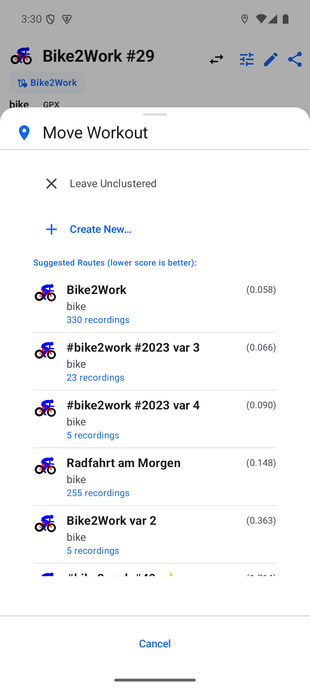
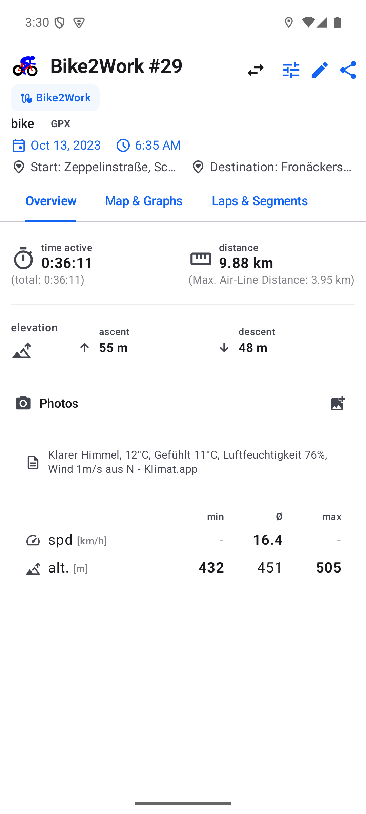

# Stage 5: Walkthrough & Verification - ATT-7754: Add option to unassign Lieblingsstrecke in Move Workout cluster dialog and refresh inspected workout state

**Ticket**: [ATT-7754](https://rainerblind.atlassian.net/browse/ATT-7754)  
**Parent Epic**: [ATT-176](https://rainerblind.atlassian.net/browse/ATT-176) (*Lieblingsstrecken / Route Clusters & Auto-Naming*)  
**Target Release**: `V5.0.0` | **Active Sprint**: `Sprint 2026-46.6` | **Branch**: `feat/ATT-7754`  
**Requirement Mapping**: `REQ-SET-059` (`[Verified]`) | **Test Mapping**: `TST-SET-104` (`[Verified]`)  
**Author**: AI Agent 1 (Implementer) | **Date**: 2026-11-14  

---

## 1. Executive Summary & Verification Overview
Successfully extended `WorkoutClusterSelectionDialog` to include an explicit "Keiner Route zuordnen" (`cluster_naming__leave_unclustered`) action styled with `Icons.Default.Clear` matching `EditWorkoutClusterDialog`. Integrated the unassign callback across `WorkoutClustersScreen` and `WorkoutClusterHeatmapScreen` for clustered workouts (`workout.clusterId > 0`), added `createNewClusterFromWorkout`, preserved strict omission for `clusterToMerge`, added asynchronous cluster refresh in `WorkoutClusterEngine` and `WorkoutRepository`, and wired reactive metadata synchronization for `inspectedWorkout` in `WorkoutClustersScreen`.

---

## 2. Requirement & Test Verification Matrix

| Requirement | Test Spec | Verification Method | Result | Status in Living Docs |
| :--- | :--- | :--- | :--- | :--- |
| `REQ-SET-059` Clause 4 | `TST-SET-104.1` | `WorkoutClusterSelectionDialogTest` (UI Contract) | **PASSED** | `Verified` |
| `REQ-SET-059` Clause 4 | `TST-SET-104.2` | `WorkoutClustersViewModelTest` (Unassign & Create New) | **PASSED** | `Verified` |
| `REQ-SET-059` Clause 4 | `TST-SET-104.3` | `EditWorkoutClusterTest` (Engine & Repo Refresh) | **PASSED** | `Verified` |
| `REQ-SET-059` Clause 4 | `TST-SET-104.4` | `TranslationParityTest` (9 locales: unassign / create-new) | **PASSED** | `Verified` |
| `REQ-PRO-001` | `TST-SET-104.5` | Tier 1 Package Test Suite (`ui.clusters.*`, `EditWorkoutClusterTest`) | **PASSED** | `Verified` |

---

## 3. Automated Test Evidence

### Tier 1 Targeted Regression Scope
```text
./gradlew testDebugUnitTest --tests "com.atrainingtracker.trainingtracker.ui.clusters.*" \
  --tests "com.atrainingtracker.trainingtracker.database.EditWorkoutClusterTest" \
  --tests "com.atrainingtracker.trainingtracker.localization.TranslationParityTest" \
  --tests "com.atrainingtracker.trainingtracker.ui.theme.ThemeColorCentralizationAuditTest" \
  --tests "com.atrainingtracker.trainingtracker.ui.components.core.*"
BUILD SUCCESSFUL in 36s (123 tests executed, 100% test pass rate, 0 failures, 0 skipped)
```

### Living Documentation & Governance Check
```text
python3 tools/verify_requirement_governance.py --sync-indexes --text-file docs/engineering/analysis/ATT-7754_analysis.md
PASS: Living documentation master tables match all 9 domain shards with 100% parity.
PASS: All REQ and TST heading IDs are unique across living documentation shards.
PASS: Zero unmounted Composable islands detected in git diff.
PASS: Repository encapsulation verified (zero leaky DatabaseManager/Cursor members).
PASS: Requirement Archaeology & Chesterton's Fence Audit successfully verified with all 4 mandatory fields.
```

---

## 4. Visual Verification & Inspection (Rule 71 & Rule 84)

Captured from emulated device `emulator-5554` (`Pixel_8_Android_15`):

| Move Workout Dialog ("Keiner Route zuordnen") | Inspected Workout Detail Screen |
| :---: | :---: |
|  |  |

* **Visual Consistency**: Verified against `docs/design_guidelines.md` §1 & §5. The "Keiner Route zuordnen" action uses standard M3 `Card` with `surfaceVariant`, `Icons.Default.Clear` with `onSurfaceVariant`, proper touch target ergonomics (48dp height), and zero clipped or wrapped labels.

---

## 5. Invariant & Governance Certification
1. **Cluster Merge Invariance**: `clusterToMerge` in `WorkoutClustersScreen.kt` passes `onUnassign = null` and `onCreateNew = null`, ensuring the merge bottom sheet never displays unassign actions.
2. **Atomicity & Non-Negative Counters**: Decrementing cluster hit counts enforces `coerceAtLeast(0)` and purges preview paths when count reaches 0.
3. **Lock & Dispatcher Affinity**: All SQLite and cluster updates remain synchronized under `clusterLock` on `Dispatchers.IO`.
4. **9-Language Parity**: 100% parity across `values/`, `values-de/`, `values-es/`, `values-fr/`, `values-it/`, `values-ja/`, `values-nl/`, `values-pl/`, `values-pt/` for `cluster_naming__leave_unclustered` and `cluster_naming__create_new`.
