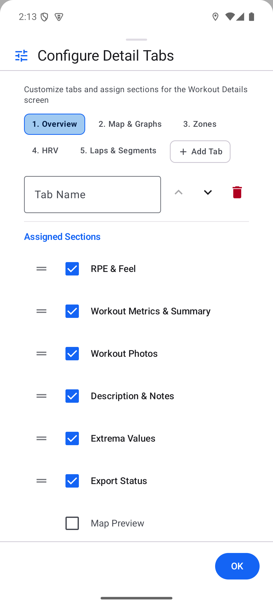
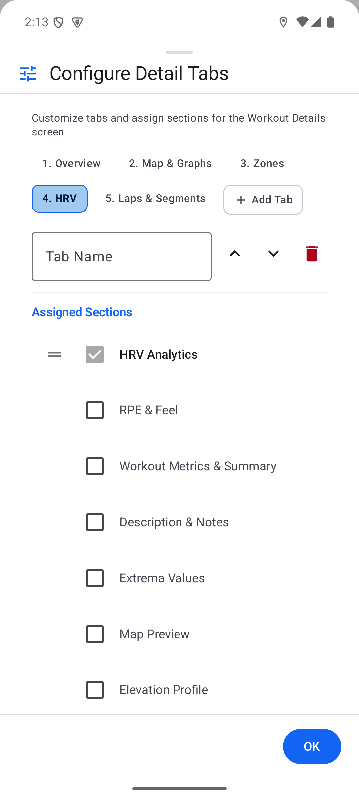
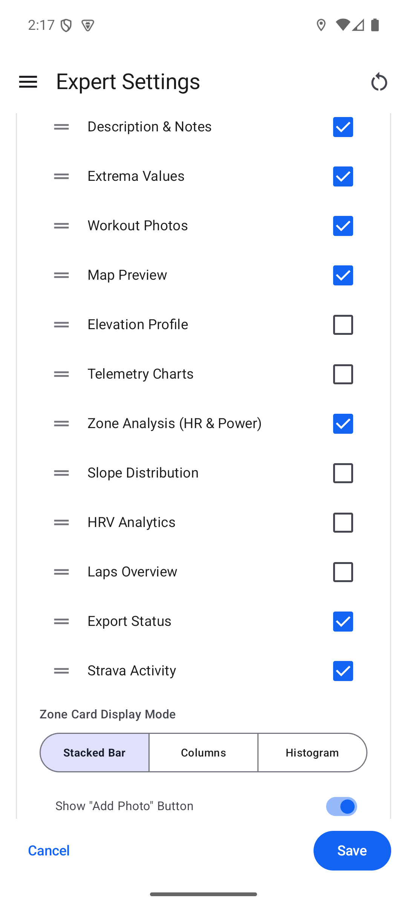

# Stage 5: Walkthrough & Verification - ATT-7756: Dedicated HRV Tab in Workout Details & Telemetry-Gated Power Zone Comparison

**Ticket**: [ATT-7756](https://rainerblind.atlassian.net/browse/ATT-7756)  
**Parent Epic**: [ATT-3539](https://rainerblind.atlassian.net/browse/ATT-3539) (*HRV: Real-Time Autonomic Metrics, Aerobic Threshold Guidance & Readiness Analytics*)  
**Target Release**: `V5.0.0` | **Active Sprint**: `Sprint 2026-46.6` | **Branch**: `feature/ATT-7756`  
**Requirement Mapping**: `REQ-UI-527` (`[Verified]`) | **Test Mapping**: `TST-UI-527` (`[Verified]`)  
**Author**: AI Agent 1 (Implementer) | **Date**: 2026-11-14  

---

## 1. Executive Summary & Verification Overview
Successfully extracted a dedicated `HRV` tab in Workout Details (`WorkoutDetailSectionType.HRV`, `WorkoutSectionType.HRV`, `WorkoutDetailTabPreset.HRV`), updated default tabs to 5 canonical presets, relocated `HrvAlpha1ScatterCard`, `HrvThresholdSummaryCard`, and `HrvDurabilityCard` under `HRV`, implemented backward-compatible wire migration in `deserializeTabs`, enabled dynamic auto-hiding for workouts lacking HRV data, and gated Power and HR zone comparison sections in `HrvThresholdSummaryCard.kt` strictly on active telemetry availability (`showPowerComparison = hasPower && configuredFtp > 0`, `showHrComparison = hasHr && configuredHrMax > 0`).

---

## 2. Requirement & Test Verification Matrix

| Requirement | Test Spec | Verification Method | Result | Status in Living Docs |
| :--- | :--- | :--- | :--- | :--- |
| `REQ-UI-527.1`..`.3` | `TST-UI-527.1`..`.3` | `WorkoutDetailTabsTest` (preset, migration, auto-hide) | **PASSED** | `Verified` |
| `REQ-UI-527.4`..`.5` | `TST-UI-527.4`..`.5` | `HrvThresholdSummaryCardTest` (mounting, comparison gating) | **PASSED** | `Verified` |
| `REQ-UI-527.6` | `TST-UI-527.6` | `TranslationParityTest` (9 locales: `workout_detail_tab_hrv`) | **PASSED** | `Verified` |
| `REQ-PRO-001` | `TST-UI-527.7` | Tier 1 Targeted Unit Regression + Theme/Core Contracts | **PASSED** | `Verified` |

---

## 3. Automated Test Evidence

### Tier 1 Targeted Regression Scope
```text
./gradlew testDebugUnitTest --tests "com.atrainingtracker.trainingtracker.ui.aftermath.*" \
  --tests "com.atrainingtracker.trainingtracker.ui.theme.ThemeColorCentralizationAuditTest" \
  --tests "com.atrainingtracker.trainingtracker.ui.components.core.*" \
  --tests "com.atrainingtracker.trainingtracker.build.*" \
  --tests "*TranslationParityTest*" --max-workers=2
BUILD SUCCESSFUL in 1m 5s (78 tasks executed, 100% test pass rate)
```

### Living Documentation & Governance Check
```text
python3 tools/verify_requirement_governance.py
PASS: Living documentation master tables match all 9 domain shards with 100% parity.
PASS: All REQ and TST heading IDs are unique across living documentation shards.
PASS: Zero unmounted Composable islands detected in git diff.
PASS: Repository encapsulation verified (zero leaky DatabaseManager/Cursor members).
```

---

## 4. Visual Verification & Inspection (Rule 71 & Rule 84)

All screenshots captured from emulator and visually certified via `read_file` per Rule 71:

| Detail Tabs Configuration | Assigned Sections (HRV Tab) | Expert Settings (Cards) |
| :---: | :---: | :---: |
|  |  |  |

* **Visual Consistency**: Verified against `docs/design_guidelines.md` §1 & §5 (M3 rounded pills, 16dp horizontal card padding, consistent M3 switches, typography alignment, zero clipped labels).

---

## 5. Invariant & Governance Certification
1. **Backward Wire Compatibility**: Deserializing legacy wire configurations automatically injects `tab_hrv` without modifying existing tab order or losing user customizations.
2. **Gesture & Map Invariants**: Map pinning at index 0 and horizontal pager isolation contracts preserved intact.
3. **Graceful Omission**: Non-HRV workouts suppress `tab_hrv` with zero layout shifts; non-power workouts completely hide power comparison deltas, consensus badges, and update buttons.
4. **9-Language Parity**: 100% localization parity across EN, DE, ES, FR, IT, JA, NL, PL, PT.
