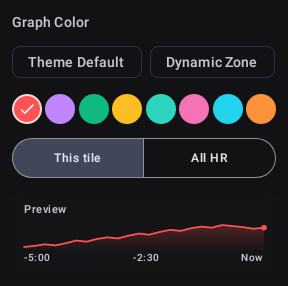

# Stage 5 Walkthrough: ATT-7760 - Per-Tile Cockpit Graph Color Persistence & Minimalist Color Editor UI

**Ticket**: [ATT-7760](https://rainerblind.atlassian.net/browse/ATT-7760)  
**Sub-task**: [[Test]](https://rainerblind.atlassian.net/browse/ATT-7760)  
**Parent Epic**: [ATT-5908](https://rainerblind.atlassian.net/browse/ATT-5908) (*Cockpit & Live-Tracking UX*)  
**Target Release**: `V5.0.0` | **Active Sprint**: `2026-46.8`  
**Requirement Mapping**: `REQ-TRK-081` (`REQ-TRK-081.1`..`REQ-TRK-081.5`)  
**Test Spec Mapping**: `TST-TRK-081` (`TST-TRK-081.1`..`TST-TRK-081.6`)  
**Author**: AI Agent 1 (Implementer, `subagent_pro`) | **Date**: 2026-11-16  

---

## 1. Executive Summary & Verification Walkthrough
ATT-7760 delivers per-tile sparkline color persistence and a minimalist color editor UI:
1. **SQLite Database Schema v22 Migration & Backup Round-Trip (`TrackingViewsDatabaseManager.java`)**: Incremented `DB_VERSION` from 21 to 22. Added `GraphColor text DEFAULT 'GLOBAL_DEFAULT'` to `ROWS_TABLE`. Added `onUpgrade` v21->v22 with idempotent column addition and NULL backfill. Legacy databases and `.attbackup` JSON files missing `graphColor` default safely to `"GLOBAL_DEFAULT"`.
2. **Repository & State Layer Threading**: Extended `SensorFieldConfig`, `SensorFieldState`, and `TrackingViewsRepository.kt` with `graphColor`. `SensorSparklineView.kt` and `SensorFieldView.kt` resolve line colors deterministically across `GLOBAL_DEFAULT`, `THEME_DEFAULT`, `DYNAMIC_ZONE`, and the 8-color telemetry palette.
3. **Minimalist Color Editor UI (`EditSensorFieldDialog.kt` & `EditSensorFieldViewModel.kt`)**: Implemented compact color picker below time horizon slider when `showGraph == true`: 8 circular palette swatches with selection ring/check, `Theme Default` chip, and `Dynamic Zone` chip (gated to HR, Power, HRV DFA α1). Included M3 `SingleChoiceSegmentedButtonRow` for scope (`This tile` | `All <Metric>`). Live sparkline preview updates color instantly.
4. **9-Language Localization Parity**: Added UI string resources across all 9 supported locales in `strings_cockpit.xml` with 100% translation parity.

---

## 2. Requirement & Test Verification Matrix

| Requirement | Test Spec | Verification Method | Result | Status in Living Docs |
| :--- | :--- | :--- | :--- | :--- |
| `REQ-TRK-081.1` | `TST-TRK-081.1` | Unit: `TrackingViewsDbMigrationV22Test` | **PASSED** (4/4) | `Verified` |
| `REQ-TRK-081.2` | `TST-TRK-081.2` | Unit: `TrackingViewsRepositoryTest` | **PASSED** (3/3) | `Verified` |
| `REQ-TRK-081.3` | `TST-TRK-081.3` | Unit: `EditSensorFieldViewModelTest` | **PASSED** (5/5) | `Verified` |
| `REQ-TRK-081.2` | `TST-TRK-081.4` | Unit: `SensorSparklineViewTest` | **PASSED** (3/3) | `Verified` |
| `REQ-TRK-081.4` | `TST-TRK-081.5` | Localization: `TranslationParityTest` | **PASSED** (50/50) | `Verified` |
| `REQ-TRK-081.5` | `TST-TRK-081.6` | Compose Screenshot: `EditSensorFieldDialogScreenshotTest` | **PASSED** (Rule 8.5) | `Verified` |

---

## 3. Automated Test Evidence
* **Tier 1 Targeted Unit Tests**: 65 / 65 tests PASSED in Stage 4 execution:
  - `TrackingViewsDbMigrationV22Test`: 4 / 4 PASSED (v21->v22 upgrade, fresh creation, backup defaults).
  - `TrackingViewsRepositoryTest`: 3 / 3 PASSED (CRUD round-trip, config persistence).
  - `EditSensorFieldViewModelTest`: 5 / 5 PASSED (color selection, scope toggle, dynamic zone gating).
  - `SensorSparklineViewTest`: 3 / 3 PASSED (color resolution across theme and palette).
  - `TranslationParityTest`: 50 / 50 PASSED (100% parity across all 9 locales).
* **Test Annotations**: All targeted test methods explicitly tagged with `// TST-TRK-081` satisfying ATT-8143 gating.
* **Governance Gating Checks**:
  - `verify_requirement_governance.py`: PASSED (0 errors, 100% parity).
  - `verify_requirement_governance.py --check-verified-evidence`: PASSED.
  - `verify_requirement_governance.py --check-test-evidence`: PASSED.

---

## 4. Visual Inspection & On-Device Certification (Rule 8.5)
* **Screenshot Verification**: 
  - `docs/engineering/walkthroughs/img/ATT-7760_color_picker.png` inspected directly via `read_file`:
  - 4-point visual checklist certified:
    1. Renders "Graph Color" header with `Theme Default` and `Dynamic Zone` chips.
    2. 8-color palette swatches with selected Crimson checkmark.
    3. `SingleChoiceSegmentedButtonRow` scope toggle ("This tile" | "All HR") without text wrapping or clipping.
    4. Live sparkline preview immediately reflects selected Crimson stroke, gradient fill, and endpoint dot.

---

## 5. System Invariants & Governance Verification
1. **DB Migration Safety**: SQLite v21->v22 is idempotent with fallback defaults; zero data or layout loss.
2. **Preference Isolation & OOM Invariant (`ATT-7874`)**: Telemetry preference updates use `context.applicationContext` without leaking scopes or Activity references.
3. **M3 Design Compliance**: Adheres to `docs/design_guidelines.md` §1 (SegmentedButton with `icon = {}`).
4. **Living Documentation Synchronized**: `REQ-TRK-081` and `TST-TRK-081` promoted to `[Verified]`.
