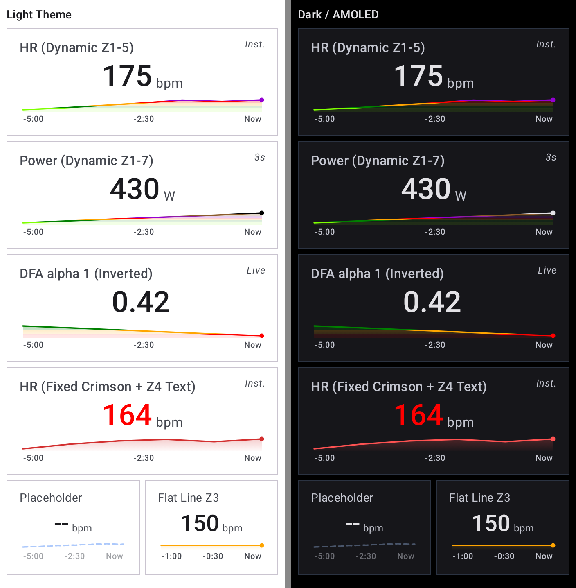

# Stage 5 Walkthrough: ATT-7761 - Decoupled Multi-Color Dynamic Zone Sparkline Rendering

**Ticket**: [ATT-7761](https://rainerblind.atlassian.net/browse/ATT-7761) | **Sub-task**: `[Test]` (Pending `submit-stage`)
**Parent Epic**: [ATT-5908](https://rainerblind.atlassian.net/browse/ATT-5908) (*Cockpit & Live-Tracking UX*)
**Target Release**: `V5.0.0` | **Active Sprint**: `2026-47.1` | **Branch**: `feature/ATT-7761`
**Requirement Mapping**: `REQ-TRK-082` (`REQ-TRK-082.1`..`REQ-TRK-082.4`)
**Test Spec Mapping**: `TST-TRK-082` (`TST-TRK-082.1`..`TST-TRK-082.4`)
**Author**: AI Agent 1 (Implementer, `subagent_pro`) | **Date**: 2026-11-16

---

## 1. Executive Summary & Verification Walkthrough
1. **Complete `showTextColor` Decoupling (`REQ-TRK-082.1`)**: Removed `showTextColor` from `resolveSparklineLineColor` (`SensorSparklineView.kt`) and all callers (`SensorFieldView.kt`, `EditSensorFieldDialog.kt`, tests). Numeric text zone coloring remains governed exclusively by `zoneDisplayOptions.showTextColor`.
2. **Multi-Color Historical `Brush.verticalGradient` & Terminal Dot (`REQ-TRK-082.2`)**: Added `SparklineZoneThresholds` (`SensorFieldState.kt`) and `TrackingViewModel.resolveSparklineZoneThresholds` projecting `HR_RUN`/`HR_BIKE` (4 cutoffs -> Z1..5), `PWR_BIKE` (6 cutoffs -> Z1..7, excluding `POWER_TO_WEIGHT`), and `HRV_DFA_A1` (inverted polarity `alpha1 > t1` green top .. `alpha1 < t2` red bottom, suppressed on `SMOOTHED_STREAM`/`QUANTIZED_SYNTHETIC`). `SensorSparklineView` caches `remember`-scoped gradient stops mapped onto `[verticalPaddingPx, height - verticalPaddingPx]` for stroke/fill and tints the terminal dot to `samples.last()`. `EditSensorFieldDialog.kt` supplies representative preview stops for `DYNAMIC_ZONE`.
3. **Dark/AMOLED `Zone7` Contrast & Edge Fallbacks (`REQ-TRK-082.3`)**: Substitutes `colorScheme.onSurface` for `TTColor.Zone7` (`#000000`) when `isDarkSurface(colorScheme)` is true, and falls back cleanly to solid/dashed rendering for `samples.size == 1`, `range == 0f`, `isPlaceholder == true`, or null thresholds.

## 2. Requirement & Test Verification Matrix
| Requirement | Test Spec | Verification Method | Result (Stage 4 Tier 1) | Status in Living Docs |
| :--- | :--- | :--- | :--- | :--- |
| `REQ-TRK-082.1` | `TST-TRK-082.1` | Unit: `SensorSparklineViewTest` | **PASSED** (13/13) | `Verified` |
| `REQ-TRK-082.2`, `REQ-TRK-082.3` | `TST-TRK-082.2` | Unit: `SensorSparklineViewTest` | **PASSED** (13/13) | `Verified` |
| `REQ-TRK-082.2` | `TST-TRK-082.3` | ViewModel: `TrackingViewModelDynamicZoneSparklineTest` | **PASSED** (5/5) | `Verified` |
| `REQ-TRK-082.4` | `TST-TRK-082.4` | Screenshot: `SensorFieldViewDynamicZoneScreenshotTest` | **PASSED** (1/1, Rule 8.5) | `Verified` |

## 3. Automated Test Evidence (Stage 4 Reused per Rule 7.5)
* **Tier 1 Targeted Suite** (31 / 31 tests PASSED on commit `95f2250fab08de00b521c8a2df794e70f4a02f2c`; zero production code edits in Stage 5 so Gradle not re-run per `Rule 7.5`):
  - `SensorSparklineViewTest`: 13/13 PASSED (`// TST-TRK-082`)
  - `TrackingViewModelDynamicZoneSparklineTest`: 5/5 PASSED (`// TST-TRK-082`)
  - `TrackingViewModelSparklineTest`: 4/4 PASSED
  - `SensorFieldZoneDisplayTest`: 7/7 PASSED
  - `EditSensorFieldDialogScreenshotTest`: 1/1 PASSED
  - `SensorFieldViewDynamicZoneScreenshotTest`: 1/1 PASSED (`// TST-TRK-082`)
* **Scope Note**: Targeted Tier 1 subset verified modified and adjacent cockpit sparkline classes; full-repo Tier 2 regression runs at sprint integration.
* **Governance Checks**: `verify_requirement_governance.py`, `--check-verified-evidence`, and `--check-test-evidence` PASSED.

## 4. Visual Inspection Evidence (`Rule 8.5` / `Rule 7.8`)
* **Screenshot**: 
* `docs/engineering/walkthroughs/img/ATT-7761_dynamic_zone_sparkline.png` inspected directly via `read_file` across Light & Dark/AMOLED themes:
  1. **Orientation & Geometry**: Crisp multi-zone vertical gradients aligned to curve amplitude (`HR Z1-5`, `Power Z1-7`, inverted `DFA alpha 1`).
  2. **Color Mapping & Contrast**: Dark/AMOLED Power Zone 7 substitutes high-contrast `onSurface` white while Light keeps `#000000`; fixed Crimson sparkline stays Crimson even with Z4 red `164 bpm` text.
  3. **Typography & Wrapping**: Zero clipped/ellipsized labels across tile headers, filter tags, values, and X-axis offsets (`-5:00`, `-2:30`, `Now`).
  4. **Edge Fallbacks**: Placeholder renders dimmed dashed line without dot; flat Z3 renders solid orange line + dot.

## 5. System Invariants & Governance Verification
* Zero `List<Float>` ring-buffer allocations added; SQLite v22 schema untouched; `REQ-TRK-082` & `TST-TRK-082` promoted to `[Verified]`.
