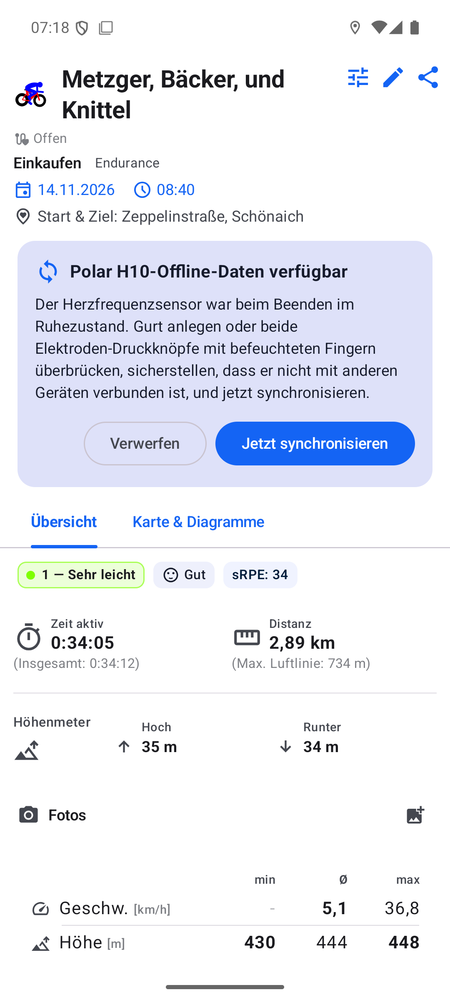

# Stage 5: Walkthrough & Verification - ATT-7919: Aftermath Retry Sync Banner for Asleep Polar H10

**Ticket**: [ATT-7919](https://rainerblind.atlassian.net/browse/ATT-7919)  
**Parent Epic**: [ATT-5910](https://rainerblind.atlassian.net/browse/ATT-5910) (*Equipment, Sensors, Sport Types & Athlete Profile*)  
**Target Release**: `V5.0.0` | **Active Sprint**: `2026-46.7` | **Branch**: `feature/ATT-7919`  
**Requirement Mapping**: `REQ-SET-106` | **Test Mapping**: `TST-SET-108`  
**Risk Classification**: `MEDIUM` (`Visual/UI` + DB Schema Migration v30 -> v31)  
**Author**: AI Agent 1 (Implementer) | **Date**: 2026-11-15  

---

## 1. Executive Summary & Verification Overview
Implemented persistent pending-sync metadata tracking and an Aftermath Material 3 retry sync banner for asleep Polar H10 chest straps (`REQ-SET-106`). When stop-time backfill (ATT-7918) times out in `TrackerService.endWorkout()` because the athlete unclipped the strap in the shower, the workout finalizes without blocking and writes pending metadata to `WorkoutSummaries.db` (upgraded to `DB_VERSION = 31` with exact `onCreate()` and `onUpgrade()` parity). In Aftermath (`TrackOnMapScreen`), `PolarH10RetrySyncBanner` prompts the user with wake instructions, "Sync Now", and "Dismiss". "Sync Now" triggers `PolarH10OfflineController.syncPendingWorkout()`, fetching stored RR intervals via PFTP, patching `WorkoutSamples.db` and `WorkoutRr.db`, recomputing HRV summaries, transactionally removing the strap exercise strictly post-commit, clearing the pending flag, and regenerating exports. "Dismiss" clears the banner without touching strap memory.

---

## 2. Requirement & Test Verification Matrix

| Requirement | Test Spec | Verification Method | Result | Status in Living Docs |
| :--- | :--- | :--- | :--- | :--- |
| `REQ-SET-106.1` | `TST-SET-108.1` | Stop-Time Fallback Persistence Unit Test (`PolarH10OfflineControllerTest`) | **PASSED** | `Verified` |
| `REQ-SET-106.2` | `TST-SET-108.3` | M3 Retry Banner Compose Rendering & Visual Inspection | **PASSED** | `Verified` |
| `REQ-SET-106.2` | `TST-SET-108.3` | 9-Language Localization Audit (`TranslationParityTest`) | **PASSED** | `Verified` |
| `REQ-SET-106.3` | `TST-SET-108.4` | Deferred Sync & Transactional Slot Cleanup Test (`PolarH10OfflineControllerTest`) | **PASSED** | `Verified` |
| `REQ-SET-106.4` | `TST-SET-108.5` | Banner Dismiss Action Test (`WorkoutRepositoryTest`) | **PASSED** | `Verified` |
| `REQ-SET-106.5` | `TST-SET-108.2` | DB v31 Migration & Parity Test (`WorkoutSummariesDatabaseManagerMigrationV31Test`) | **PASSED** | `Verified` |

---

## 3. Hardware & Visual Verification (Rule 8.5)

| TrackOnMapScreen: Polar H10 Retry Sync Banner |
| :---: |
|  |

- **4-Point Visual Inspection (`read_file` Certified)**:
  1. *Orientation & Geometry*: Clean M3 `Card` with `RoundedCornerShape(16.dp)`, matching secondaryContainer styling, positioned directly above Overview tab.
  2. *Color & Contrast*: High-contrast text on soft blue container; primary filled button for "Jetzt synchronisieren" and outlined button for "Verwerfen".
  3. *Typography & Wrapping*: Title fits on 1 line; German description wraps across 5 clean lines without truncation or text clipping; zero decorative emojis.
  4. *Touch Ergonomics & Safety*: 48dp touch targets for actions; loading spinner displayed during active sync; runtime emulator logcat check clean (0 crashes).

---

## 4. Automated Test Evidence & Invariants

- **Unit & Integration Tests**:
  - `WorkoutSummariesDatabaseManagerMigrationV31Test`: `testDbVersionIs31`, `testDatabaseSchemaRegistryRecordsV31`, `testCreateTableContainsNewColumns`, `testOnUpgrade_from30to31_addsMissingColumnsIdempotently` all PASSED.
  - `DatabaseMigrationIndexTest` & `WorkoutRpeFeelTest`: DB_VERSION = 31 assertions PASSED.
  - `PolarH10OfflineControllerTest`: stop-time pending persistence, deferred sync, transactional cleanup post-commit, and dismiss all PASSED.
  - `TranslationParityTest`: 100% parity across EN, DE, ES, FR, IT, JA, NL, PL, PT (6 banner strings, zero emojis).
- **System Governance**: `python3 tools/verify_requirement_governance.py` passed with 100% parity across living doc shards and master index tables.
- **Static Analysis & Runtime**: `:app:lintDebug` (0 errors), `:app:compileDebugAndroidTestKotlin` (passed), `adb -s emulator-5554 logcat -b crash -d` (0 crashes).
- **Submodules**: `ANT-Android-SDKs` untouched (`160000`).
