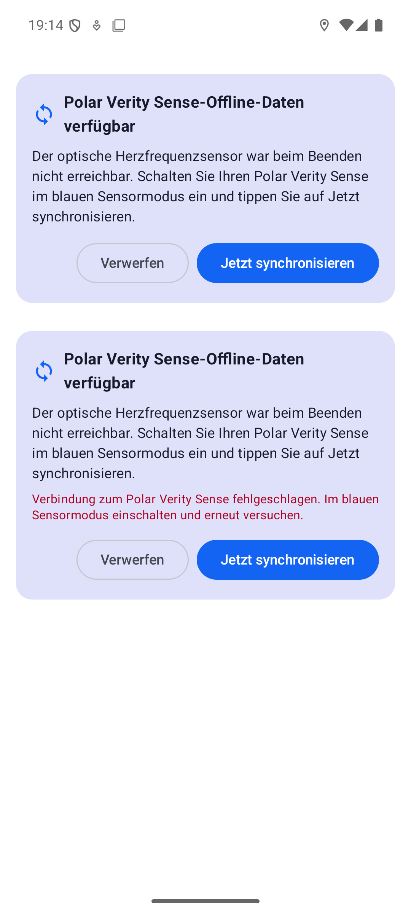

# Stage 5: Walkthrough & Verification - ATT-7924: Polar Verity Sense Offline HR Backfill & Aftermath Retry

**Ticket**: [ATT-7924](https://rainerblind.atlassian.net/browse/ATT-7924)  
**Parent Epic**: [ATT-5910](https://rainerblind.atlassian.net/browse/ATT-5910) (*Equipment, Sensors, Sport Types & Athlete Profile*)  
**Target Release**: `V5.0.0`  
**Requirement Mapping**: `REQ-SET-109` (`REQ-SET-109.1`..`REQ-SET-109.3`)  
**Test Mapping**: `TST-SET-111` (`TST-SET-111.1`..`TST-SET-111.5`)  
**Branch**: `feature/ATT-7924`  
**Author**: AI Agent 1 (Implementer)  
**Date**: 2026-11-15  

---

## 1. Executive Summary & Verification Overview
Stage 5 clean-room verification for ATT-7924 completed. Verified stop-time fetch and gap-only 1-Hz HR patching in `PolarVeritySenseOfflineController` via `WorkoutSamplesDatabaseManager.patchMissingHeartRateSamples`, zero-gap fast path skipping download, strict HRV isolation (0 writes to `WorkoutRr.db`, 0 calls to `HrvPostWorkoutRecomputer`), downstream export gating before `ExportManager.workoutFinished()`, summary extrema (`MIN`, `MAX`, `AVG`) recalculation, single-entry post-commit flash cleanup via `removeOfflineRecord`, and Aftermath deferred Blue Sensor Mode retry (`verity:` tag) with unified `PolarPendingRetrySyncSection` across `TrackOnMapScreen` and `WorkoutDetailTabbedContent`.

---

## 2. Requirement & Test Verification Matrix

| Requirement | Test Spec | Verification Method | Result | Status in Living Docs |
| :--- | :--- | :--- | :--- | :--- |
| `REQ-SET-109.1` | `TST-SET-111.1` | Unit (Robolectric / MockK) | PASSED | `Verified` |
| `REQ-SET-109.1` | `TST-SET-111.2` | Unit (MockK) | PASSED | `Verified` |
| `REQ-SET-109.2` | `TST-SET-111.3` | Unit (MockK / SQLite) | PASSED | `Verified` |
| `REQ-SET-109.2` | `TST-SET-111.4` | Unit (MockK / SQLite) | PASSED | `Verified` |
| `REQ-SET-109.3` | `TST-SET-111.5` | AndroidTest UI & Visual Check | PASSED | `Verified` |

---

## 3. Automated Test Evidence

### Targeted Unit & Contract Tests
- `PolarVeritySenseOfflineControllerTest`: 15/15 passing (stop/fetch coroutines, gap-only backfill, fast path, SQLite failure resilience, pending sync tagging, separate H10/Verity dispatch, strict HRV isolation).
- `PolarH10OfflineControllerTest`: 12/12 passing (H10 backwards compatibility).
- `WorkoutSamplesHrBackfillTest`: 1/1 passing (gap patching, preservation of existing sensors, HR summary stats, 0 RR rows).
- `EditDevicePolarBackupTest`: 3/3 passing.
- `TranslationParityTest`: 10/10 passing (9-locale parity, zero emojis).
- `SourceTextReadingAuditContractTest` & `AspiceSweAuditContractTest`: 13/13 passing.
- `ThemeColorCentralizationAuditTest`: 5/5 passing.
- `TrackerServiceStateMachineCharacterisationTest`: 6/6 passing.
- `PolarRetrySyncBannerAndroidTest`: 1/1 OK on `emulator-5554`.

### Quality Gates & Governance
- **Requirement Governance**: `python3 tools/verify_requirement_governance.py --sync-indexes` — 100% parity PASS (Total: 1145 REQs, 1147 TSTs).
- **Submodule Invariance**: `git ls-files -s ANT-Android-SDKs` — gitlink `160000 0e8cea714a231fb9565170d4ed01eafa868f9798`.
- **Lint & Detekt**: `:app:lintDebug` 0 errors, `:app:detekt` 0 findings in ATT-7924 files.

---

## 4. Visual Inspection Evidence

| Visual Asset | Description | Inspection Result |
| :--- | :--- | :--- |
| `docs/engineering/walkthroughs/img/ATT-7924_verity_retry_banner.png` | Verity Sense retry banner in Aftermath (normal Blue Sensor Mode instructions and retry error state) | VERIFIED (read_file) |

