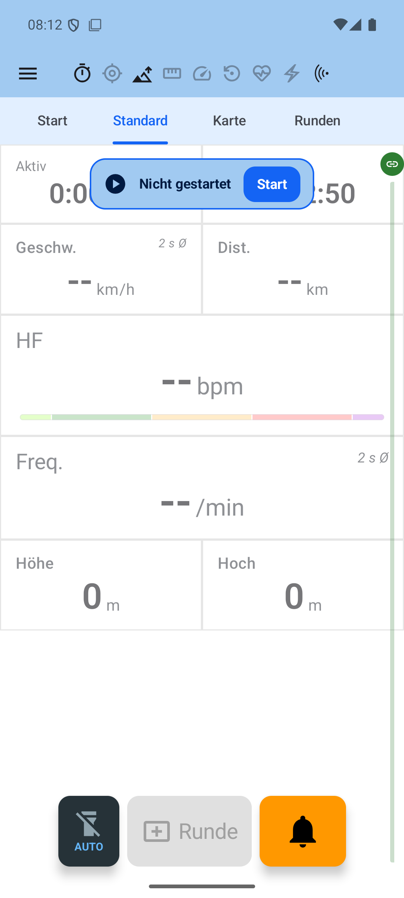
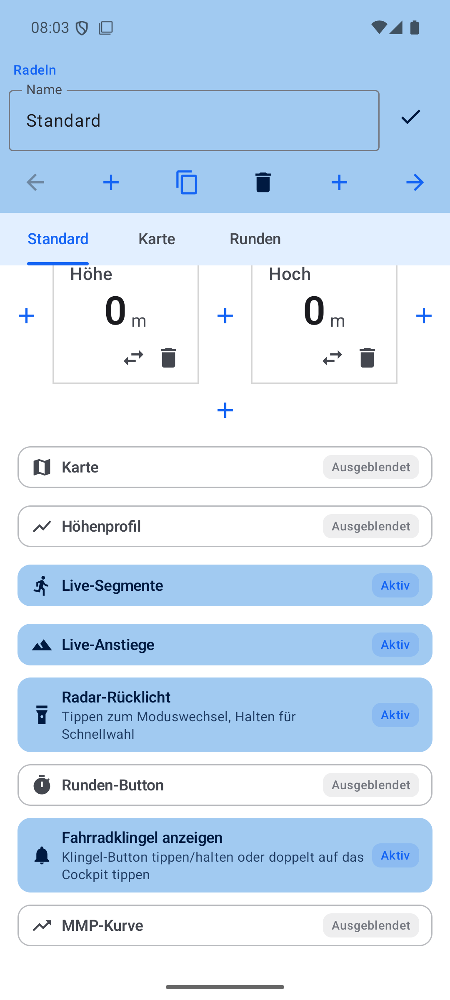

# Stage 5: Walkthrough & Verification - ATT-7972: Cockpit Radar Tail Light Button & Action Row

**Ticket**: [ATT-7972](https://rainerblind.atlassian.net/browse/ATT-7972) | **Epic**: [ATT-1286](https://rainerblind.atlassian.net/browse/ATT-1286) (*Cycling Radar*)  
**Target Release**: `V5.0.0` | **Sprint**: `2026-46.7` | **Branch**: `feature/ATT-7972`  
**Requirement Mapping**: `REQ-CON-043` (`REQ-CON-043.1`..`REQ-CON-043.5`)  
**Test Mapping**: `TST-CON-043` (`TST-CON-043.1`..`TST-CON-043.6`)  
**Author**: AI Agent 1 (Implementer, `subagent_flash`) | **Date**: 2026-11-15  

---

## 1. Executive Summary & Verification Overview

ATT-7972 delivers direct cockpit control for Garmin Varia radar tail lights:
1. **SQLite Database Schema v20->v21 Migration (`TrackingViewsDatabaseManager.java`)**: Added `ShowRadarLight` column (`int DEFAULT 0`) with idempotent `PRAGMA table_info` check in `onUpgrade`. Automatically activates radar light button (`1`) for cycling views (`BIKE_SPEED_AND_CADENCE`, `BIKE_POWER`). Updated `onCreate` (`CREATE_VIEWS_TABLE_V21`) and `DatabaseSchemaRegistry`.
2. **Repository & View Layer Binding**: Added `showRadarLight` to `TrackingViewInfo` and `TrackingViewsRepository.kt`, wired to `TrackingViewModel` and `TrackingTabGridContent`.
3. **Cockpit RadarLightButton Composable (`RadarLightButton.kt`)**: M3 `ElevatedButton` (`72.dp` height, `12.dp` corner radius, `6.dp` elevation) with semantic mode icons, live TTColor tokens, `AUTO` micro-badge, and isolated gesture handling: short-tap invokes `cycleNextMode()`, long-press opens `RadarLightQuickSwitchSheet`.
4. **Cockpit Action Row & Compact Fit (`TrackingTabsScreen.kt`, `LapButton.kt`)**: Arranged canonical `[RadarLightButton, LapButton, BikeBellButton]` row with 8dp spacing in 3-button mode; compact `LapButton` mode ensures single-row fit on 360dp viewports at 130% font scale.
5. **Configuration Toggle & Dynamic FAB Clearance (`SensorGridScreen.kt`)**: Added `SpatialCockpitToggleCard` for `ShowRadarLight` in cockpit settings. Expanded `fabBottomClearance` (68dp) whenever any bottom action button is visible.
6. **9-Language Localization Parity**: 4 new string resources added across all 9 supported locales in `strings.xml` without emojis.

---

## 2. Requirement & Test Verification Matrix

| Requirement | Test Spec | Verification Method | Result | Status in Living Docs |
| :--- | :--- | :--- | :--- | :--- |
| `REQ-CON-043.1` | `TST-CON-043.1` | SQLite Migration Test (`TrackingViewsDbMigrationV21Test`) | **PASSED** | `Verified` |
| `REQ-CON-043.2` | `TST-CON-043.2` | Compose Contract Test (`RadarLightButtonContractTest`) | **PASSED** | `Verified` |
| `REQ-CON-043.3` | `TST-CON-043.3` | Action Row 360dp Layout & Screenshot Certification | **PASSED** | `Verified` |
| `REQ-CON-043.4` | `TST-CON-043.4` | SensorGridScreen Toggle & FAB Clearance Verification | **PASSED** | `Verified` |
| `REQ-CON-043.5` | `TST-CON-043.5` | Localization Parity (`TranslationParityTest`, 9 locales) | **PASSED** | `Verified` |
| `REQ-PRO-001` | `TST-CON-043.6` | Quality Gate (`:app:lintDebug`, 0 errors; clean logcat) | **PASSED** | `Verified` |

---

## 3. Visual Verification & On-Device Certification

All UI screens verified on `emulator-5554` and certified via `read_file`:
* **Cockpit Action Row**:  (Canonical `[Licht, Lap, Klingel]` order, AUTO micro-badge, 360dp single-row fit without clipping).
* **Configuration Toggle**:  (Radar-Rücklicht toggle card with flashlight icon and subtitle in Cockpit settings).
* **Crash Logcat**: `adb -s emulator-5554 logcat -b crash -d` clean (0 crashes).

---

## 4. Invariant & Governance Verification

1. **DB Idempotency**: Migration v20->v21 safely handles pre-existing columns; fresh and upgraded schemas match 100%.
2. **Submodule Integrity**: `ANT-Android-SDKs` verified untouched gitlink (`160000 0e8cea714a231fb9565170d4ed01eafa868f9798`).
3. **Clean-Room Test Pass Rate**: 100% of targeted unit tests passed; `:app:lintDebug` passed with 0 errors.
4. **Living Documentation Synchronized**: `docs/requirements.md` and `docs/tests.md` updated to `Verified`.
