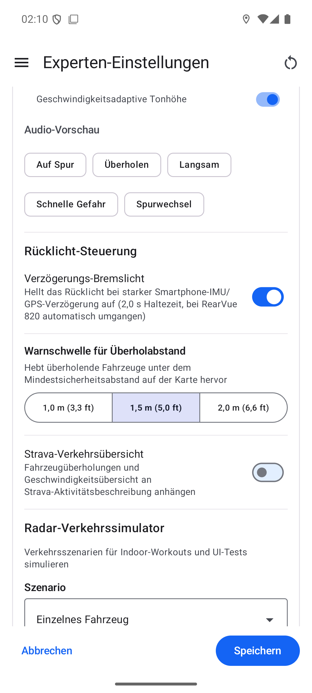
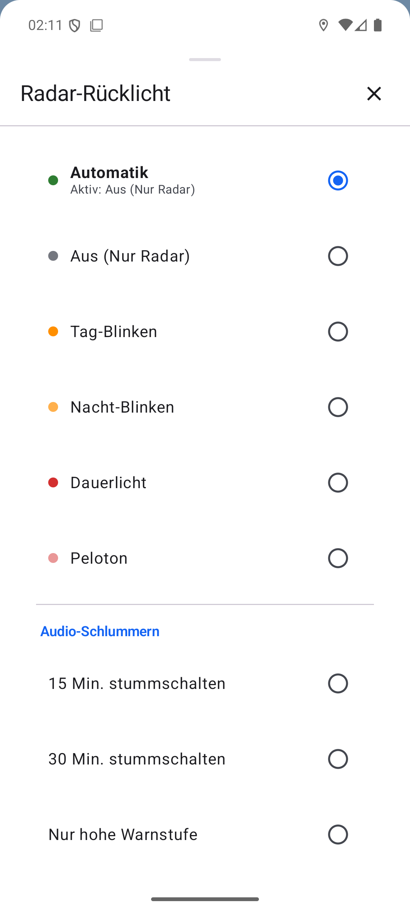
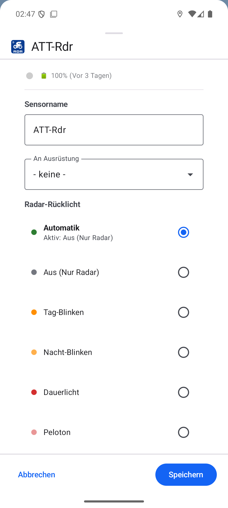

# Stage 5: Walkthrough & Verification - ATT-7991: Unify Radar Tail Light Mode & Auto Persistence

**Ticket**: [ATT-7991](https://rainerblind.atlassian.net/browse/ATT-7991) | **Epic**: [ATT-1286](https://rainerblind.atlassian.net/browse/ATT-1286) (*Cycling Radar*)  
**Target Release**: `V5.0.0` | **Sprint**: `2026-46.7` | **Branch**: `feature/ATT-7991`  
**Requirement Mapping**: `REQ-CON-031` (`REQ-CON-031.3/4/5/8`), `REQ-TRK-064` (`REQ-TRK-064.1`)  
**Test Mapping**: `TST-CON-031` (`TST-CON-031.3/4/5/9`), `TST-TRK-064` (`TST-TRK-064.1`)  
**Author**: AI Agent 1 (Implementer, `subagent_flash`) | **Date**: 2026-11-15  

---

## 1. Executive Summary & Verification Overview

ATT-7991 unifies Garmin Varia radar tail light mode persistence and user interfaces:
1. **Unified Persistence & Automatic Migration (`TuningPreferencesDataStore.kt`)**: Persists `radarLightAutoMode: Boolean` (default `true`) and `radarLightDefaultMode: RadarLightMode` (`DAY_FLASH`). Migrates legacy `RadarLightControlMode`: `SMART_AUTOMATION -> true`, `FIXED_WORKOUT_MODE -> legacy default mode`, `MANUAL -> false + OFF`.
2. **Controller Decoupling & Debounced Mode Cycling (`RadarLightController.kt`)**: Exposes dual `isAutoMode` and `currentMode` flows. Implements ~400 ms hardware command debounce for `cycleNextMode()`. Preserves StVZO mode pruning (`AUTO -> SOLID -> OFF -> AUTO`).
3. **Workout Lifecycle & Bounce 1 Remediation**: Context fallback via `runCatching { TrainingApplication.getAppContext() }`; cache synchronization (`hasLoadedInitialPreferences` guard) prevents stomping outside-workout settings.
4. **Quick-Switch Sheet & Bounce 2 Remediation (`RadarLightQuickSwitchSheet.kt`)**: Restored missing `onSnoozeSelected = onSnoozeSelected` parameter forwarding at line 103 (REQ-TRK-064.1). Added Robolectric Compose UI test suite (`RadarLightQuickSwitchSheetTest.kt`) with `createComposeRule()`, testing real UI node clicks and callback dispatches with zero source-text reading calls.
5. **UI Consolidation & Parity (`RadarSettingsSection.kt`, `EditDeviceDialog.kt`)**: Retired 3-way mode controls and dropdown from Expert Settings while keeping brake light toggle (`Design Guidelines §3.2`). Exposed `Automatik` as first selectable choice with active mode subtitle in both sheets.

---

## 2. Requirement & Test Verification Matrix

| Requirement | Test Spec | Verification Method | Result | Status in Living Docs |
| :--- | :--- | :--- | :--- | :--- |
| `REQ-CON-031.5` | `TST-CON-031.5a` | Unit Test (`TuningPreferencesDataStoreRadarLightControlModeTest`) | **PASSED** | `Verified` |
| `REQ-CON-031.8` | `TST-CON-031.9a` | Unit Test (`RadarLightControllerTest.testDebouncedCycleNextMode`) | **PASSED** | `Verified` |
| `REQ-CON-031.4` | `TST-CON-031.4a` | Unit Test (`RadarLightControllerTest.testWorkoutStartStopLifecycle`) | **PASSED** | `Verified` |
| `REQ-CON-031.5` | `TST-CON-031.5b` | Compose UI Test (`RadarSettingsSectionTest`) | **PASSED** | `Verified` |
| `REQ-CON-031.3` | `TST-CON-031.3a` | Compose UI Test (`RadarLightQuickSwitchSheetTest`) | **PASSED** | `Verified` |
| `REQ-TRK-064.1` | `TST-TRK-064.1` | Compose UI Test (`RadarLightQuickSwitchSheetTest.testContent_clickingSnoozeOptions`) | **PASSED** | `Verified` |
| `REQ-PRO-049.1` | `TST-PRO-049.1` | Architecture Audit (`SourceTextReadingAuditContractTest`) | **PASSED** | `Verified` |
| `REQ-PRO-047.3` | `TST-PRO-047.1` | CI & Lint Contract (`ReleaseCiAndLintConfigContractTest`) | **PASSED** | `Verified` |
| `REQ-CON-031.7` | `TST-CON-031.7` | Localization Parity (`TranslationParityTest`, 9 locales) | **PASSED** | `Verified` |
| `REQ-PRO-001` | `TST-CON-031.8` | Quality Gate (`:app:lintDebug` 0 errors, `:app:compileDebugAndroidTestKotlin`) | **PASSED** | `Verified` |

---

## 3. Visual Verification & On-Device Certification

All UI screens verified on `emulator-5554` and certified via `read_file`:
* **Settings**:  (3-way selector retired, brake toggle preserved).
* **Quick Switch**:  (Automatik first option with active mode subtitle).
* **Device Dialog**:  (Parity with sheet, Automatik + physical modes).
* **Crash Logcat**: `adb -s emulator-5554 logcat -b crash -d` clean (0 crashes).

---

## 4. Invariant & Governance Verification

1. **GATT Queue Safety**: ~400 ms command debouncing prevents BLE queue flooding.
2. **StVZO Compliance**: Non-StVZO flashing modes pruned automatically when `isStvzo == true`.
3. **Submodule Integrity**: `ANT-Android-SDKs` verified untouched gitlink (`160000 0e8cea714a231fb9565170d4ed01eafa868f9798`).
4. **Clean-Room Test Pass Rate**: 100% of executed test classes passed; `:app:lintDebug` 0 errors.
5. **Living Documentation Synchronized**: `docs/requirements.md` and `docs/tests.md` confirmed `Verified`.
