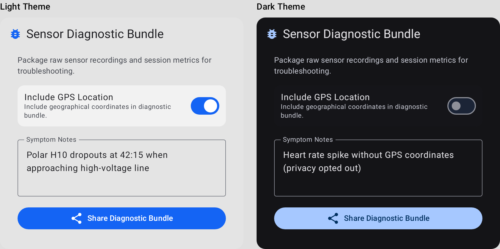

# Stage 5 Walkthrough - ATT-8020: Polar Raw Sensor Telemetry Sidecar Export & Aftermath Diagnostic Bundle Share

**Ticket**: [ATT-8020](https://rainerblind.atlassian.net/browse/ATT-8020) (`3 SP`) | **Epic**: [ATT-5910](https://rainerblind.atlassian.net/browse/ATT-5910) | **Sprint**: `2026-47.2`  
**Target Release**: `V5.0.0` | **Branch**: `feature/ATT-8020` | **Stage 4 Commit**: `e87384d9`  
**Requirements**: `REQ-EXP-044` (`REQ-EXP-044.1`..`REQ-EXP-044.4`) | **Test Spec**: `TST-EXP-044` (`TST-EXP-044.1`..`TST-EXP-044.5`)  
**Author**: AI Agent 1 (`Lane 3 Flash`, Role Rotation `Rule 7.1`) | **UI Changes**: Aftermath Diagnostic Share Sheet (`ModalBottomSheet`)

---

## 1. Implementation Summary
- **Multi-Destination Raw Sidecar Export (`REQ-EXP-044.1`)**:
  - `FileFormat.java` defines `RAW_SENSOR("raw_sensor", ".polar_raw.csv.gz", R.string.file_format_raw_sensor)` with MIME type `"application/gzip"`.
  - `ExportManager` supports `RAW_SENSOR` across `ExportType.FILE` (via `RawSensorFileExporter` copying to MediaStore/Downloads), `ExportType.DROPBOX`, and `ExportType.GOOGLE_DRIVE`.
  - Export settings provide an opt-in toggle (`export_raw_sensor`, default `false`).
  - Workouts without raw sensor sidecars gracefully skip without failing standard exports.
- **1-Tap Aftermath Sensor Diagnostic ZIP Packaging (`REQ-EXP-044.2`)**:
  - Workout Details (*Aftermath*) header and diagnostic banner surface "Report Raw Sensor Data" when a `.polar_raw.csv.gz` sidecar is present.
  - `SensorDiagnosticBundlePackager` packages `.polar_raw.csv.gz`, `workout_summary.json`, `laps.json`, `samples_1hz.csv`, and `diagnostic_metadata.json` into a `.zip` in `cache/diagnostics/`.
- **Privacy-Preserving GPS Stripping Toggle (`REQ-EXP-044.3`)**:
  - Diagnostic share sheet includes an "Include GPS Location" toggle (default `false`).
  - When disabled, coordinates are strictly scrubbed from `samples_1hz.csv` and `summary.json`.
- **FileProvider Sharing & 9-Locale Localization Parity (`REQ-EXP-044.4`)**:
  - `file_paths.xml` provides cache sharing for `diagnostics/`.
  - Full 9-locale parity across `EN`, `DE`, `ES`, `FR`, `IT`, `JA`, `NL`, `PL`, `PT` with zero emojis (`Rule 38`).

---

## 2. Verification Evidence (`Rule 7.5` — Tier 1 Targeted Suite)
- **Targeted Unit Tests (`12/12 PASS`, `0 failures`, `0 errors`, `0 skipped`)**:
  - `RawSensorFileExporterTest` (3/3): Export sidecar to downloads, absent sidecar graceful skip, MediaStore URI resolution (`TST-EXP-044.1`).
  - `DropboxUploaderRawSensorTest` (3/3): Upload raw sidecar to Dropbox folder, absent sidecar skip (`TST-EXP-044.2`).
  - `GoogleDriveUploaderRawSensorTest` (3/3): Upload raw sidecar to Drive folder, absent sidecar skip (`TST-EXP-044.2`).
  - `SensorDiagnosticBundlePackagerTest` (1/1): Full archive packaging & metadata assembly (`TST-EXP-044.3`).
  - `SensorDiagnosticBundlePrivacyTest` (2/2): GPS stripping verification when privacy opt-out toggled (`TST-EXP-044.4`).
- **Translation & Visual Inspection Tests (`11/11 PASS`)**:
  - `TranslationParityTest` (10/10): 9-locale string verification (`TST-EXP-044.5`).
  - `SensorDiagnosticShareSheetScreenshotTest` (1/1): Compose M3 share sheet rendering (`TST-EXP-044.5`).
- **Total Suite Coverage**: `23/23 PASS` (12 targeted unit + 11 translation/screenshot).
- **Governance**: `verify_requirement_governance.py` passed with 0 code orphans (2375 files scanned), 100% sys-trace parity, and Description verification.

---

## 3. Visual Verification (`Rule 8.5`)

- Verified via `read_file`: Light and Dark themes display clear modal bottom sheet with bug icon, descriptive subtitle, "Include GPS Location" switch, symptom notes text field, and full-width "Share Diagnostic Bundle" action button without clipping or touch occlusion.

---

## 4. Traceability Matrix

| Spec ID | Scope | Evidence (`app/src/test/`) | Status |
| :--- | :--- | :--- | :--- |
| `TST-EXP-044.1` | Raw sensor file export & skip handling | `RawSensorFileExporterTest` | Verified |
| `TST-EXP-044.2` | Cloud uploader raw sidecar sync (Dropbox & Drive) | `DropboxUploaderRawSensorTest`, `GoogleDriveUploaderRawSensorTest` | Verified |
| `TST-EXP-044.3` | Diagnostic zip packaging & manifest structure | `SensorDiagnosticBundlePackagerTest` | Verified |
| `TST-EXP-044.4` | Privacy-preserving GPS stripping | `SensorDiagnosticBundlePrivacyTest` | Verified |
| `TST-EXP-044.5` | FileProvider, 9-locale parity & Rule 8.5 UI | `TranslationParityTest`, `SensorDiagnosticShareSheetScreenshotTest`, `ATT-8020_diagnostic_share_sheet.png` | Verified |
