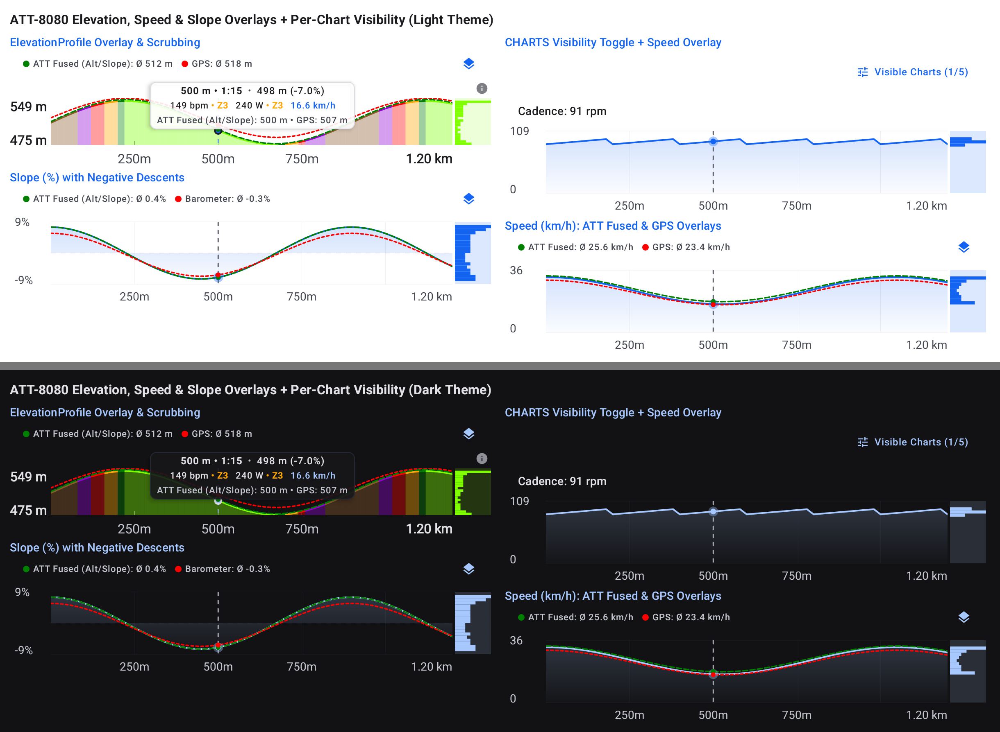

# Walkthrough: Support Multi-Source Sensor Overlays & Per-Chart Visibility in Workout Details (`ATT-8080`)

**Jira Ticket**: `ATT-8080`
**Target Release**: `V5.0.0`
**Status**: `Verified`

## Summary of Changes
- **ATT Fused Track Layers & `NETWORK` Removal**: Replaced `TrackType.NETWORK` with `TrackType.ATT_FUSED` (`LATITUDE_att_fused` / `LONGITUDE_att_fused`) in [MapModels.kt](../../app/src/main/java/com/atrainingtracker/trainingtracker/ui/map/MapModels.kt), extracted [WorkoutMultiSourceSampleDiscovery.kt](../../app/src/main/java/com/atrainingtracker/trainingtracker/ui/aftermath/WorkoutMultiSourceSampleDiscovery.kt) for localized `GPS`/`Fused` alias resolution, and wired `showTechnicalTracks = true` + `Layers` selection across `TrackOnMapScreen`, `PeriodMapScreen`, `PeriodsScreen`, `WorkoutClusterHeatmapScreen`, and `WorkoutClustersScreen`.
- **Multi-Source Overlays (`ALTITUDE`, `SPEED_mps`, `SLOPE`) & `MapDetailLayout` Scrub Readout**: Discovered `<TYPE> (<name>)`, `_(gps|google_fused|att_fused)`, and `att_fused_altitude_slope` columns, retained `<= 0.0` (`isFinite()`) values for `ALTITUDE`/`SLOPE`, extracted [ElevationProfileOverlayComponents.kt](../../app/src/main/java/com/atrainingtracker/trainingtracker/ui/map/ElevationProfileOverlayComponents.kt) and [TelemetryOverlayComponents.kt](../../app/src/main/java/com/atrainingtracker/trainingtracker/ui/map/TelemetryOverlayComponents.kt), added `TelemetryMetricType.SLOPE`, hoisted `ALTITUDE` overlay state in [MapDetailLayout.kt](../../app/src/main/java/com/atrainingtracker/trainingtracker/ui/map/MapDetailLayout.kt) into `ScrubbingTelemetryBadge(overlayReadoutText = ...)`, and unified locale decimals + `AltitudeFormatter` reuse.
- **Persisted Per-Chart Visibility, Landscape Clearance & LoC Compliance**: Extracted [TelemetryChartStack.kt](../../app/src/main/java/com/atrainingtracker/trainingtracker/ui/map/TelemetryChartStack.kt) shared by [MapDetailLayout.kt](../../app/src/main/java/com/atrainingtracker/trainingtracker/ui/map/MapDetailLayout.kt) (`1,062 <= 1,500`) and [TrackOnMapScreen.kt](../../app/src/main/java/com/atrainingtracker/trainingtracker/ui/aftermath/TrackOnMapScreen.kt) (`1,028 <= 1,500`), persisted `HIDDEN_TELEMETRY_CHARTS`, reserved Landscape top clearance above `Visible Charts` when `showElevationProfile == false`, stayed under all LoC caps (`WorkoutRepository.kt: 4,966 <= 5,117`, `TelemetryMetricGraph.kt: 1,779 <= 1,965`, `ElevationProfile.kt: 1,454 <= 1,500`), and added 9-language `strings_workout_details.xml`.

## Verification Results
### 1. Tier 1 Targeted JVM & Contract Tests (`Rule 7.5` Gate 4 Bounce 1 Evidence Reused)
- Post-Bounce 1 suite (`17` classes on final code): **`133` tests completed, `0` failed, `0` skipped** (`ArchitectureConformanceContractTest: 11`, `DetailedDesignParityContractTest: 3`, `SourceTextReadingAuditContractTest: 4`, `SpeedConversionContractTest: 7`, `TranslationParityTest: 10`, `PeriodsViewModelTest: 14`, `WorkoutClustersViewModelTest: 16`, `ElevationProfileOverlayTest: 4`, `MapDetailLayoutScrubSynchronizationTest: 7`, `MultiSensorChartsScreenshotTest: 1`, `TelemetryChartStackVisibilityTest: 7`, `TelemetryMetricGraphHrvTest: 3`, `TelemetryMetricGraphOverlayTest: 5`, `TelemetryMetricGraphTest: 18`, `TelemetryMetricUtilsTest: 14`, `TrackOnMapAftermathViewModelFallbackTest: 2`, `TrackOnMapAftermathViewModelTest: 7`).
- Plus Stage 4 repository/preferences suites on unchanged files (`WorkoutRepositoryProjectionTest: 5`, `WorkoutRepositoryTelemetryTest: 17`, `TelemetryGraphColorPreferencesTest: 7`, `0` failed/skipped). Unrelated pre-existing baseline failure: `DeadCodeEliminationContractTest > testComposePreviewsVisibilityAudit` in untouched `EditDeviceDialog.kt`.

### 2. Visual, Emulator & Governance Verification (`Rule 8.5`)
- **Robolectric Compose Screenshot** (`TelemetryChartStackVisibilityTest`): Inspected  — Light/Dark overlays, `Visible Charts`, aligned X-axes, and scrub readouts verified cleanly.
- **On-Device Smoke Check (`emulator-5554`, `Pixel_8_Android_15`)**: Healed APK (`./gradlew installDebug`) launched `MainActivityWithNavigation` -> `Einheiten` -> `sample_workout` -> `Karte & Diagramme`, rendered `Höhenprofil` + `Sichtbare Diagramme` dropdown (`Geschwindigkeit`, `Herzfrequenz`, `Leistung`, `Trittfrequenz`) + profile swipe with empty `adb logcat -b crash -d`.
- **Governance**: `python3 tools/verify_requirement_governance.py --repo-root .` exited `0` (`REQ-PER-044`, `REQ-MAP-011`, `REQ-MAP-012`, `TST-PER-052`, `TST-UI-055` `[Verified]`).
