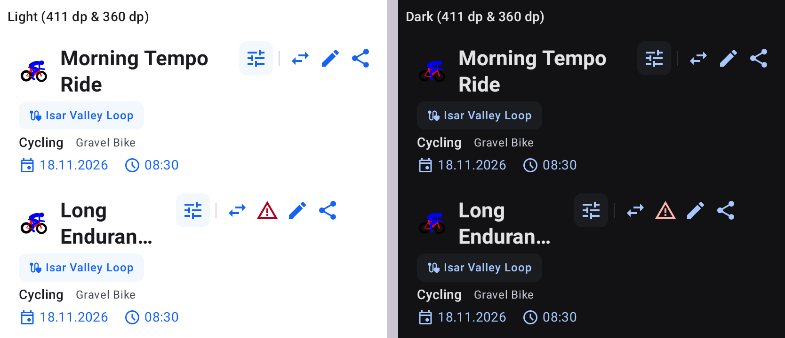

# Stage 5: Walkthrough & Verification - ATT-8097: Unify Workout Detail Header Action Icons

**DOC-ID**: `DOC-WLK-ATT-8097` | **Ticket**: [ATT-8097](https://atrainingtracker.atlassian.net/browse/ATT-8097)  
**Parent Epic**: [ATT-176](https://atrainingtracker.atlassian.net/browse/ATT-176) (*Lieblingsstrecken / Route Clusters & Auto-Naming*) | **Target Release**: `V5.0.0`  
**Active Sprint**: `sprint/2026-11-18_01_Früh` | **Requirement Mapping**: `REQ-UI-2786` | **Test Mapping**: `TST-UI-2786`  
**Branch**: `feature/ATT-8097` | **Author**: `--as agent1` | **Date**: 2026-11-18

---

## 1. Executive Summary & Verification Overview
Unified Workout Detail top-right header action icons across `WorkoutHeader.kt`, `WorkoutDetailTabbedContent.kt`, `TrackOnMapScreen.kt`, `TrackOnMapAftermathViewModel.kt`, `WorkoutClusterRepository.kt`, `WorkoutClusterComponents.kt`, `WorkoutClustersScreen.kt`, `WorkoutClusterHeatmapScreen.kt`, `WorkoutClustersViewModel.kt`, and 9-locale `values*/strings_workout_header.xml`:
* **Uniform `32.dp` & `MaterialTheme.colorScheme.primary` Tint**: All 4 action icons (`Tune`, `SwapHoriz`/`⇄`, `Edit`, `Share`) render uniformly at `32.dp` in `primary` tint (`WarningAmber` retains semantic `error` tint).
* **Global-vs-Per-Workout Ordering & Grouping**: Ordered `[Tune]` (subtle `TTAlpha.Faint` tonal pill + `16.dp` `VerticalDivider`) before per-workout `[⇄][Edit][Share]` with 9-locale `TooltipBox`/`PlainTooltip` labels and complete `actionSpacerWidth` reservation (`360–411 dp`).
* **Universal `⇄` & Non-GPS Fallback**: `TrackOnMapScreen` centrally wires `onChangeCluster` across all 5 entry points; indoor/non-GPS workouts (`startLatLng == null || endLatLng == null`) fall back to `getAllClustersSync()` (`Double.NaN` score hidden) and `assignClusterToWorkout` with `onCreateNew = null` and `onUnassign` when `clusterId > 0`. `WorkoutRepository.kt` remained strictly untouched (`5,117` LoC).

## 2. Requirement & Test Verification Matrix
| Requirement | Test Spec | Verification Method | Result | Status in Living Docs |
| :--- | :--- | :--- | :--- | :--- |
| `REQ-UI-2786.1`, `.2` | `TST-UI-2786.1` | Robolectric `createComposeRule()` (`WorkoutDetailHeaderActionsComposeTest`, `0` `src/main` reads) | **5/5 PASS** | `[Verified]` |
| `REQ-UI-2786.3` | `TST-UI-2786.2` | Unit & ViewModel (`TrackOnMapClusterActionViewModelTest`, `WorkoutClustersViewModelTest`) | **4/4 + 16/16 PASS** | `[Verified]` |
| `REQ-UI-2786.2`, `.4` | `TST-UI-2786.3` | 9-Locale & Architecture Contracts (`TranslationParityTest`, `ArchitectureConformanceContractTest`, `SourceTextReadingAuditContractTest`, header/cluster contracts) | **10/10 + 9/9 + 4/4 + 42/42 PASS** | `[Verified]` |
| `REQ-UI-2786.1`–`.4` | `TST-UI-2786.4` | `Rule 8.5` Light/Dark `@Preview` PNG Audit (`ATT-8097_header_actions_preview.png`) | **PASSED** (4-point checklist) | `[Verified]` |

## 3. Automated Test Evidence (`Rule 7.5` Reused Stage 4 `04d16116` XMLs)
Because Stage 5 modifies living documentation & walkthrough markdown only (`app/` unchanged since `04d16116`), the Stage 4 Tier 1 JUnit XML results under `app/build/test-results/testDebugUnitTest/` are reused directly without redundant Gradle execution:
* **19 JUnit XML Suites — `90/90` PASS (`0` failures, `0` errors, `0` skipped)**:
  * `WorkoutDetailHeaderActionsComposeTest` (`5/5`), `TrackOnMapClusterActionViewModelTest` (`4/4`), `TranslationParityTest` (`10/10`), `ArchitectureConformanceContractTest` (`9/9`), `SourceTextReadingAuditContractTest` (`4/4`), `WorkoutClustersViewModelTest` (`16/16`), `WorkoutDetailTabbedContentTest` (`7/7`), `TrackOnMapAftermathViewModelTest` (`7/7`), `WorkoutClusterSelectionDialogTest` (`5/5`), `TrackOnMapScreenLapRoutingContractTest` (`4/4`), `TrackOnMapScreenMetadataRoutingContractTest` (`3/3`), `TrackOnMapScreenSectionSlottingContractTest` (`3/3`), `WorkoutHeaderLandscapeTest` (`3/3`), `WorkoutHeaderExportMenuContractTest` (`2/2`), `TrackOnMapAftermathViewModelFallbackTest` (`2/2`), `ui.map.TrackOnMapScreenMetadataRoutingContractTest` (`2/2`), `TrackOnMapViewModelTelemetryTest` (`2/2`), `TrackOnMapScreenDetailPreferencesContractTest` (`1/1`), `WorkoutDetailHeaderClickContractTest` (`1/1`).
* **Requirement Governance**: `verify_requirement_governance.py --repo-root . --base-ref cdc33430 --sync-indexes --check-size --check-doc-headers --check-conflict-markers` and `verify_requirement_governance.py --repo-root .` both exited `0`; `has_verified_test_evidence('TST-UI-2786')` returned `(True, ...)`.

## 4. Visual Inspection (`Rule 8.5`) & Device Verification Boundary (`Rule 7.6`)
| Light & Dark `@Preview` (`411 dp` & `360 dp`) |
| :---: |
|  |

* **`Rule 8.5` 4-Point Visual Audit (`read_file` verified)**: (1) *Orientation & Geometry*: `[Tune]` tonal pill + `16.dp` `VerticalDivider` cleanly precedes `[⇄]`, optional `[WarningAmber]`, `[Edit]`, `[Share]`; (2) *Color*: uniform `primary` tint on all 4 action icons + semantic `error` tint on `[WarningAmber]` in both Light & Dark themes; (3) *Typography & Wrapping*: `Morning Tempo Ride` wraps cleanly on `411 dp` and `Long Enduran...` ellipsizes cleanly before actions on `360 dp`; (4) *Touch Ergonomics*: `32.dp` compact spacing without overlap.
* **Physical Hardware Boundary (`Rule 7.6`)**: Physical Pixel 10 device verification is strictly reserved for PO Ceremony 2 / physical sign-off (`Rule 7.6`); autonomous Stage 5 validation relies on the `90/90` Robolectric/JVM suite and `Rule 8.5` Light/Dark `@Preview` screenshot inspection.

## 5. Invariant & Governance Verification
1. `WorkoutRepository.kt` strictly untouched (`5,117` LoC); `0` `src/main` reads in new tests (`REQ-PRO-049.1`); `tools/*` untouched.
2. `feature/ATT-8097` preserved intact (not merged/squashed onto `sprint/2026-11-18_01_Früh`); parent ticket awaits Stage 6 Cold Review (`Final Review (Agent)` -> `Final Review (Human)`).
