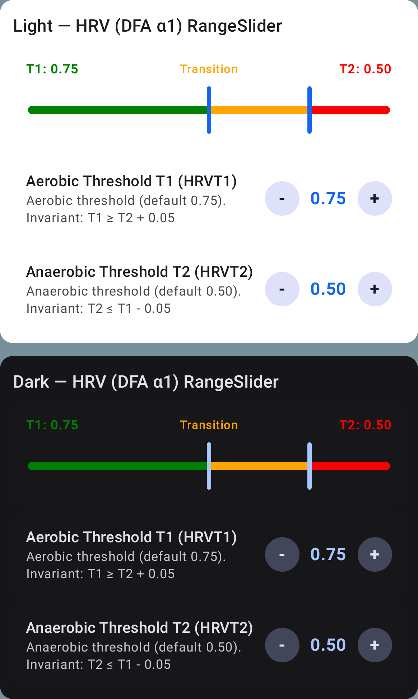

# Stage 5: Walkthrough & Verification - ATT-8105: Gesture-Isolated HrvDfaA1RangeSlider

**Ticket**: [ATT-8105](https://rainerblind.atlassian.net/browse/ATT-8105) | **Sub-task**: `(Pending submit-stage)` (`[Test]`)  
**Parent Epic**: [ATT-3539](https://rainerblind.atlassian.net/browse/ATT-3539) (*HRV*) | **Target Release**: `V5.0.0` | **Sprint**: `sprint/2026-11-17_03_Nacht`  
**Requirement Mapping**: `REQ-TRK-086` (refining `REQ-TRK-061.4`) | **Test Mapping**: `TST-TRK-086`  
**Branch**: `feature/ATT-8105` | **Author**: AI Agent 1 (Implementer) | **Date**: 2026-11-18  

---

## 1. Executive Summary & Verification Overview
Isolated `HrvDfaA1RangeSlider` (and optional `HrvThresholdControlRow` slider) touch/drag gestures in `ZonesSettingsActivity.kt` from the parent `HorizontalPager` without changing `app/` or `tools/` in Stage 5 (`ATT-8030` zero code drift).
* Lifted `isSliderGestureActive` in `ZoneSettingsScreen` (`HorizontalPager(userScrollEnabled = !isSliderGestureActive)`) with `LaunchedEffect(pagerState.currentPage)` page-exit reset.
* Added `rememberSliderGestureIsolationModifier` combining `PointerEventPass.Initial` press/release tracking, `MutableInteractionSource` press/drag monitoring, `DisposableEffect` cleanup, and `PointerEventPass.Main` horizontal-only delta consumption (preserving `verticalScroll` and outside-slider tab swipes).
* Added local drag state (`dragT1`/`dragT2`, `onValueChangeFinished`, `awaitSyncAfterDrag`) in `HrvDfaA1RangeSlider` to prevent async `TuningPreferencesDataStore` thumb snap-back while preserving `0.30f..1.20f` and $T_1 \ge T_2 + 0.05f$.

## 2. Requirement & Test Verification Matrix
| Requirement | Test Spec | Verification Method | Result | Status in Living Docs |
| :--- | :--- | :--- | :--- | :--- |
| `REQ-TRK-086.1` | `TST-TRK-086.1`, `TST-TRK-086.2` | Robolectric `createComposeRule()` (`HrvDfaA1RangeSliderGestureTest`) | **PASSED (5/5)** | `Verified` |
| `REQ-TRK-086.2` | `TST-TRK-086.1` | Robolectric bidirectional drag & lag buffering (`HrvDfaA1RangeSliderGestureTest`) | **PASSED** | `Verified` |
| `REQ-TRK-086.3`, `REQ-TRK-061.4` | `TST-TRK-086.3` | Contract + `Rule 8.5` PNG (`HrvDfaA1SettingsContractTest` + `ATT-8105_hrv_slider_zones.png`) | **PASSED (12/12)** | `Verified` |

## 3. Automated Test Evidence (Tier 1 Targeted Scope on Stage 4 SHA `c72dfb9e`)
Executed under `/tmp/att_build_merge.lock` (`parallel_sprint_lock.py`):
`./gradlew :app:assembleDebug :app:testDebugUnitTest --rerun-tasks --tests "com.atrainingtracker.trainingtracker.zones.HrvDfaA1RangeSliderGestureTest" --tests "com.atrainingtracker.trainingtracker.zones.HrvDfaA1SettingsContractTest" --tests "com.atrainingtracker.trainingtracker.zones.ZonesSettingsHeaderContractTest" --tests "com.atrainingtracker.trainingtracker.zones.ZonesSettingsPreviewLayoutTest" --tests "com.atrainingtracker.trainingtracker.zones.ZonesSettingsPreviewPillsContractTest" --tests "com.atrainingtracker.trainingtracker.build.DetailedDesignParityContractTest" --tests "com.atrainingtracker.trainingtracker.build.InterfaceSignatureDriftContractTest" --max-workers=2`
* **Result**: `BUILD SUCCESSFUL in 8m 51s` (`55 actionable tasks: 55 executed`), **31/31 tests passed across 7 suites** (`0` failures, `0` errors, `0` skipped): `HrvDfaA1RangeSliderGestureTest` (`5/5`), `HrvDfaA1SettingsContractTest` (`12/12`), `ZonesSettingsHeaderContractTest` (`3/3`), `ZonesSettingsPreviewLayoutTest` (`2/2`), `ZonesSettingsPreviewPillsContractTest` (`3/3`), `DetailedDesignParityContractTest` (`3/3`), `InterfaceSignatureDriftContractTest` (`3/3`).
* **Zero `src/main/` file reads**: `HrvDfaA1RangeSliderGestureTest.kt` uses Compose behavioral UI assertions only (`REQ-PRO-049.1`).
* **Localization**: `N/A - no UI strings added or modified`.

## 4. Visual Consistency & `Rule 8.5` Verification
| Light & Dark `HrvDfaA1RangeSlider` + Stepper Rows | Notes |
| :---: | :--- |
|  | Inspected via `read_file`: clean 3-zone `TTColor.Zone2`/`Zone3`/`Zone4` track with zero M3 stop dots, crisp `T1: 0.75`/`Transition`/`T2: 0.50` contrast in Light & Dark, well-spaced `-`/`+` steppers, zero clipping/wrapping. |

* **Checked against `docs/design_guidelines.md`**: shapes [x] spacing [x] colors/themes [x] typography/icons [x] placement [x] | **Deviations**: None.

## 5. Invariant & Governance Verification
1. **Zero Code Drift**: `app/`, `tools/`, and `docs/architecture/` untouched after Stage 4 SHA `c72dfb9e`.
2. **Living Docs & Governance**: `REQ-TRK-086` and `TST-TRK-086` promoted to `[Verified]`, master indexes synced via `--sync-indexes`, `verify_requirement_governance.py` exited `0`.
3. **Branch & Gate**: `feature/ATT-8105` preserved intact for Stage 6 Cold Review (`REQ-PRO-125`); parent ticket remains for human acceptance in `Final Review (Human)`.
