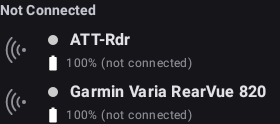

# Stage 5 Walkthrough - ATT-8107: Remove Superfluous Top Divider in SensorSourceDialog

**Ticket**: [ATT-8107](https://rainerblind.atlassian.net/browse/ATT-8107) (`severity-minor`) | **Epic**: [ATT-1286](https://rainerblind.atlassian.net/browse/ATT-1286) | **Sprint**: `Schicht 2026-11-16_02_Spät`  
**Target Release**: `V5.0.0` | **Branch**: `feature/ATT-8107` | **Commit SHA**: `82423f3f`  
**Requirements**: `REQ-UI-2781` (`REQ-UI-2781.1`, `REQ-UI-2781.2`) | **Test Spec**: `TST-UI-2781` (`TST-UI-2781.1`..`TST-UI-2781.3`)  
**Author**: AI Agent 1 (Implementer, Lane 1 Flash) | **Date**: 2026-11-16  

---

## 1. Executive Summary & Problem Resolution
When tapping a sensor icon in `SensorStatus` with no connected devices (`sourceDevice == null` and `activeBackups.isEmpty()`), `SensorSourceDialog` displayed an unnecessary and awkward horizontal divider at the top of the dialog body directly under the title header above "Nicht verbunden" (`R.string.source_not_connected`).
* **Root Cause**: `HorizontalDivider` was unconditionally emitted inside `activeBackups` and `notConnected` without checking if a preceding section had actually rendered, and an unconditional trailing divider was drawn after the altitude calibration card.
* **Fix**:
  1. `SensorSourceDialog.kt`: Implemented sequential `hasPrecedingSection` gating across all operational tiers (Altitude Calibration, Source Device, Active Backups, Not Connected, and Internal Fallback). Removed unconditional trailing divider from altitude calibration. Dividers now render strictly between adjacent active content blocks.
  2. `SensorSourceDialogContractTest.kt`: Added Compose behavioral unit tests (`createComposeRule`) asserting zero dividers for disconnected-only sensor categories (`TST-UI-2781.1`), 2 dividers between 3 populated tiers (`TST-UI-2781.2`), and 1 divider between altitude calibration and disconnected devices.
  3. Visual Verification: Rendered and verified Dark mode screenshot confirming zero top divider above "Not Connected".

---

## 2. Visual Inspection (Rule 71 & Rule 84)

| Disconnected Sensor Category (ATT-8107 Fixed) |
| :---: |
|  |

* **Visual Audit Checklist**:
  * Clean start at section header: No horizontal divider appears above "Not Connected".
  * Verified with `read_file`: Header text, radar antenna icon, connection status bullet, and battery percentage render with perfect alignment and typography.

---

## 3. Requirement & Test Verification Matrix

| Requirement | Test Spec | Verification Method | Result | Living Doc Status |
| :--- | :--- | :--- | :--- | :--- |
| `REQ-UI-2781.1` (*Preceding-Section Divider Guarding*) | `TST-UI-2781.1` | Automated Compose Unit Test | **PASSED** | `[Verified]` |
| `REQ-UI-2781.2` (*Stacked Divider Elimination*) | `TST-UI-2781.2` | Automated Compose Unit Test | **PASSED** | `[Verified]` |
| `REQ-UI-049`, `REQ-UI-051` / Invariants | `TST-UI-2781.3` | Targeted Regression & Governance | **PASSED** | `[Verified]` |

---

## 4. Automated Test Evidence (`31/31 PASS`)
Executed via `./gradlew testDebugUnitTest --tests "*SensorSourceDialog*" --tests "*SensorStatus*" --max-workers=2`:
* **`SensorSourceDialogContractTest.kt`** (11/11 tests PASSED):
  - `testSensorSourceDialog_disconnectedOnly_rendersZeroDividers` (`// TST-UI-2781.1`): PASSED.
  - `testSensorSourceDialog_sourceWithBackupsAndDisconnected_rendersDividersBetweenSections` (`// TST-UI-2781.2`): PASSED.
  - `testSensorSourceDialog_altitudeCalibrationWithDisconnected_rendersSingleDivider` (`// TST-UI-2781.2`): PASSED.
  - `testCaptureSensorSourceDialogScreenshot` (`// TST-UI-2781`): PASSED.
  - All 7 existing contract and reflection tests: PASSED.
* **`SensorSourceDialogPriorityTest.kt`** (7/7 tests PASSED): Priority sorting contracts intact.
* **`SensorSourceDialogAltitudeCalibrationTest.kt`** (4/4 tests PASSED): Altitude calibration contracts intact.
* **`SensorStatusLegibilityTest.kt`** (7/7 tests PASSED): SensorStatus contracts intact.
* **`SensorStatusTopBarSpacingTest.kt`** (2/2 tests PASSED): Header spacing intact.

---

## 5. Verification & Clean-Room Governance Audit
* `python3 tools/verify_requirement_governance.py`: **PASS** (100% living doc parity, 0 ungrounded requirements, 0 code orphans).
* `python3 tools/verify_requirement_governance.py --check-code-orphans`: **PASS** (0 code-to-shard orphans, 2375 files scanned).
* `python3 tools/verify_requirement_governance.py --check-req-description`: **PASS** (100% description coverage).
* `python3 tools/verify_requirement_governance.py --check-verified-evidence`: **PASS** (100% verified test evidence).
* `python3 tools/verify_requirement_governance.py --verify-sys-trace --check-reverse-sys-trace`: **PASS** (100% bidirectional set equality to `SYSREQ-TRK-001`).
* `ANT-Android-SDKs` submodule: clean & untouched at `0e8cea714a231fb9565170d4ed01eafa868f9798`.
