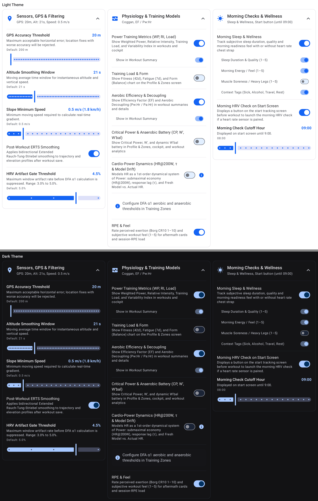

# Stage 5 Walkthrough: ATT-8117 - Move HRV Artifact Gate to Sensors & Add Morning Checks Section

**Ticket**: [ATT-8117](https://rainerblind.atlassian.net/browse/ATT-8117) | **Sub-task**: `[Test]` (Pending `submit-stage`)
**Parent Epic**: [ATT-355](https://rainerblind.atlassian.net/browse/ATT-355) (*Global UI & Design System*)
**Target Release**: `V5.0.0` | **Active Sprint**: `2026-47.1` | **Branch**: `feature/ATT-8117`
**Requirement Mapping**: `REQ-SET-113` (`REQ-SET-113.1`..`REQ-SET-113.4`)
**Test Spec Mapping**: `TST-SET-115` (`TST-SET-115.1`..`TST-SET-115.5`)
**Author**: AI Agent 1 (Implementer, `subagent_pro`) | **Date**: 2026-11-16

---

## 1. Executive Summary & Verification Walkthrough
1. **HRV Artifact Gate Relocation (`REQ-SET-113.1`)**: Moved `hrvArtifactGateThresholdPercent` (`tuning_hrv_artifact_gate_title`, `3.0%..5.0%`) from `PhysiologyModelsSection.kt` to `SensorsGpsFilterSection.kt` (`TuningSection.SENSORS_GPS`) and wired it symmetrically from `AdvancedTuningScreen.kt` and `@Deprecated AdvancedTuningDialog.kt` without altering `TuningPreferencesDataStore` keys/defaults. `tuning_physiology_hrv_zones_link` and `showRpeAndFeel` remain in `PhysiologyModelsSection.kt`.
2. **Dedicated Morning Checks Section (`REQ-SET-113.2`)**: Added `TuningSection.MORNING_CHECK` (12 canonical entries) and `TuningSubtitleFormatter.formatMorningCheckSubtitle(...)` in `AdvancedTuningAccordion.kt`, created `categories/MorningCheckSection.kt` bundling all 7 Morning Check settings, and mounted it in both `AdvancedTuningScreen.kt` and `AdvancedTuningDialog.kt`.
3. **Design Guidelines, Contract Sync & 9-Language Parity (`REQ-SET-113.3`)**: Category composables strictly use `TuningToggleItem`, `SubordinateTuningToggleItem`, `TuningSliderItem`, and `HorizontalDivider`; updated `PhysiologyModelsVisibilityContractTest`, `AdvancedTuningAccordionTest`, `AdvancedTuningModularityTest`, `AdvancedTuningScreenTest`, and `AdvancedTuningVisualContractTest`; added 3 strings (`tuning_cat_morning_check`, `tuning_morning_check_start_short`, `tuning_morning_check_none_enabled`) across all 9 `strings_hrv.xml` locales (zero emojis).

## 2. Requirement & Test Verification Matrix
| Requirement | Test Spec | Verification Method | Result (Stage 4 Tier 1) | Status in Living Docs |
| :--- | :--- | :--- | :--- | :--- |
| `REQ-SET-113.1` | `TST-SET-115.1` | Contract: `PhysiologyModelsVisibilityContractTest` | **PASSED** (10/10) | `Verified` |
| `REQ-SET-113.2` | `TST-SET-115.2` | Unit/Contract: `AdvancedTuningAccordionTest`, `ModularityTest`, `ScreenTest`, `VisualContractTest` | **PASSED** (32/32) | `Verified` |
| `REQ-SET-113.3` | `TST-SET-115.3` | Design Contract: `TuningDesignGuidelinesContractTest` | **PASSED** (5/5) | `Verified` |
| `REQ-SET-113.3` | `TST-SET-115.4` | Localization & Nav: `TranslationParityTest` (10/10) + `SecondaryTabbedHeadersContractTest` (8/8) | **PASSED** (18/18) | `Verified` |
| `REQ-SET-113.4` | `TST-SET-115.5` | Screenshot: `AdvancedTuningSectionsScreenshotTest` | **PASSED** (1/1, Rule 8.5) | `Verified` |

## 3. Automated Test Evidence (Stage 4 Reused per Rule 7.5)
* **Tier 1 Targeted Suite** (66 / 66 tests PASSED on commit `96b0525769225ebd95dfa82431087524ddf3296a`; zero production code edits in Stage 5 so Gradle not re-run per `Rule 7.5`):
  - `PhysiologyModelsVisibilityContractTest`: 10/10 PASSED (`// TST-SET-115`)
  - `AdvancedTuningAccordionTest`: 16/16 PASSED (`// TST-SET-115`)
  - `AdvancedTuningModularityTest`: 2/2 PASSED (`// TST-SET-115`)
  - `AdvancedTuningScreenTest`: 6/6 PASSED (`// TST-SET-115`)
  - `AdvancedTuningVisualContractTest`: 8/8 PASSED (`// TST-SET-115`)
  - `TuningDesignGuidelinesContractTest`: 5/5 PASSED
  - `SecondaryTabbedHeadersContractTest`: 8/8 PASSED
  - `TranslationParityTest`: 10/10 PASSED (9-locale parity, zero emojis)
  - `AdvancedTuningSectionsScreenshotTest`: 1/1 PASSED (`// TST-SET-115`)
* **Governance Checks**: `verify_requirement_governance.py`, `--check-verified-evidence`, and `--check-test-evidence` PASSED.

## 4. Visual Inspection Evidence (`Rule 8.5` / `Rule 7.8`)
* **Screenshot**: 
* `docs/engineering/walkthroughs/img/ATT-8117_tuning_sections.png` inspected directly via `read_file` across Light & Dark themes:
  1. **Sensors, GPS & Filtering**: Hosts HRV Artifact Gate Threshold (`4.5%`, `Default: 5.0%`) cleanly below Post-Workout ERTS Smoothing.
  2. **Physiology & Training Models**: Retains 5 models, `tuning_physiology_hrv_zones_link`, and `RPE & Feel`; zero HRV Artifact Gate or Morning Check clutter.
  3. **Morning Checks & Wellness**: Renders live subtitle (`Sleep & Wellness, Start button (until 09:00)`), master/4 subordinate toggles, Start Screen toggle, and Cutoff Hour slider (`09:00`) with zero wrapping or clipping.

## 5. System Invariants & Governance Verification
* DataStore keys/defaults unchanged; `TuningDesignGuidelinesContractTest` clean; `REQ-SET-113` & `TST-SET-115` promoted to `[Verified]`.
