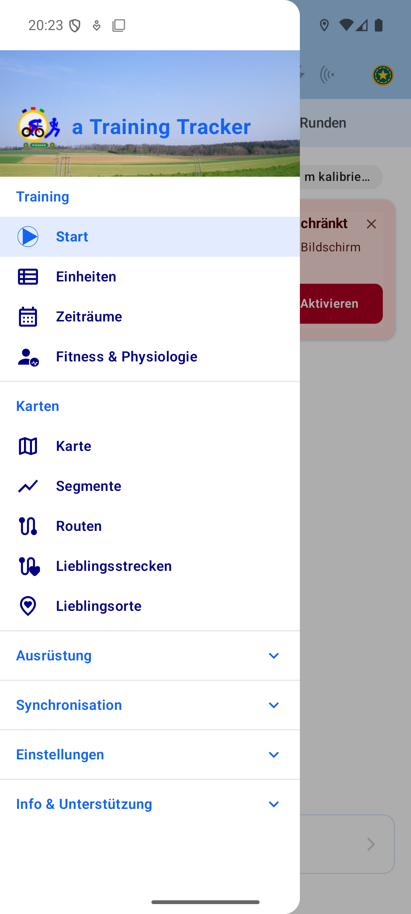
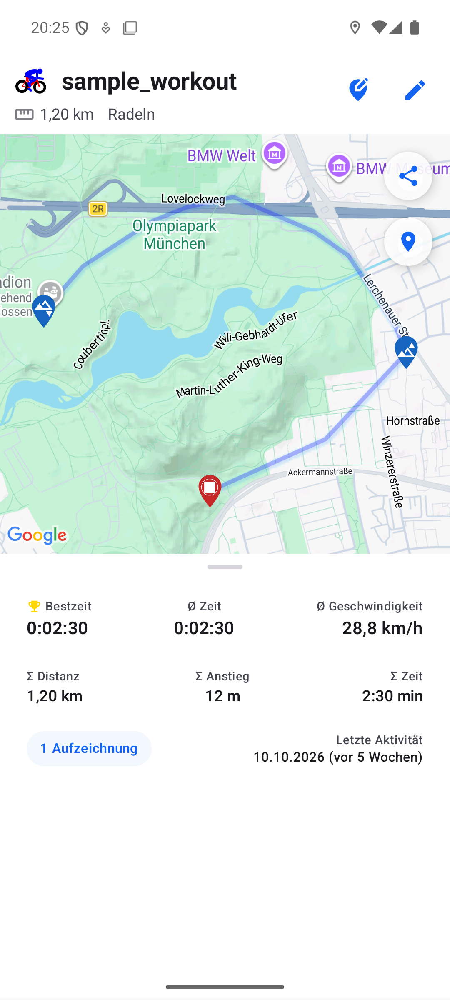

# Stage 5: Walkthrough & Verification - ATT-8326: Executable/Attested Verification for Maps & Navigation (7 TSTs)

**Ticket**: `ATT-8326` (`1 SP`) | **Parent Epic**: `ATT-8138` | **Target Release**: `V5.0.0` | **Active Sprint**: `2026-11-18_02_Spät`  
**Requirement Mapping**: `REQ-SET-050`, `REQ-UI-112`, `REQ-SET-051`, `REQ-SET-053`, `REQ-SET-054`, `REQ-MAP-016`, `REQ-MAP-018`  
**Test Mapping**: `TST-NAV-001`, `TST-NAV-002`, `TST-NAV-003`, `TST-NAV-005`, `TST-NAV-006`, `TST-MAP-010`, `TST-MAP-020`  
**Branch**: `feature/ATT-8326` | **Status**: `Verified` | **Date**: 2026-11-18

---

## 1. Executive Summary & Verification Overview
* Replaced the 7 unbacked `[Implemented]` Maps & Navigation test specs from `ATT-8145` with deterministic `createComposeRule()` / Robolectric / JVM tests (`ATT-8198` compliant: 0 `Class.forName("...Kt")` stubs under `ui/`, 0 `src/main` file reads) and extracted `@VisibleForTesting resolveZoomAdaptiveStyling(currentZoom)` in `MapContentScope.kt` (`612` LoC) without mutating production behavior.
* **Evidence Reuse (`Rule 7.5`)**: Zero source or test code edits occurred post-Gate 4 `PASS`; Stage 4 JUnit XML results (`36/36` passing) are reused directly alongside `emulator-5554` debug verification.

## 2. Requirement & Test Verification Matrix
| Requirement | Test Spec | Verification Method | Result | Status in `tst_maps_navigation.md` |
| :--- | :--- | :--- | :--- | :--- |
| `REQ-SET-050` | `TST-NAV-001` | Compose UI (`createComposeRule()`) + Unit (`NavigationDrawerAndDialogContractTest`) | **PASSED (2/2)** | `Verified` |
| `REQ-UI-112` | `TST-NAV-002` | Compose UI EN/DE (`createComposeRule()`, `NavigationDrawerAndDialogContractTest`) | **PASSED (2/2)** | `Verified` |
| `REQ-SET-051` | `TST-NAV-003` | Compose UI + Route (`createComposeRule()`, `NavigationDrawerAndDialogContractTest`) | **PASSED (1/1)** | `Verified` |
| `REQ-SET-053` | `TST-NAV-005` | Compose UI + Prefs (`createComposeRule()`, `UnitsSettingsDialogTest`) | **PASSED (2/2)** | `Verified` |
| `REQ-SET-054` | `TST-NAV-006` | Compose UI + Prefs (`createComposeRule()`, `ExportSettingsDialogTest`) | **PASSED (2/2)** | `Verified` |
| `REQ-MAP-016` | `TST-MAP-010` | Unit/Robolectric (`MapHeatmapZoomAndDetailTest` + `PolylineHeatmapTileProviderTest`) | **PASSED (18/18)** | `Verified` |
| `REQ-MAP-018` | `TST-MAP-020` | Robolectric Tile (`13..18`, alpha `<= 180/255`) + `emulator-5554` GL Check | **PASSED (1/1 + GL)** | `Verified` |
| `REQ-PRO-132`, `REQ-PRO-049` | `TST-PRO-132`, `TST-PRO-049` | Contract Audits (`UiReflectionOnlyTestAuditContractTest`, `SourceTextReadingAuditContractTest`) | **PASSED (8/8)** | `Verified` |

## 3. Automated Test Evidence (Tier 1 Targeted Suite — Stage 4 Reuse)
* Command: `python3 tools/parallel_sprint_lock.py ./gradlew :app:testDebugUnitTest --tests "com.atrainingtracker.trainingtracker.ui.navigation.NavigationDrawerAndDialogContractTest" --tests "com.atrainingtracker.trainingtracker.ui.settings.units.UnitsSettingsDialogTest" --tests "com.atrainingtracker.trainingtracker.ui.settings.export.ExportSettingsDialogTest" --tests "com.atrainingtracker.trainingtracker.ui.map.MapHeatmapZoomAndDetailTest" --tests "com.atrainingtracker.trainingtracker.ui.map.PolylineHeatmapTileProviderTest" --tests "com.atrainingtracker.trainingtracker.build.UiReflectionOnlyTestAuditContractTest" --tests "com.atrainingtracker.trainingtracker.build.SourceTextReadingAuditContractTest"`
* Result: `BUILD SUCCESSFUL in 1m 34s` — **36/36 tests passed, 0 failed, 0 skipped** (`NavigationDrawerAndDialogContractTest`: 5/5, `UnitsSettingsDialogTest`: 2/2, `ExportSettingsDialogTest`: 2/2, `MapHeatmapZoomAndDetailTest`: 2/2, `PolylineHeatmapTileProviderTest`: 17/17, `UiReflectionOnlyTestAuditContractTest`: 4/4, `SourceTextReadingAuditContractTest`: 4/4).
* *Scope Note*: Tier 1 targeted execution only; full-repo suite and static analyzers run at Tier 2 `Schichtwechsel` (`Rule 7.5`).

## 4. Emulator Verification (`emulator-5554`, `Pixel_8_Android_15`)
* **Install & Launch**: `ANDROID_SERIAL=emulator-5554 python3 tools/parallel_sprint_lock.py ./gradlew installDebug` (`BUILD SUCCESSFUL`), launched `com.atrainingtracker.debug/com.atrainingtracker.trainingtracker.activities.MainActivityWithNavigation`.
* **Drawer & Live Heatmap GL Check (`TST-MAP-020.2`)**: Opened navigation drawer (`ATT-8326_drawer.png`: verified German sections `Training`, `Karten`, `Ausrüstung`, `Synchronisation`, `Einstellungen`, `Info & Unterstützung`), navigated via `Zeiträume` -> `sample_workout` -> `WorkoutClusterHeatmapScreen` (`ATT-8326_cluster_heatmap.png`: verified translucent blue heatmap `TileOverlay` visible at street-level zoom with road/park labels legible underneath). `adb -s emulator-5554 logcat -b crash -d` returned 0 crashes.
* **UI Consistency**: No UI changes (`Rule 8.5` visual inspection completed via `read_file` on both PNGs).

| Navigation Drawer (`ATT-8326_drawer.png`) | Cluster Heatmap (`ATT-8326_cluster_heatmap.png`) |
| :---: | :---: |
|  |  |

## 5. Invariant & Governance Verification
1. **Living Documentation Synchronized**: All 7 TSTs promoted to `[Verified]` with `- **Code**:` pointers in `docs/tests/tst_maps_navigation.md` (`v1.0.5`), `docs/tests.md` synced via `verify_requirement_governance.py --sync-indexes`, and `--check-verified-evidence` passes for all 7 `ATT-8326` TSTs (only pre-existing unrelated `TST-TRK-087` flagged globally).
2. **Feature Branch Intact**: Committed cleanly on `feature/ATT-8326` (unmerged onto `sprint/2026-11-18_02_Spät` pending Stage 6 Cold Review); 4 pre-existing dirty `tools/` files untouched.
3. **Human Gate Preserved**: Parent ticket advances only to `Final Review (Agent)` -> `Final Review (Human)`.
