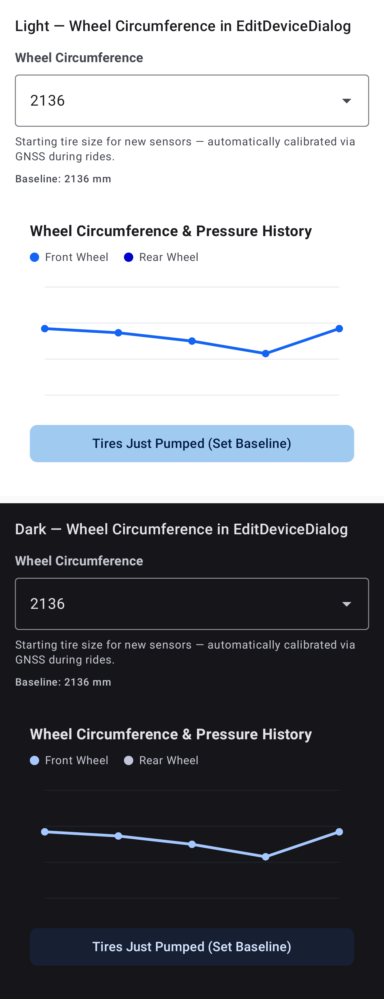

# Stage 5: Verification & Walkthrough - ATT-8422: EditDeviceDialog (Rad-Sensor) Calibration UI Cleanup & WheelCircumferenceHistoryChart Embedding

**Ticket**: `ATT-8422` (`2 SP`, `Verbesserung`, `Priority: Medium`) | **Parent Epic**: `ATT-166` | **Target Release**: `V5.0.0`  
**Active Sprint**: `2026-11-20_01_Früh` (`465`) | **Branch**: `feature/ATT-8422` (preserved unmerged for Stage 6 Cold Final Review)  
**Verified Production SHA (Gate 4 Bounce 1 `ATT-9275`)**: `c4bdc03c` (`git diff c4bdc03c..HEAD -- app/` = EMPTY, `Rule 7.5` doc-only Stage 5 Bounce 1)  
**Requirement / Test IDs**: `REQ-SEN-033` (`REQ-SEN-033.1`–`.3`) [Verified] ↔ `TST-SEN-033` (`TST-SEN-033.1`–`.3`) [Verified]  
**Author**: AI Agent 1 (`agent1`, Pro/Neon) | **Date**: 2026-11-20

---

## 1. Delivered Functionality & Acceptance Criteria Verification

1. **Bike-Sensor Known-Distance Calculator Removal, Initial Tire-Size Preset & Auto-Calibration Hint (`REQ-SEN-033.1` / `TST-SEN-033.1`)**:
   * Extracted pure stateless `WheelCircumferenceSection` (`WheelCircumferenceSection.kt`, `168` LoC) from `EditDeviceDialog.kt` (shrinking `EditDeviceDialog.kt` from **`1,843 -> 1,774 / 2,004` LoC**, `-69` LoC downward ratchet).
   * Removed `Icons.Default.Calculate` and `CorrectCalibrationDialog` invocation from wheel-capable bike sensors (`BIKE_SPEED`, `BIKE_SPEED_AND_CADENCE`, wheel-capable `BIKE_POWER`) while strictly preserving `RunCalibrationFactorContent` + `CorrectCalibrationDialog` for `RUN_SPEED` footpods.
   * Retained the Material 3 `ExposedDropdownMenuBox` (`ExposedDropdownMenuAnchorType.PrimaryEditable`, zero compiler warnings) tire-size preset picker (`700 x 28` etc.) and numeric mm input, added localized GNSS auto-calibration hint (`devices_wheel_circumference_auto_hint`), and replaced hardcoded `"Baseline: $baselineMm mm"` with localized `devices_wheel_baseline_format` using `(it * 1000.0).roundToInt()` (eliminating IEEE-754 `2.010 m -> 2009 mm` truncation) across all 9 locales.
   * *Proof*: `EditDeviceWheelCircumferenceTest.testWheelCircumferenceSection_removesBikeCalculatorPreservesPresetsAndAutoHint_tstSen033_1`, `EditDeviceWheelCircumferenceTest.testRunCalibrationFactorContent_preservesKnownDistanceCalculator_tstSen033_1`, & `EditDeviceWheelCircumferenceTest.testBaselineCircumferenceRounding_avoidsIeee754TruncationAt2010mm_tstSen033_1`.
2. **Per-Sensor Chronological History Query, Unlinked Fallback & Async Baseline Sync (`REQ-SEN-033.2` / `TST-SEN-033.2`)**:
   * Added `EquipmentRepository.getCircumferenceHistoryForDevice(deviceId)` (scoping each linked bike's history by assigned `WheelPosition` or all bike records when `UNSPECIFIED`, merged and sorted strictly `timestampMs ASC`, returning `emptyList()` for unlinked sensors) and `recordManualBaselineResetForDevice(deviceId, circumferenceMm, timestampMs)`.
   * Extended `DeviceDataRepository.resetTirePressureBaseline(deviceId, circumferenceMm: Int? = null)` to persist edited draft circumference + baseline atomically to `Devices.db` and broadcast `CALIBRATION_FACTOR_CHANGED` (`0` edits to `DevicesDatabaseManager.java` or `EquipmentDbHelper.java`).
   * Updated `EditDeviceViewModel` (keeping public 1-arg constructor, injecting `ioDispatcher = Dispatchers.IO` + `EquipmentRepository`, clearing stale `_wheelCircumferenceHistory` on `loadInitialDeviceData()`, and syncing both `Devices.db` and `WheelCircumferenceHistory` on `resetTirePressureBaseline()`).
   * *Proof*: `EditDeviceWheelCircumferenceTest.testEquipmentRepository_getCircumferenceHistoryForDeviceAndManualReset_tstSen033_2` & `EditDeviceWheelCircumferenceTest.testEditDeviceViewModel_asyncHistoryLoadStaleClearAndDraftBaselineSync_tstSen033_2`.
3. **Embedded `WheelCircumferenceHistoryChart`, `UNSPECIFIED` Fallback, Unified Baseline Reset & 9-Locale Parity (`REQ-SEN-033.3` / `TST-SEN-033.3`)**:
   * Enhanced `WheelCircumferenceHistoryChart` with wrapping `FlowRow` legends (preventing 3-legend overflow on narrow `280 dp` / `360 dp` localized dialogs), optional `emptyStateText` (`devices_wheel_history_empty` in `EditDeviceDialog`, preserving `equipment_tpms_no_history` default in `EditEquipmentDialog`), and conditional `WheelPosition.UNSPECIFIED` curve + legend (`equipment_tpms_unspecified_legend`) rendered strictly when `unspecifiedRecords.isNotEmpty()`.
   * Eliminated the duplicate standalone `OutlinedButton`, consolidating onto the chart's single `wheel_circumference_reset_baseline_button`, and synchronized 18 XML files across all 9 active locales (`values`, `de`, `es`, `fr`, `it`, `ja`, `nl`, `pl`, `pt`: +4 added strings, -4 removed obsolete bike-only strings).
   * *Proof*: `EditDeviceWheelCircumferenceTest.testWheelCircumferenceHistoryChart_unspecifiedLegendAndSensorEmptyState_tstSen033_3`, `EditDeviceWheelCircumferenceTest.testLightDarkWheelCircumferenceSection_renderAndCapturePng_rule85_tstSen033_3`, `EditDeviceWheelCircumferenceTest.testNarrow280dpThreeLegendFlowRow_wrapsWithoutClippingOrZeroWidth_tstSen033_3`, and `TranslationParityTest` (`11/11` PASS).

---

## 2. Rule 8.5 Visual Certification (Light & Dark Mode)

* Visually inspected in both Light and Dark Material 3 themes (`docs/engineering/walkthroughs/img/ATT-8422_wheel_circumference_edit_device.png`, `193 KB`): full-width tire-size dropdown (`2136`) with zero calculator icon, crisp 2-line GNSS auto-calibration hint, localized `Baseline: 2136 mm` readout, embedded `Wheel Circumference & Pressure History` chart with clean Front/Rear legend and smooth pressure-drop/pump-up curve, and a single consolidated `Tires Just Pumped (Set Baseline)` button with zero clipping or contrast defects.

---

## 3. Independent Verification Evidence (`Rule 7.5` Reuse of Gate 4 Bounce 1 `ATT-9275` on `c4bdc03c`)

Zero files under `app/` were modified after Gate 4 Bounce 1 verified commit `c4bdc03c` (`git diff c4bdc03c..HEAD -- app/` is empty).

| Verification Suite / Check | Scope | Result |
| :--- | :--- | :--- |
| `EditDeviceWheelCircumferenceTest` (`app/src/test/java/com/atrainingtracker/banalservice/ui/devices/editdevice/EditDeviceWheelCircumferenceTest.kt`) | `TST-SEN-033.1`, `TST-SEN-033.2`, `TST-SEN-033.3`, Bounce 1 `roundToInt` & `FlowRow` regressions + Rule 8.5 PNG capture | **8/8 PASS** |
| `EditDeviceEquipmentWheelPositionTest` (`app/src/test/java/com/atrainingtracker/banalservice/ui/devices/editdevice/EditDeviceEquipmentWheelPositionTest.kt`) | `TST-SEN-031` `EditDeviceDialog` wheel-position non-regression | **5/5 PASS** |
| `EditDeviceDialogWheelGuidanceTest` (`app/src/test/java/com/atrainingtracker/banalservice/ui/devices/editdevice/EditDeviceDialogWheelGuidanceTest.kt`) | `TST-SEN-029` wheel guidance non-regression | **2/2 PASS** |
| `WheelCircumferenceHistoryChartTest` (`app/src/test/java/com/atrainingtracker/trainingtracker/ui/equipment/WheelCircumferenceHistoryChartTest.kt`) | `TST-SEN-030.4` chart contract & `EditEquipmentDialog` parity | **3/3 PASS** |
| `WheelCircumferenceHistoryDbTest` (`app/src/test/java/com/atrainingtracker/trainingtracker/database/WheelCircumferenceHistoryDbTest.kt`) | `TST-SEN-030.3` SQLite v5 history schema & cascade non-regression | **4/4 PASS** |
| `TranslationParityTest` (`app/src/test/java/com/atrainingtracker/trainingtracker/localization/TranslationParityTest.kt`) | `TST-LOC-001` 9-locale parity (`values`, `de/es/fr/it/ja/nl/pl/pt`) | **11/11 PASS** |
| `ArchitectureConformanceContractTest` (`app/src/test/java/com/atrainingtracker/trainingtracker/build/ArchitectureConformanceContractTest.kt`) | LoC ceilings (`EditDeviceDialog.kt = 1,774 / 2,004`), `0` monolith edits, `REQ-PRO-050` | **11/11 PASS** |
| `DeadCodeEliminationContractTest` (`app/src/test/java/com/atrainingtracker/trainingtracker/build/DeadCodeEliminationContractTest.kt`) | Dead-code & unused component elimination | **5/5 PASS** |
| `UiReflectionOnlyTestAuditContractTest` (`app/src/test/java/com/atrainingtracker/trainingtracker/build/UiReflectionOnlyTestAuditContractTest.kt`) | `REQ-PRO-132` (`0` new reflection-only UI tests) | **4/4 PASS** |
| `SourceTextReadingAuditContractTest` (`app/src/test/java/com/atrainingtracker/trainingtracker/build/SourceTextReadingAuditContractTest.kt`) | `REQ-PRO-049.1` (`0` new `src/main` reads) | **6/6 PASS** |
| `SystemLiveTrackingRequirementsContractTest` (`app/src/test/java/com/atrainingtracker/trainingtracker/build/SystemLiveTrackingRequirementsContractTest.kt`) | `SYSREQ-TRK-001`/`010` traceability parity | **4/4 PASS** |
| **Total Unit & Contract Suites (`--rerun`)** | **11 suites + `:app:compileDebugKotlin` GREEN (`0` Kotlin compiler warnings across all `ATT-8422` production & test files)** | **63/63 PASS** (`0` fail, `0` err, `0` skip) |
| **Python Safety Linters (4/4)** | `check_secrets_hygiene.py`, `lint_cursor_safety.py`, `lint_lifecycle_safety.py`, `lint_safe_enum.py` | **4/4 PASS (`exit 0`)** |
| **Governance & Clean-Checkout Evidence** | `verify_requirement_governance.py --base-ref` & `--check-verified-evidence` (empty test dir) | **PASS (`exit 0`)** |

---

## 4. Architecture, LoC Budget & Branch Preservation
* `EditDeviceDialog.kt`: **`1,774 / 2,004` LoC** (**-69 LoC reduction** from `1,843`), `WheelCircumferenceSection.kt`: `168 / 1,500`, `EditDeviceViewModel.kt`: `429 / 1,500`, `DeviceDataRepository.kt`: `738 / 1,500`, `EquipmentRepository.kt`: `315 / 1,500`, `WheelCircumferenceHistoryChart.kt`: `298 / 1,500`.
* Protected Monoliths: **`0` LoC touched** (`DevicesDatabaseManager.java`, `EquipmentDbHelper.java`, `DeviceManager.java`, `TrackerService.java`, `BANALServiceRepository.kt` strictly untouched; `ATT-8421` boundary respected).
* Database schema migrations: `0` | 9-locale localization parity: **100% PASS** (`11/11` `TranslationParityTest`).
* **Branch Preservation**: `feature/ATT-8422` preserved intact and unmerged for Stage 6 Cold Final Review (`--merge-ticket` deferred strictly post-Stage 6 PASS).
