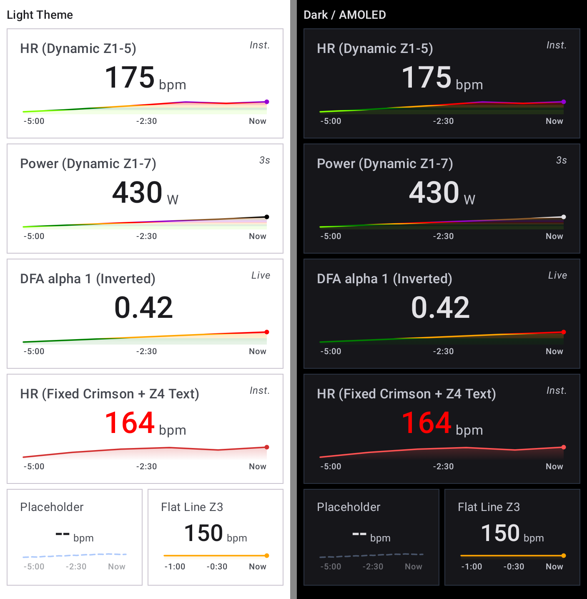

# Stage 5: Walkthrough & Verification - ATT-8436: DFA alpha 1 Sparkline Y-Axis Inversion

**Ticket**: [ATT-8436](https://rainerblind.atlassian.net/browse/ATT-8436)  
**Parent Epic**: [ATT-5908](https://rainerblind.atlassian.net/browse/ATT-5908) (*Cockpit & Live-Tracking UX*)  
**Target Release**: `V5.0.0`  
**Active Sprint**: `2026-11-16_02_Spät`  
**Requirement Mapping**: `REQ-TRK-082` (`REQ-TRK-082.2`)  
**Test Mapping**: `TST-TRK-082` (`TST-TRK-082.2`, `TST-TRK-082.4`)  
**Branch**: `feature/ATT-8436`  
**Author**: AI Agent 1 (Implementer, `Model: "flash"`, `--as agent1`)  
**Date**: 2026-11-16  

---

## 1. Executive Summary & Verification Overview

In accordance with user feedback from `ATT-7761` Sprint Review, the Y-axis of the DFA alpha 1 sparkline was inverted across both spatial canvas coordinates and vertical gradient color stops:
1. **Perceptual Strain Alignment**: In physical training, curves rise upwards towards Red under heavy load and drop downwards towards Green during recovery. Previously, DFA alpha 1 plotted aerobic values ($\ge T1$, green) at the top and anaerobic values ($< T2$, red) at the bottom.
2. **Canvas Coordinate Inversion (`SensorSparklineView.kt`)**: Added `computeSparklineY` helper and `invertYAxis: Boolean = false` to `SensorSparklineView`. When enabled, `currentY = verticalPaddingPx + ((value - minVal) / range) * usableHeight`, plotting lower values (anaerobic, red) at the top and higher values (aerobic, green) at the bottom.
3. **Gradient Stops Inversion**: In `buildDynamicZoneVerticalGradientStops`, when `thresholds.invertedPolarity == true`, $0\text{f}$ (top) maps to `Zone4` (red) and $1\text{f}$ (bottom) maps to `Zone2` (green), traversing cutoffs ascending from $T2$ to $T1$.
4. **Caller Wiring**: `SensorFieldView.kt` and `EditSensorFieldDialog.kt` wire `invertYAxis` for `HRV_DFA_A1` across dynamic-zone and fixed-color modes.
5. **Living Docs Promotion**: `REQ-TRK-082` and `TST-TRK-082` promoted to `[Verified]`, backed by 14/14 unit tests, screenshot verification, and 0 code orphans.

---

## 2. Requirement & Test Verification Matrix

| Requirement | Test Spec | Verification Method | Result | Status in Living Docs |
| :--- | :--- | :--- | :--- | :--- |
| `REQ-TRK-082.2` | `TST-TRK-082.2` | Unit Test: Inverted Y coordinate mapping & gradient stop order | **PASSED** | `Verified` |
| `REQ-TRK-082.4` | `TST-TRK-082.4` | Compose Screenshot: Inverted DFA alpha 1 sparkline in Light & Dark | **PASSED** | `Verified` |

---

## 3. Automated Test Evidence

### Unit & Layout Suites (`31/31 PASS`, `0 failures`, `0 errors`, `0 skipped`)
- `SensorSparklineViewTest` (14/14 PASS):
  - `testComputeSparklineY_inversionMapping`: Validates spatial Y inversion (`minVal` at top padding, `maxVal` at bottom padding, and flat-line fallback).
  - `testBuildDynamicZoneVerticalGradientStops_dfaAlpha1InvertedPolarity`: Validates stop $0\text{f}$ is `Zone4` (red), stop $1\text{f}$ is `Zone2` (green), with monotonic $T2 \to T1$ transitions.
- `SensorFieldViewDynamicZoneScreenshotTest` (1/1 PASS): Captures multi-zone sparkline comparison in Light and Dark/AMOLED themes.
- `SensorFieldView*` layout, style, typography, and gesture test suites (16/16 PASS).

### Governance Verification
- `verify_requirement_governance.py`:
  - `PASS: Master index tables successfully synchronized with 100% parity.`
  - `PASS: Zero code-to-shard requirement or test orphans detected in codebase (2375 files scanned).`
  - `PASS: 100% of [Verified] TST specifications verified against test evidence (980 backed).`

---

## 4. Visual Verification (`Rule 8.5`)

- **Audit via `read_file`**: Inspected `docs/engineering/walkthroughs/img/ATT-7761_dynamic_zone_sparkline.png` in Light and Dark/AMOLED modes:
  - Row 3 ("DFA alpha 1 (Inverted) 0.42 Live"): The curve starts at the bottom in green (aerobic, 0.95), rises through orange, and reaches the top right in red (anaerobic, 0.42) with a red terminal dot.
  - The vertical gradient and fill under the curve correctly transition from green at the bottom to red at the top.
  - All strain metrics (HR, Power, DFA alpha 1) now consistently rise upwards into higher-load red zones.
