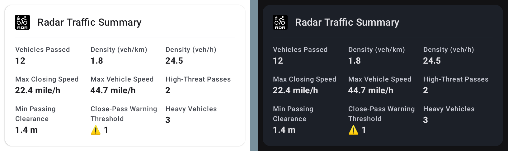

# Stage 5: Walkthrough & Verification - ATT-8440: RadarTrafficSummaryCard Canonical Speed Units

**Ticket**: [ATT-8440](https://rainerblind.atlassian.net/browse/ATT-8440) | **Epic**: [ATT-1286](https://rainerblind.atlassian.net/browse/ATT-1286) (*Cycling Rearview Radar*)  
**Target Release**: `V5.0.0` | **Branch**: `feature/ATT-8440` | **Stage 4 Commit**: `52e3c45b` (rebased onto `sprint/2026-11-17_01_Früh` @ `1750ab64`)  
**Requirement Mapping**: `REQ-UI-2784` (`REQ-UI-2784.1`, `REQ-UI-2784.2`, refining `REQ-RAD-005` & `Rule 36`)  
**Test Mapping**: `TST-UI-2784` (`TST-UI-2784.1`..`TST-UI-2784.4`)

---

## 1. Executive Summary & Implemented Changes
1. **Canonical Speed Formatting (`RadarTrafficSummaryCard.kt` `L59`, `L133`, `L140`)**:
   - Replaced hardcoded `String.format(locale, "%.1f km/h", summary.maxApproachSpeedMps * 3.6)` and `String.format(locale, "%.1f km/h", summary.maxVehicleSpeedMps * 3.6)` with `LocalMetricFormatter.current.speed.format_with_units(...)` (`MetricFormatterContext.kt:32-41`, `SpeedFormatter.kt:26-46`, `MyHelper.mps2userUnit()`), displaying `km/h` under `MyUnits.METRIC` and `mile/h` under `MyUnits.IMPERIAL`.
   - Preserved `if (summary == null || summary.totalVehicles <= 0) return` (`L57`), non-speed metrics (`vehiclesPerKm` `L112`, `vehiclesPerHour` `L119`, `minPassingDistanceM` `L158`), sole caller `WorkoutDetailTabbedContent.kt:932`, and out-of-scope `RadarTrafficSummaryFormatter.kt` (`REQ-RAD-007`).
2. **Robolectric Compose Verification (`RadarTrafficSummaryCardTest.kt`)**:
   - Added 5 Robolectric Compose UI tests covering `MyUnits.METRIC` (`36.0 km/h` / `72.0 km/h`), `MyUnits.IMPERIAL` (`22.4 mile/h` / `44.7 mile/h`, zero `km/h` nodes), null/zero guard, non-speed metric preservation, and Light/Dark PNG rendering (`TrainingApplication.setUnitForTesting(null)` reset in `@After`).

---

## 2. Visual Verification (`Rule 8.5`)
Inspected `docs/engineering/walkthroughs/img/ATT-8440_summary_card_preview.png` via `read_file`:

* Side-by-side Light and Dark `ATrainingTrackerTheme` captures under `MyUnits.IMPERIAL` confirm crisp contrast, single-line `22.4 mile/h` and `44.7 mile/h` cells with zero truncation/clipping, aligned 3-column grid rows, and intact non-speed metrics (`12`, `1.8`, `24.5`, `2`, `1.4 m`, `1`, `3`).

---

## 3. Requirement & Test Verification Matrix
* **Tier 1 Targeted Execution** (`./gradlew :app:testDebugUnitTest --tests "*RadarTraffic*" --tests "*SpeedFormatterTest*" --tests "*TrackOnMap*" --tests "*WorkoutDetail*" :app:compileDebugAndroidTestKotlin --max-workers=2` on rebased tree): **105/105 PASSED** (`0` failed, `0` errors, `0` skipped across 19 test classes) + `:app:compileDebugAndroidTestKotlin` **PASSED**. Full-repo Tier 2 suite deferred to Sprint Integration Gate.

| Requirement | Test Spec | Verification Class & Measured Scope | Result | Living Docs |
| :--- | :--- | :--- | :--- | :--- |
| `REQ-UI-2784.1`, `REQ-UI-2784.2` | `TST-UI-2784.1`..`TST-UI-2784.3` | `RadarTrafficSummaryCardTest` (`5/5`: Metric, Imperial, guard, non-speed, Light/Dark PNG) | **PASSED** | `Verified` |
| `REQ-UI-2784.1` | `TST-UI-2784.4` | `SpeedFormatterTest` (`3/3`) + `RadarTrafficSummaryTest` (`6/6`) + `RadarTrafficSummaryFormatterTest` (`6/6`) + `RadarTrafficSimulatorTest` (`14/14`) | **PASSED** | `Verified` |
| Caller & Aftermath Guard | `TST-UI-2784.4` | `TrackOnMap*` (`24/24` across 8 classes) + `WorkoutDetail*` (`47/47` across 6 classes) | **PASSED** | `Verified` |

---

## 4. Invariant & Governance Verification
1. **Living Documentation**: `REQ-UI-2784` & `TST-UI-2784` promoted to `[Verified]`; `python3 tools/verify_requirement_governance.py --check-specs --text-file docs/engineering/walkthroughs/ATT-8440_walkthrough.md` **PASSED** (exit `0`; Total REQs `1207`, Verified `970`; Total TSTs `1214`, Verified `999`; zero unmounted Composable islands; zero repository encapsulation violations).
2. **Submodule & Scope Hygiene**: `ANT-Android-SDKs` untouched (`0e8cea714a231fb9565170d4ed01eafa868f9798`); zero SQLite/DTO/string edits.
