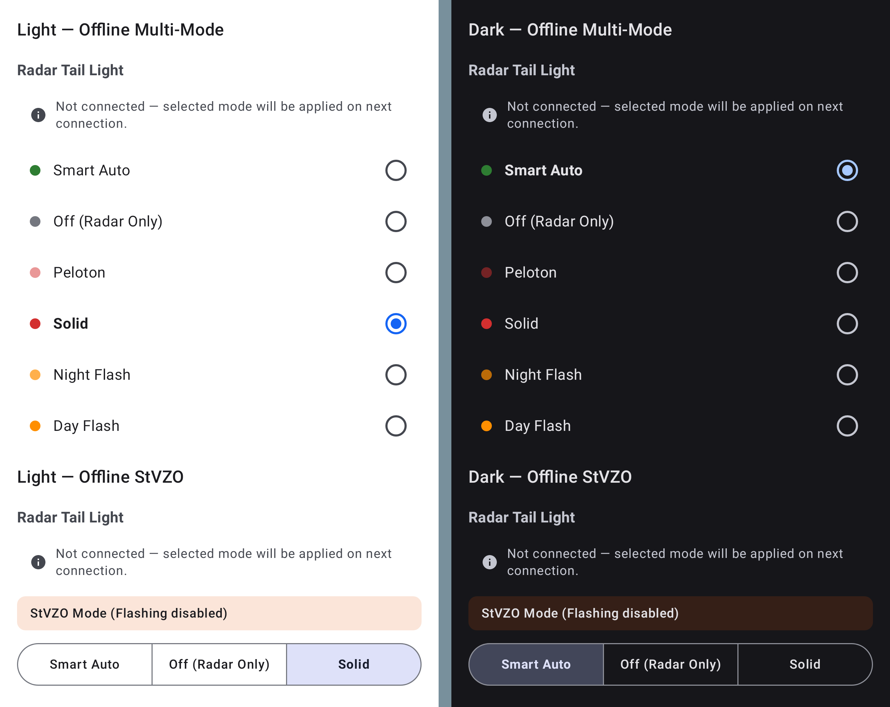

# Stage 5: Walkthrough & Verification - ATT-8450: Offline `EditDeviceDialog` Radar Tail Light Configuration

**Ticket**: [ATT-8450](https://rainerblind.atlassian.net/browse/ATT-8450) | **Epic**: [ATT-1286](https://rainerblind.atlassian.net/browse/ATT-1286) (*Cycling Rearview Radar*)  
**Target Release**: `V5.0.0` | **Branch**: `feature/ATT-8450` | **Rebased Base**: `f220434b` (`sprint/2026-11-17_02_Spät`)  
**Requirement Mapping**: `REQ-CON-048` (`REQ-CON-048.1`..`REQ-CON-048.4`), `REQ-CON-031.5`, `REQ-CON-031.7`, `REQ-CON-047.3`  
**Test Mapping**: `TST-CON-048` (`TST-CON-048.1`..`TST-CON-048.4`), `TST-CON-031.5`

---

## 1. Executive Summary & Implemented Changes
1. **Cold-Start Hydration, Offline `preferredMode` & StVZO Reset (`RadarLightController.kt`)**:
   - Exposed `preferredMode: StateFlow<RadarLightMode>` (`TuningPreferencesDefaults.RADAR_LIGHT_DEFAULT_MODE`), kept synced in `updateCachedPreferences()` and `resolveActiveConfig()`, so offline `setManualLightMode()` highlights the selected mode immediately instead of falling back to `currentMode == OFF`.
   - Added `hydrateFromPreferences()` and `hydrateFromPreferencesAsync()` reading `TuningPreferencesDataStore` on cold start prior to workout start without overwriting in-session selections.
   - Reset `_isStvzo.value = false` in `unregisterRadarDevice()` so disconnected radars do not inherit stale StVZO state.
2. **Offline `RadarLightControlSection` & `@Preview`s (`EditDeviceDialog.kt`)**:
   - Added `isKnownRadarWithoutLight()` (`RVR315` / `RVR 315` exclusion) and `shouldShowRadarLightControlSection()`: keeps `RadarLightControlSection` visible & interactive offline for `DeviceType.BIKE_RADAR` (`RearVue8`), while hiding `RVR315` and live-connected `!isLightControlAvailable` devices.
   - Hydrates preferences via `LaunchedEffect(Unit)`, binds offline highlight to `preferredMode`, displays neutral `surfaceVariant` hint `R.string.radar_light_offline_hint` without spurious StVZO errors when `isStvzo == false`, retains `SingleChoiceSegmentedButtonRow` (`icon = {}`) when `isStvzo == true`, and adds 4 Light/Dark `@Preview`s in `ATrainingTrackerTheme`.
3. **9-Language Localization (`strings_radar.xml`)**: Added `radar_light_offline_hint` across all 9 locales (`values`, `de`, `es`, `fr`, `it`, `ja`, `nl`, `pl`, `pt`).

---

## 2. Visual Verification (`Rule 8.5`)
Inspected `docs/engineering/walkthroughs/img/ATT-8450_radar_offline_edit_device.png` via `read_file`:

* Side-by-side Light & Dark Robolectric Compose captures (`w920dp-h1200dp-xxhdpi`) confirm zero clipping/ellipsizing across Multi-Mode (`Smart Auto`, `Off (Radar Only)`, `Peloton`, `Solid`, `Night Flash`, `Day Flash`) and StVZO (`Smart Auto`, `Off (Radar Only)`, `Solid`), crisp neutral `surfaceVariant` offline hint (`Info` icon), zero spurious StVZO notice in Multi-Mode, and accurate selection highlights (`Solid` Light, `Smart Auto` Dark).

---

## 3. Requirement & Test Verification Matrix
* **Post-Rebase Verification (`:app:assembleDebug` + Targeted Suites under `parallel_sprint_lock.py`)**: **BUILD SUCCESSFUL**, **213/213 PASSED** (`0` failures, `0` errors, `0` skipped across 23 test classes; full Tier 2 lint/detekt/all-module suite deferred to Sprint Integration Gate).

| Requirement | Test Spec | Verified Class & Measured Scope | Result | Living Docs |
| :--- | :--- | :--- | :--- | :--- |
| `REQ-CON-048.1`, `.3`, `.4` | `TST-CON-048.1`, `.3` | `EditDeviceDialogRadarLightTest` (`4/4`: offline visibility, `RVR315` guard, Multi-Mode/StVZO, Light/Dark PNG) | **PASSED** | `Verified` |
| `REQ-CON-048.2` | `TST-CON-048.2` | `RadarLightControllerTest` (`39/39`: offline `preferredMode`, cold hydration, `_isStvzo` disconnect reset) | **PASSED** | `Verified` |
| `REQ-CON-048.4`, `REQ-CON-031.7` | `TST-CON-048.4` | `TranslationParityTest` (`10/10`: 9-locale `strings_radar.xml` parity) | **PASSED** | `Verified` |
| Cross-Caller & Contracts | `TST-CON-031.5` | `EditDeviceDialog*`/`ViewModel` (`18/18`), `Radar*` (`111/111`), `ModalBottomSheet`/`Theme`/`Polish`/`DataStore` (`31/31`) | **PASSED** | `Verified` |

---

## 4. Invariant & Governance Verification
1. **Living Documentation**: `REQ-CON-048` and `TST-CON-048` promoted to `[Verified]` (`DOC-REQ-TRK` & `DOC-TST-TRK` `1.0.3`); `--sync-indexes` synced `docs/requirements.md` (`Total=1225, Verified=981, Implemented=243, Planned=1`) and `docs/tests.md` (`Total=1232, Verified=1010, Implemented=214, Planned=8`).
2. **Governance & Scope Hygiene**: `verify_requirement_governance.py --check-doc-headers --check-commit-hygiene --check-conflict-markers`, full `verify_requirement_governance.py`, and `--text-file` checks verified; zero `src/main` reads in tests (`REQ-PRO-049.1`); `EditDeviceViewModel` draft state decoupled; `ANT-Android-SDKs` untouched at `0e8cea714a231fb9565170d4ed01eafa868f9798`.
