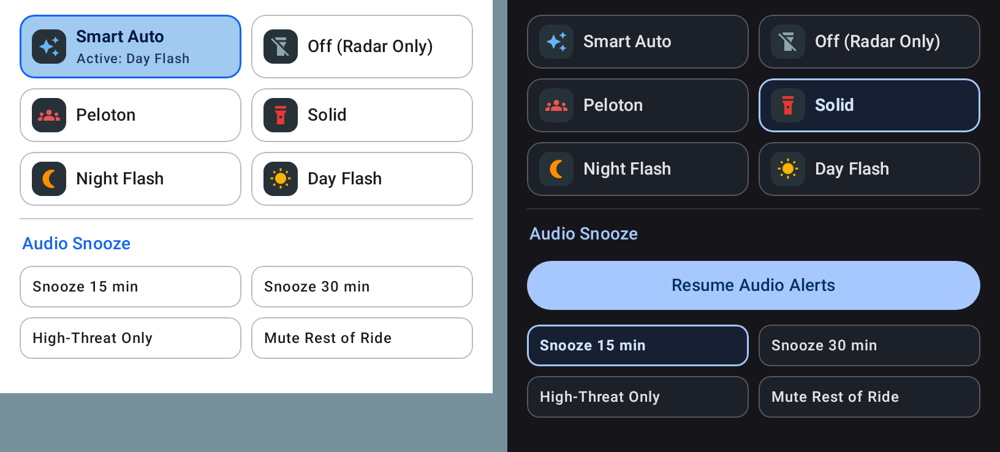

# Stage 5: Walkthrough & Verification - ATT-8456: Compact `RadarLightQuickSwitchSheet` & Ascending Mode Order

**Ticket**: [ATT-8456](https://rainerblind.atlassian.net/browse/ATT-8456) | **Epic**: [ATT-1286](https://rainerblind.atlassian.net/browse/ATT-1286) (*Cycling Rearview Radar*)  
**Target Release**: `V5.0.0` | **Branch**: `feature/ATT-8456` | **Stage 4 Commit**: `f59c3df5a`  
**Requirement Mapping**: `REQ-CON-047` (`REQ-CON-047.1`..`REQ-CON-047.4`), `REQ-CON-031.3`, `REQ-CON-031.8`  
**Test Mapping**: `TST-CON-047` (`TST-CON-047.1`..`TST-CON-047.4`), `TST-CON-031.9`

---

## 1. Executive Summary & Implemented Changes
1. **Ascending-Intensity Mode Order (`RadarLightMode.kt`, `RadarLightController.kt`)**: Reordered `RadarLightMode` entries to `OFF` (0 lm), `PELOTON` (~8 lm), `SOLID` (~25 lm), `NIGHT_FLASH` (~40 lm), `DAY_FLASH` (100 lm), preserving `commandByte`, `titleResId`, `isStvzoCompliant`, and `fromCommandByte()`. Refactored `RadarLightController.cycleNextMode()` to step through `RadarLightMode.getAvailableModes(_isStvzo.value)` (`AUTO -> OFF -> PELOTON -> SOLID -> NIGHT_FLASH -> DAY_FLASH -> AUTO`; StVZO `AUTO -> OFF -> SOLID -> AUTO`), preserving ~400 ms debounce and `ATT-8455` `isAutoMode` invariants. `EditDeviceDialog.kt` consumes `getAvailableModes()` directly.
2. **Shared Button-Matching Icons (`RadarLightButton.kt`)**: Exposed `internal fun resolveLightVisuals()` as the single source of truth for semantic vector icons and contrast colors across `RadarLightButton` and `RadarLightQuickSwitchSheet`.
3. **Compact 2-Column Sheet (`RadarLightQuickSwitchSheet.kt`)**: Replaced the 10 tall `RadioButton` rows in `RadarLightQuickSwitchSheetContent` with deterministic `IntrinsicSize.Min` 2-column rows of `RadarQuickSwitchLightTile()` (with `resolveLightVisuals()` icons) and `RadarQuickSwitchSnoozeTile()` (2×2 snooze grid), retaining all `RadarLightMode_*`/`RadarSnooze_*` testTags and Light/Dark/StVZO `@Preview`s.

---

## 2. Visual Verification (`Rule 8.5`)
Inspected `docs/engineering/walkthroughs/img/ATT-8456_quick_switch_preview.png` via `read_file`:

* Light & Dark comparison confirms equal row heights (`IntrinsicSize.Min`), zero clipping (`<= 480.dp` bounded height with `RadarSnooze_Resume` visible), high-contrast `TTColor.RadarLightContainer` icon pills matching `RadarLightButton`, and crisp selection borders.

---

## 3. Requirement & Test Verification Matrix
* **Tier 1 Targeted Execution** (`./gradlew :app:testDebugUnitTest --tests "*Radar*" --tests "*EditDeviceDialog*" --tests "*TranslationParityTest*" --max-workers=2` on `f59c3df5a`): **344/344 PASSED** (`0` failed, `0` skipped across 40 test classes; full Tier 2 suite deferred to Sprint Integration Gate).

| Requirement | Test Spec | Verification Class & Measured Scope | Result | Living Docs |
| :--- | :--- | :--- | :--- | :--- |
| `REQ-CON-047.1`..`047.4` | `TST-CON-047.1`..`047.4` | `RadarLightQuickSwitchSheetTest` (`9/9`: `<=480dp`, icons, order, Light/Dark PNG) | **PASSED** | `Verified` |
| `REQ-CON-047.2` | `TST-CON-047.1` | `RadarLightButtonContractTest` (`4/4`: `resolveLightVisuals` + ascending order) | **PASSED** | `Verified` |
| `REQ-CON-047.3`, `REQ-CON-031.8` | `TST-CON-047.2`, `TST-CON-031.9` | `RadarLightControllerTest` (`36/36`: ascending cycle + StVZO + debounce) | **PASSED** | `Verified` |
| `REQ-CON-047.4` | `TST-CON-047.3` | `TranslationParityTest` (`10/10`: 9-locale parity) | **PASSED** | `Verified` |
| Cross-Caller & Radar Guard | — | `EditDeviceDialog*`/`EditDeviceViewModelTest` (`11/11`) + Radar suites (`274/274`) | **PASSED** | `Verified` |

---

## 4. Invariant & Governance Verification
1. **Living Documentation**: `REQ-CON-047` & `TST-CON-047` promoted to `[Verified]`; `REQ-CON-031` & `TST-CON-031` `[Verified]`; `python3 tools/verify_requirement_governance.py` and `--text-file` checks PASSED (exit `0`; Total REQs `1204`, Verified `967`; Total TSTs `1207`, Verified `992`).
2. **Submodule & Scope Hygiene**: `ANT-Android-SDKs` untouched (`0e8cea714a231fb9565170d4ed01eafa868f9798`); zero SQLite or XML string edits; StVZO pruning & `Automatik`-first invariant intact.
