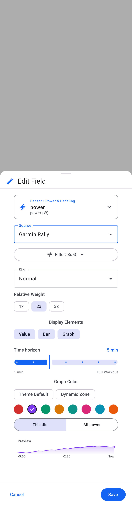
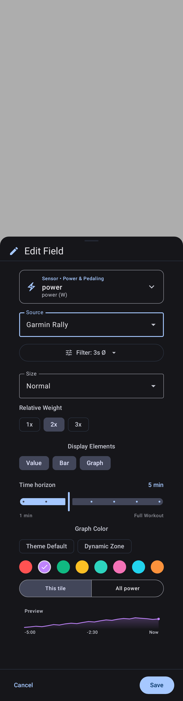

# Stage 5 Walkthrough: ATT-8462 - EditSensorFieldDialog Logical Section Ordering

**Ticket**: [ATT-8462](https://rainerblind.atlassian.net/browse/ATT-8462) | **Parent Epic**: [ATT-5908](https://rainerblind.atlassian.net/browse/ATT-5908) (*Cockpit & Live-Tracking UX*)  
**Target Release**: `V5.0.0` | **Active Sprint**: `2026-11-16_03_Nacht` | **Branch**: `feature/ATT-8462`  
**Requirement Mapping**: `REQ-UI-2782` (`REQ-UI-2782.1`..`REQ-UI-2782.3`)  
**Test Spec Mapping**: `TST-UI-2782` (`TST-UI-2782.1`..`TST-UI-2782.4`)  
**Author**: AI Agent 1 (`--as agent1`) | **Date**: 2026-11-17

---

## 1. Executive Summary & Changes Implemented
Reorganized `EditSensorFieldDialog.kt` (`bb524c6f44afa07cf48d5b25ba83ec33640872e1`) into three cohesive vertical tiers while preserving every visibility guard, ViewModel callback, and modal overlay:
1. **Group 1 — Messdaten (`REQ-UI-2782.1`)**: `SensorTypeSelectorSection` -> `Spinner` (*Quelle*, hidden for single `-1L` device) -> `OutlinedButton` (*Filter / Glättung*, rendered directly between *Quelle* and *Textgröße* when `filteringPossible == true`).
2. **Group 2 — Kachel-Geometrie (`REQ-UI-2782.2`)**: `Spinner` (*Textgröße*) -> *Relative Breite* (`1x` / `2x` / `3x` `FilterChip` row, rendered directly below *Textgröße* when `uiState.isMultiFieldRow == true`).
3. **Group 3 — Visuelle Darstellung & Metrik-Hinweise (`REQ-UI-2782.3`)**: *Anzeigeelemente* (`Wert` / `Balken` / `Graph`) -> expanded Graph block (`uiState.isGraphSupported && uiState.showGraph`: Horizon `Slider`, Color Editor, Scope `SingleChoiceSegmentedButtonRow`, Live `SensorSparklineView` preview) -> Metric guidance (`POWER_TO_WEIGHT`, `INTENSITY_FACTOR`/`TSS`, `isHrvMetric`), plus removal of shadowed `context` (`L309`).

---

## 2. Requirement & Test Verification Matrix

| Requirement | Test Spec | Verification Method | Result | Living Docs |
| :--- | :--- | :--- | :--- | :--- |
| `REQ-UI-2782.1`..`.3` | `TST-UI-2782.1` | Compose UI: `EditSensorFieldDialogOrderTest` (`boundsInRoot().top`) | **PASSED** (2/2 order tests) | `Verified` |
| `REQ-UI-2782.1`..`.3` | `TST-UI-2782.2` | Compose UI: `EditSensorFieldDialogOrderTest` (guards & callbacks) | **PASSED** (2/2 guard/cb tests) | `Verified` |
| `REQ-UI-2782` | `TST-UI-2782.3` | Compose Screenshot: `EditSensorFieldDialogScreenshotTest` (Rule 8.5) | **PASSED** (2/2 Light & Dark) | `Verified` |
| `REQ-UI-2782` | `TST-UI-2782.4` | Targeted Regression + `verify_requirement_governance.py` | **PASSED** (Tier 1 + Governance) | `Verified` |

---

## 3. Automated Test Evidence
* **Stage 5 Targeted Verification** (`./gradlew :app:testDebugUnitTest --tests "*EditSensorField*" --max-workers=2`): **41 / 41 PASSED** (0 failed, 0 skipped):
  - `EditSensorFieldDialogOrderTest`: 4/4 PASSED (vertical `boundsInRoot().top` monotonicity, conditional omissions, metric guidance, callbacks).
  - `EditSensorFieldDialogScreenshotTest`: 2/2 PASSED (Color picker + full Light/Dark dialog captures).
  - `EditSensorFieldDialogSparklineTest`: 7/7 PASSED; `EditSensorFieldViewModelTest`: 28/28 PASSED.
* **Stage 4 Extended Targeted Suite** (`bb524c6f`): **71 / 71 PASSED** (including `SensorCategoryAndSelectorContractTest` 4/4, `TrackingTabsPolishContractTest` 5/5, `ModalBottomSheetDialogsIntegrityTest` 20/20, `PhysiologyModelsVisibilityContractTest` 1/1, and `:app:compileDebugAndroidTestKotlin`).
* **Governance Verification**: `python3 tools/verify_requirement_governance.py --sync-indexes` & `python3 tools/verify_requirement_governance.py` -> **100% PASS** (0 errors, 100% shard/master parity).

---

## 4. Visual Inspection (Rule 8.5)
* **Light & Dark Captures**:  
* Both `ATT-8462_dialog_light.png` (`md5: d373e781b1bbbd85a15abb2d704c02dc`) and `ATT-8462_dialog_dark.png` (`md5: 517a09b4458327965d6d26a2ef9ca1e5`) were inspected directly via `read_file`:
  1. **Orientation & Geometry**: Strict 3-group vertical order (`Sensor -> Source -> Filter` | `Size -> Relative Weight` | `Display Elements -> Time horizon -> Graph Color -> Preview` -> `Cancel / Save`).
  2. **Color Mapping & M3 Artifacts**: Clean Light/Dark contrast, Violet swatch/sparkline consistency, crisp M3 slider tick dots.
  3. **Typography & Wrapping**: All labels render single-line without clipping or ellipsis.
  4. **Touch Ergonomics**: Consistent `12.dp`/`16.dp` spacing and comfortable touch targets.

---

## 5. System Invariants & Hygiene
* Zero ViewModel, repository, SQLite DB, or string resource modifications (9-locale parity preserved).
* `ANT-Android-SDKs` submodule untouched (`0e8cea714a231fb9565170d4ed01eafa868f9798`).
* `REQ-UI-2782` and `TST-UI-2782` promoted to `[Verified]` with master tables synchronized (`docs/requirements.md`, `docs/tests.md`).
