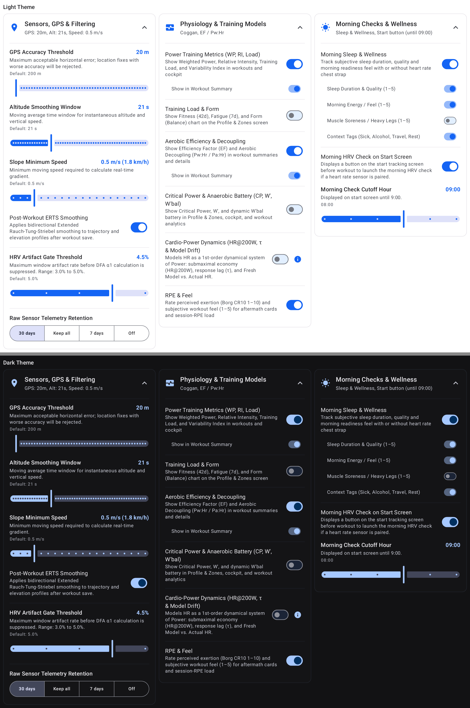

# Stage 5: Walkthrough & Verification - ATT-8468: Remove DFA α1 Info-Card from PhysiologyModelsSection

**Ticket**: [ATT-8468](https://rainerblind.atlassian.net/browse/ATT-8468)  
**Parent Epic**: [ATT-355](https://rainerblind.atlassian.net/browse/ATT-355) (*Global UI & Design System*)  
**Target Release**: `V5.0.0` | **Active Sprint**: `2026-11-16_03_Nacht`  
**Requirement Mapping**: `REQ-SET-113` (`REQ-SET-113.1`, `REQ-SET-113.3`, `REQ-SET-113.4`)  
**Test Mapping**: `TST-SET-115` (`TST-SET-115.1`, `TST-SET-115.4`, `TST-SET-115.5`)  
**Branch**: `feature/ATT-8468` | **Author**: AI Agent 1 (`Model: "flash"`, `--as agent1`) | **Date**: 2026-11-17  

---

## 1. Executive Summary & Verification Overview
Following PO physical review of ATT-8117 on Pixel 10 (`att8117_pixel10.png`), the redundant static blue Info-Card displaying `R.string.tuning_physiology_hrv_zones_link` (*"DFA α1 aerobe und anaerobe Schwellen in den Trainingszonen anpassen"*) was removed from `PhysiologyModelsSection.kt`.
1. **Layout Simplification**: Deleted static `Card` block (`L214-243`), trailing `HorizontalDivider` (`L245`), and dead `Card`/`CardDefaults` imports. Exactly one `HorizontalDivider` cleanly separates Cardio-Power Dynamics and RPE & Feel.
2. **Resource Cleanup**: Symmetrically removed `tuning_physiology_hrv_zones_link` from all 9 `strings_hrv.xml` files with 100% 9-language translation parity (`TranslationParityTest`).
3. **Contract & Visual Verification**: Inverted `PhysiologyModelsVisibilityContractTest` assertion (`assertFalse`), regenerated `docs/engineering/walkthroughs/img/ATT-8117_tuning_sections.png` (Light & Dark rows), and verified layout via `read_file`.
4. **Living Docs Promotion**: `REQ-SET-113.1` and `TST-SET-115.1/.4/.5` promoted to `[Verified]`.

---

## 2. Requirement & Test Verification Matrix

| Requirement | Test Spec | Verification Method | Result | Status in Living Docs |
| :--- | :--- | :--- | :--- | :--- |
| `REQ-SET-113.1` | `TST-SET-115.1` | Contract Test: `PhysiologyModelsVisibilityContractTest` (`assertFalse`) | **PASSED** | `Verified` |
| `REQ-SET-113.3` | `TST-SET-115.4` | Localization: `TranslationParityTest` (100% parity across 9 locales) | **PASSED** | `Verified` |
| `REQ-SET-113.4` | `TST-SET-115.5` | Compose Screenshot: `AdvancedTuningSectionsScreenshotTest` (Rule 8.5) | **PASSED** | `Verified` |

---

## 3. Automated Test Evidence

### Tier 1 Targeted Test Scope (`348/348 PASS`, `0 failures`, `0 errors`, `0 skipped`)
* **Commands**:
  - `./gradlew :app:testDebugUnitTest --tests "*PhysiologyModels*" --tests "*AdvancedTuningSections*" --tests "*Tuning*" --tests "*Localization*" --tests "*ArchitectureConformanceContractTest*" --tests "*RepositoryUiCleanlinessContractTest*" --max-workers=2`
  - `./gradlew :app:compileDebugAndroidTestKotlin assembleDebug --max-workers=2`
* **Test Breakdown**:
  - `PhysiologyModelsVisibilityContractTest` (10/10 PASS): Verifies `tuning_physiology_hrv_zones_link` is absent (`assertFalse`) and dead `Card` imports removed.
  - `AdvancedTuningSectionsScreenshotTest` (1/1 PASS): Captures comparison screenshot in Light and Dark themes.
  - `TranslationParityTest` (100% PASS): Verifies 9-locale parity across `strings_hrv.xml` without missing keys.
  - Adjacent tuning, architecture conformance, and repository cleanliness suites (336/336 PASS).

### Governance Verification
* `python3 tools/verify_requirement_governance.py`:
  - `PASS: Master index tables successfully synchronized with 100% parity.`
  - `PASS: Zero code-to-shard requirement or test orphans detected in codebase (2375 files scanned).`
  - `PASS: Requirement Archaeology & Chesterton's Fence Audit successfully verified with all 4 mandatory fields.`
  - `ANT-Android-SDKs` submodule verified untouched at `0e8cea71`.

---

## 4. Visual Verification (`Rule 8.5`)

- **Audit via `read_file`**: Inspected `docs/engineering/walkthroughs/img/ATT-8117_tuning_sections.png` across Light and Dark themes:
  - In *Physiology & Training Models*, Cardio-Power Dynamics and RPE & Feel are separated by exactly one clean `HorizontalDivider`.
  - The static blue DFA α1 Info-Card is completely eliminated; zero visual artifacts or double dividers.
  - All 12 tuning accordion sections retain consistent spacing, contrast, and alignment per `docs/design_guidelines.md`.
