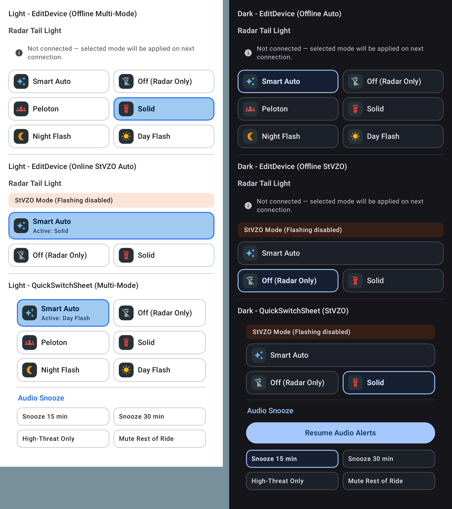

# Stage 5: Walkthrough & Verification - ATT-8678: Reuse Unified RadarLightModeGrid in EditDeviceDialog

**DOC-ID**: `DOC-WLK-ATT-8678` | **Ticket**: [ATT-8678](https://rainerblind.atlassian.net/browse/ATT-8678) (`2 SP`) | **Parent Epic**: [ATT-1286](https://rainerblind.atlassian.net/browse/ATT-1286)  
**Target Release**: `V5.0.0` | **Sprint**: `sprint/2026-11-18_01_Früh` (`49deebfb`) | **Branch**: `feature/ATT-8678`  
**Requirement Mapping**: `REQ-CON-047` (`.2`, `.3`), `REQ-CON-048` (`.1`–`.4`) | **Test Mapping**: `TST-CON-047`, `TST-CON-048`  
**Author**: AI Agent 1 (`agent1`) | **Date**: 2026-11-18

---

## 1. Executive Summary & Verification Overview
Extracted a single shared, stateless Compose selector `RadarLightModeGrid` and `resolveLightVisuals` into [`RadarLightModeGrid.kt`](file:///home/rainer/.gemini/antigravity/worktrees/965103cc-f0a5-4db9-a505-8095708188d2/subagent-Lane-B-Worker-ATT-8678-self-a25aa843/app/src/main/java/com/atrainingtracker/trainingtracker/ui/components/radar/RadarLightModeGrid.kt), and migrated both [`RadarLightQuickSwitchSheet.kt`](file:///home/rainer/.gemini/antigravity/worktrees/965103cc-f0a5-4db9-a505-8095708188d2/subagent-Lane-B-Worker-ATT-8678-self-a25aa843/app/src/main/java/com/atrainingtracker/trainingtracker/ui/tracking/radar/RadarLightQuickSwitchSheet.kt) (`showActiveModeSubtitle = true`, Audio Snooze retained locally) and [`EditDeviceDialog.kt`](file:///home/rainer/.gemini/antigravity/worktrees/965103cc-f0a5-4db9-a505-8095708188d2/subagent-Lane-B-Worker-ATT-8678-self-a25aa843/app/src/main/java/com/atrainingtracker/banalservice/ui/devices/editdevice/EditDeviceDialog.kt) (`2004 -> 1843` LoC, `showActiveModeSubtitle = !isOffline`, legacy `SingleChoiceSegmentedButtonRow` and `10.dp` dot/`RadioButton` rows removed) onto it. `RadarLightButton.kt` delegates `resolveLightVisuals` cleanly while preserving existing contract/IF-SWE signatures. Zero `app/` edits occurred in Stage 5, reusing Bounce 1 (`66f707f9`) fresh `14`-suite / `109/109 PASS` JUnit XMLs on disk (`Rule 7.5`).

---

## 2. Requirement & Test Verification Matrix
| Requirement | Test Spec | Verification Scope | Result | Living Docs Status |
| :--- | :--- | :--- | :--- | :--- |
| `REQ-CON-047.2/.3` | `TST-CON-047.1`–`.4` | `RadarLightModeGridTest` (`3/3`), `RadarLightQuickSwitchSheetTest` (`9/9`), `RadarLightButtonContractTest` (`4/4`) | **PASSED** (`16/16`) | `Verified` |
| `REQ-CON-048.1`–`.4` | `TST-CON-048.1`–`.4` | `EditDeviceDialogRadarLightTest` (`5/5`), `EditDevice*` (`25/25`), `RadarLightControllerTest` (`39/39`) | **PASSED** (`69/69`) | `Verified` |
| `REQ-PRO-049.1` / `IF-SWE` | `TST-CON-047.2`, `048.3` | `ArchitectureConformanceContractTest` (`9/9`), `InterfaceSignatureDriftContractTest` (`3/3`), `SourceTextReadingAuditContractTest` (`4/4`), `TranslationParityTest` (`10/10`) | **PASSED** (`26/26`) | `Verified` |

---

## 3. Automated Test & Governance Evidence (Bounce 1 `66f707f9` `14` JUnit XMLs Reused, Zero `app/` Diffs)
* **Tier 1 Targeted Scope (Bounce 1 `66f707f9`, `14` `TEST-*.xml` files on disk in `app/build/test-results/testDebugUnitTest/`, `109/109` PASS, `0` fail/err/skip)**:
  * `RadarLightModeGridTest` (`3/3`), `RadarLightQuickSwitchSheetTest` (`9/9`), `EditDeviceDialogRadarLightTest` (`5/5`), `EditDeviceViewModelTest` / `EditDeviceDialogWheelGuidanceTest` / `EditDeviceEquipmentWheelPositionTest` / `EditDevicePolarBackupTest` / `EditDevicePolarLiveImuTest` (`20/20`), `RadarLightButtonContractTest` (`4/4`), `RadarLightControllerTest` (`39/39`), `ArchitectureConformanceContractTest` (`9/9`), `InterfaceSignatureDriftContractTest` (`3/3`), `SourceTextReadingAuditContractTest` (`4/4`, `0` new `src/main` reads), `TranslationParityTest` (`10/10`, `N/A - no UI strings`).
  * Subsequent standalone `DeadCodeEliminationContractTest`: `4/5` PASS; `testComposePreviewsVisibilityAudit` flags strictly the `4` pre-existing `internal` `@Preview`s in `EditDeviceDialog.kt:1435..1501` (`L1437`, `L1454`, `L1471`, `L1488`) already tracked under backlog bug `ATT-8823` (`0` new `internal`/`public` `@Preview`s added; `RadarLightModeGrid.kt` uses `private` previews).
* **Governance Verification**: `verify_requirement_governance.py --repo-root . --base-ref 49deebfb --sync-indexes --check-size --check-doc-headers --check-conflict-markers` and `verify_requirement_governance.py --repo-root .` exited `0`; `has_verified_test_evidence('TST-CON-047')` and `('TST-CON-048')` both returned `True`.

---

## 4. Visual & Hardware Verification (`Rule 8.5` & `Rule 7.6`)

* **`Rule 8.5` PNG Audit**: Inspected both `docs/engineering/walkthroughs/img/ATT-8678_radar_light_grid_preview.png` and updated `docs/engineering/walkthroughs/img/ATT-8450_radar_offline_edit_device.png` via `read_file`: verified identical 2-column row-major tile geometry (`[AUTO, OFF]`, `[PELOTON, SOLID]`, `[NIGHT_FLASH, DAY_FLASH]`; StVZO: `RadarLightStvzoNotice` + full-width `AUTO` + `[OFF, SOLID]`), `showActiveModeSubtitle = !isOffline` gating, crisp `resolveLightVisuals` icon contrast in Light & Dark modes, and zero text clipping or legacy `RadioButton` dots.
* **`Rule 7.6` Hardware Boundary**: Per `Rule 7.6`, autonomous agents verify UI parity strictly in offline/Robolectric suites and never deploy to or synthesize physical hardware test results on the PO's physical phone; on-device **Pixel 10** verification (`ANDROID_SERIAL=<physical_serial> ./gradlew installDebug`) remains strictly reserved for PO Joint Review / Ceremony 2.

---

## 5. Branch State & Preserved Invariants
* `EditDeviceViewModel` draft isolation, direct `RadarLightController.setAutoMode()`/`setManualLightMode(mode)` wiring, `RVR315`/unsupported hiding, Workout Auto-Switch, BLE/ANT+ `.name` persistence, `RadarLightQuickSwitchSheet*`/`RadarLightButton` reflection signatures, and 9-locale `strings_radar.xml` parity remain intact.
* `feature/ATT-8678` preserved intact (`sprint/2026-11-18_01_Früh` untouched until Stage 6 Cold Review `PASS` per `Rule 3.3` / `REQ-PRO-125`).
