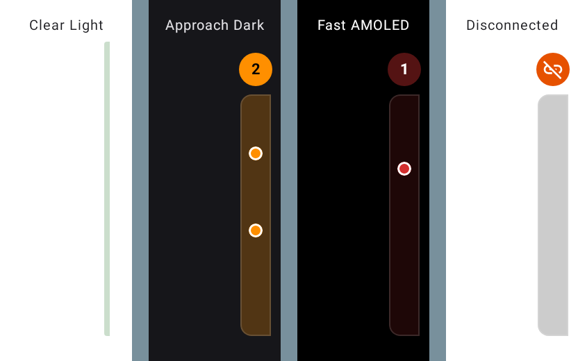

# Stage 5: Walkthrough & Verification - ATT-8679: Remove Green Connected Status Circle/Pill (`RadarStatusBadgePill`)

**DOC-ID**: `DOC-WLK-ATT-8679` | **Ticket**: [ATT-8679](https://atrainingtracker.atlassian.net/browse/ATT-8679) (`1 SP`) | **Parent Epic**: [ATT-1286](https://atrainingtracker.atlassian.net/browse/ATT-1286)  
**Target Release**: `V5.0.0` | **Sprint**: `sprint/2026-11-18_01_Früh` | **Branch**: `feature/ATT-8679`  
**Requirement Mapping**: `REQ-TRK-062` (`.2`/`.3`/`.4`/`.6`), `REQ-TRK-064` (`.1`/`.2`) | **Test Mapping**: `TST-TRK-062`, `TST-TRK-064`  
**Author**: `--as agent1` | **Date**: 2026-11-18

---

## 1. Executive Summary & Verification Overview
Permanently suppressed the green connected status circle/pill (`RadarStatusBadgePill`) whenever the road is clear (`!isDisconnectError && !hasActiveThreats`, both unsnoozed and snoozed) across `LEFT`, `RIGHT`, and `FULL_SCREEN` layouts on both Start and Live Tracking tabs (`RadarEdgeOverlay.kt`). Guarded the top `8.dp + 6.dp` `Spacer`s on `showStatusBadge` so `RadarVerticalRail` aligns at `0.dp` without a `14.dp` downward shift, retained `DISCONNECTED_ERROR` amber hazard/reconnect (`REQ-TRK-062.4`) and active-threat count/snooze badges (`REQ-TRK-064.2`), and removed orphaned `ic_device_available.xml` plus `radar_overlay_clear` & `radar_overlay_connecting` across all 9 `values*/strings_radar.xml` locales. Reused Stage 4 (`00895c64`) JUnit XML & lint evidence cleanly with zero `app/` diffs (`Rule 7.5`).

## 2. Requirement & Test Verification Matrix
| Requirement | Test Spec | Verification Method | Result | Status in Living Docs |
| :--- | :--- | :--- | :--- | :--- |
| `REQ-TRK-062.2/.3` | `TST-TRK-062.4` | Robolectric `createComposeRule()` (`RadarEdgeOverlayTest` `30/30`, `0` `src/main` reads) | **PASSED** (`30/30`) | `Verified` |
| `REQ-TRK-062.4` / `REQ-TRK-064.1/.2` | `TST-TRK-062.3`, `TST-TRK-064.2` | `RadarEdgeOverlayTest` + `RadarSnoozeControllerTest` (`15/15`) + `RadarAlertManagerTest` (`34/34`) | **PASSED** (`79/79`) | `Verified` |
| `REQ-TRK-062.6` | `TST-TRK-062.6` | `TranslationParityTest` (`10/10`) + `:app:lintDebug` (`0` errors / `0` `UnusedResources`) | **PASSED** (`10/10`, `0` errors) | `Verified` |
| `REQ-TRK-062` / `REQ-PRO-049.1` | `TST-TRK-062.9` | `SourceTextReadingAuditContractTest` (`4/4`) + `Rule 8.5` PNG audit + adjacent radar suites | **PASSED** (`126/126`) | `Verified` |

## 3. Automated Test & Lint Evidence (Reused from Stage 4 `00895c64`, Zero `app/` Diffs)
* **Tier 1 Targeted Scope** (`app/build/test-results/testDebugUnitTest/TEST-*.xml` on `00895c64`):
  * `RadarEdgeOverlayTest` (`30/30`, `0` `src/main` reads per `REQ-PRO-049.1`), `TranslationParityTest` (`10/10`), `SourceTextReadingAuditContractTest` (`4/4`).
  * Adjacent radar & tracking suites (`82/82`): `RadarAlertManagerTest` (`34/34`), `RadarSnoozeControllerTest` (`15/15`), `RadarSettingsSectionTest` (`10/10`), `RadarLightQuickSwitchSheetTest` (`9/9`), `RadarAccordionSectionTest` (`7/7`), `RadarLightButtonContractTest` (`4/4`), `TrackingTabsScreenLayoutTest` (`3/3`).
  * **Total**: **126/126 passed across 10 suites** (`0` failures, `0` errors, `0` skipped).
  * **Pre-existing Unrelated Note**: In an earlier Stage 4 run, `DeadCodeEliminationContractTest` flagged pre-existing `ATT-8823` (`EditDeviceDialog.kt` `internal @Preview`s); all `@Preview` composables in `RadarEdgeOverlay.kt` remain strictly `private fun`.
* **Android Lint (`:app:lintDebug`)**: `app/build/reports/lint-results-debug.txt` reports **`0` errors** (`0` `UnusedResources` regressions from removed `ic_device_available.xml`, `radar_overlay_clear`, and `radar_overlay_connecting`).
* **Governance & Evidence Links**: `verify_requirement_governance.py --repo-root . --base-ref cf5155bb --sync-indexes --check-size --check-doc-headers --check-conflict-markers` and `verify_requirement_governance.py --repo-root .` exited `0`; `has_verified_test_evidence('TST-TRK-062')` and `has_verified_test_evidence('TST-TRK-064')` both returned `True`.

## 4. Visual & Hardware Verification (`Rule 8.5` & `Rule 7.6`)

* **`Rule 8.5` PNG Audit**: Both `agent1` and `agent2` inspected `docs/engineering/walkthroughs/img/ATT-8679_radar_edge_overlay_preview.png` via `read_file`: `Clear Light` renders the slim translucent green rail aligned cleanly at `0.dp` with **zero green connected circle**; `Approach Dark` (`2`), `Fast AMOLED` (`1`), and `Disconnected` (amber hazard `ic_device_not_available` + grey rail) render crisply with zero clipping.
* **`Rule 7.6` Hardware Boundary**: Offline Robolectric Compose UI rendering (`LEFT`/`RIGHT`/`FULL_SCREEN`, `AUTO_HIDE_3S`, `DISCONNECTED_ERROR`, and active-threat states) verified in `RadarEdgeOverlayTest`. Per `Rule 7.6`, autonomous agents do not deploy to or fabricate test results on the PO's physical device; live on-bike verification with physical radar hardware on the **Pixel 10** (`ANDROID_SERIAL=<physical_serial> ./gradlew installDebug`) remains strictly reserved for **PO Joint Review / Ceremony 2**.

## 5. Branch State & Invariants
* Preserved `DISCONNECTED_ERROR` amber hazard/reconnect (`REQ-TRK-062.4`), active-threat count/snooze badges (`REQ-TRK-064.2`), upward threat kinematics (`140m/175m -> 0m`), 100% touch pass-through, `.navigationBarsPadding()`, and 9-locale parity (`radar_overlay_clear_mode*` untouched).
* `feature/ATT-8679` remains intact (`sprint/2026-11-18_01_Früh` untouched until Stage 6 Cold Review `PASS` per `Rule 3.3` / `REQ-PRO-125`; PO's dirty `tools/*` files untouched).
