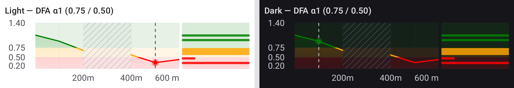

# Stage 5: Walkthrough & Verification - ATT-8710: Color DFA alpha 1 Graph by Configurable HRV Zones

**DOC-ID**: `DOC-WLK-ATT-8710` | **Ticket**: [ATT-8710](https://rainerblind.atlassian.net/browse/ATT-8710) (`2 SP`) | **Parent Epic**: [ATT-3539](https://rainerblind.atlassian.net/browse/ATT-3539)  
**Target Release**: `V5.0.0` | **Active Sprint**: `sprint/2026-11-18_01_Früh` | **Branch**: `feature/ATT-8710`  
**Requirement Mapping**: `REQ-HRV-044` (`REQ-HRV-044.1`–`REQ-HRV-044.5`) | **Test Mapping**: `TST-HRV-044`  
**Author**: `--as agent1` | **Date**: 2026-11-18

---

## 1. Executive Summary & Verification Overview
* Extended `TelemetryZoneMath.kt`, `TelemetryMetricGraph.kt`, `TelemetryMetricUtils.kt`, and `HrvAlpha1ScatterChart.kt` so Workout Details DFA $\alpha_1$ graphs and scatter dots render with the athlete's configurable 3-zone thresholds (`dfaA1ThresholdT1`/`T2`): Aerob (`> T1`, `TTColor.Zone2` Green), Schwelle (`T2 <= α1 <= T1`, `TTColor.Zone3` Orange), and Anaerob (`< T2`, `TTColor.Zone4` Red).
* Added monotonic `[0f, 1f]` vertical gradient stops (`Brush.verticalGradient`) for `HRV_DFA_A1` stroke/fill preserving `> 5.0%` artifact breaks and hatching, zone-colored single-point/cursor dots and `nonZonedHistogram` bins, `52.dp` portrait margin disjointness (`nonZonedHistogram.isEmpty()` guard on `band.label`), and `(dataMin, dataMax)` dash/label filtering (`MAX_DFA_A1_THRESHOLD = 1.50f > 1.4`).
* Fixed `HrvAlpha1ScatterChart.kt:384` to forward `(t1, t2)` to `HrvZoneIndicator.calculateZoneColor`, and reused verified Stage 4 (`a380edf5`) Tier 1 XML test results (`114/114` passed, `0` failed, `0` skipped; zero `app/` diffs in Stage 5 per `Rule 7.5`).

---

## 2. Requirement & Test Verification Matrix

| Requirement | Test Spec | Verification Method | Result | Status in Living Docs |
| :--- | :--- | :--- | :--- | :--- |
| `REQ-HRV-044.1`, `REQ-HRV-044.4` | `TST-HRV-044.1` | Unit (`TelemetryZoneMathTest`, bands, polarity, dash filter, gradient stops) | **PASSED** (`19/19`) | `Verified` |
| `REQ-HRV-044.3` | `TST-HRV-044.2` | Unit + Compose UI (`HrvAlpha1ScatterChartTest` `3/3`, `HrvAlpha1ScatterChartUiTest` `1/1`) | **PASSED** (`4/4`) | `Verified` |
| `REQ-HRV-044.1`–`REQ-HRV-044.5` | `TST-HRV-044.3` | Compose UI + `Rule 8.5` PNG (`TelemetryMetricGraphHrvUiTest` `2/2`, `TelemetryMetricGraphHrvTest` `3/3`) | **PASSED** (`5/5`) | `Verified` |
| `REQ-HRV-044.5`, `REQ-PRO-049.1` | `TST-HRV-044.4` | Tier 1 Targeted Regression (`20` XML suites incl. `SourceTextReadingAuditContractTest` `4/4`) | **PASSED** (`114/114`) | `Verified` |

---

## 3. Automated Test Evidence (Reused from Stage 4 `a380edf5`, Zero `app/` Diffs)
* **Tier 1 Scope**: Verified against `app/build/test-results/testDebugUnitTest/TEST-*.xml` generated on `a380edf5`:
  * `TelemetryZoneMathTest`: `19/19` | `TelemetryMetricGraphHrvTest`: `3/3` | `TelemetryMetricGraphHrvUiTest`: `2/2`
  * `HrvAlpha1ScatterChartTest`: `3/3` | `HrvAlpha1ScatterChartUiTest`: `1/1` | `TrackingHrvZoneIndicatorTest`: `13/13`
  * `TelemetryMetricGraphZoneTest`: `7/7` | `TelemetryMetricGraphColorTest`: `5/5` | `SourceTextReadingAuditContractTest`: `4/4`
  * 11 sibling `TelemetryMetricGraph*Test` & `AdvancedTuningPaceCeilingContractTest` suites: `57/57` — **Total: `114/114` passed, `0` failed, `0` skipped**.
* **Governance**: `verify_requirement_governance.py` passed (`exit 0`, `1239` REQs / `1246` TSTs synced); `has_verified_test_evidence("TST-HRV-044")` passed (`3 passing testcases`). *(Pre-existing base `62c5d410` `TST-TRK-087` triggers `--check-verified-evidence` outside ATT-8710 scope.)*

---

## 4. Visual Verification (`Rule 8.5`)

* Inspected via `read_file` by both `agent1` and `agent2`: Light/Dark themes render Green Aerob (`> 0.75`), Orange Schwelle (`0.50..0.75`), and Red Anaerob (`< 0.50`) bands, matching vertical-gradient curve/fill, hatched artifact gap, zone-colored cursor dots/halos, disjoint `52.dp` marginal histogram bars, and crisp axis labels.

---

## 5. Invariant & Governance Verification
1. **Preserved Invariants**: `HEART_RATE`/`POWER` solid `accentColor` strokes (`REQ-UI-230`), `50.dp`/`52.dp` padding (`Rule 64`), `α1 == T1 -> TTColor.Zone3`, zero non-private `@Preview`s, and zero `src/main` reads in tests (`REQ-PRO-049.1`).
2. **Feature Branch Intact**: All changes remain on `feature/ATT-8710` (not squashed onto `sprint/2026-11-18_01_Früh` per `Rule 3.3`); parent ends at `Final Review (Human)`.
