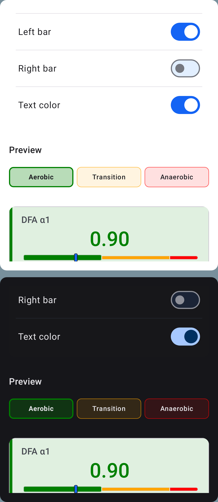

# Stage 5: Walkthrough & Verification - ATT-8712: Remove 'Zonen-Balken' Switch from HRV Tab in ZonesSettingsActivity

**DOC-ID**: `DOC-WLK-ATT-8712` | **Ticket**: [ATT-8712](https://rainerblind.atlassian.net/browse/ATT-8712)  
**Parent Epic**: [ATT-355](https://rainerblind.atlassian.net/browse/ATT-355) (*Global UI & Design System*) | **Target Release**: `V5.0.0`  
**Sprint**: `sprint/2026-11-18_01_Früh` | **Branch**: `feature/ATT-8712` | **Author**: `--as agent1`  
**Requirement Mapping**: `REQ-TRK-087` (refines `REQ-TRK-061.4`, `REQ-UI-2783.3`; aligns with `REQ-TRK-046.4`) | **Test Mapping**: `TST-TRK-087`

---

## 1. Executive Summary & Verification Overview
Removed the redundant *Zonen-Balken* (`R.string.zone_display_gauge`) switch from `HrvDfaA1SettingsContent` (`ZonesSettingsActivity.kt`, tab 3) with zero code drift after Stage 4 SHA `c9e8046e` (`Rule 7.5` / `ATT-8030`).
* Removed the trailing `HorizontalDivider` and `ZoneDisplayToggleRow(R.string.zone_display_gauge, displayOptions.showGauge, ...)` below `ZoneDisplayOptionsToggleList(..., showGaugeToggle = false)`.
* Set `previewFieldState.showBar = true` unconditionally in `HrvDfaA1SettingsContent`, establishing 1:1 parity with `SettingsScreenContent` (tabs 0–2) and `REQ-TRK-046.4`, while preserving `ZoneDisplayConfigSection` (`EditSensorFieldDialog`, `SensorGridScreen`) and `SettingsDataStore.HRV_DFA_A1_ZONE_SHOW_GAUGE`.

## 2. Requirement & Test Verification Matrix
| Requirement | Test Spec | Verification Method | Result | Status in Living Docs |
| :--- | :--- | :--- | :--- | :--- |
| `REQ-TRK-087.1`, `REQ-TRK-046.4` | `TST-TRK-087.1` | Robolectric `createComposeRule()` (`HrvDfaA1RangeSliderGestureTest`) | **PASSED (7/7)** | `Verified` |
| `REQ-TRK-087.2`, `REQ-TRK-061.4` | `TST-TRK-087.2` | Contract (`HrvDfaA1SettingsContractTest`) + `SourceTextReadingAuditContractTest` | **PASSED (12/12 + 4/4)** | `Verified` |
| `REQ-UI-2783.3` | `TST-TRK-087.2` | Tile/Tab Config (`EditSensorFieldZoneDisplayTest`, `TrackingTabConfigZoneDisplayTest`) | **PASSED (6/6 + 3/3)** | `Verified` |

## 3. Automated Test Evidence (Tier 1 Targeted Scope on Unchanged Code SHA `c9e8046e`)
Verified directly from Stage 4 JUnit XMLs on unchanged `.kt`/`.xml` code (`Rule 7.5` zero redundant Gradle re-runs; zero `@Preview` functions added in `app/src/main/`):
* `./gradlew :app:testDebugUnitTest --tests "com.atrainingtracker.trainingtracker.zones.HrvDfaA1RangeSliderGestureTest" --tests "com.atrainingtracker.trainingtracker.zones.HrvDfaA1SettingsContractTest" --tests "com.atrainingtracker.trainingtracker.ui.tracking.editsensorfield.EditSensorFieldZoneDisplayTest" --tests "com.atrainingtracker.trainingtracker.ui.tracking.tracking.TrackingTabConfigZoneDisplayTest" --tests "com.atrainingtracker.trainingtracker.build.SourceTextReadingAuditContractTest" --max-workers=2`
* **Result**: **32/32 tests passed across 5 targeted suites** (`0` failures, `0` errors, `0` skipped): `HrvDfaA1RangeSliderGestureTest` (`7/7`), `HrvDfaA1SettingsContractTest` (`12/12`), `EditSensorFieldZoneDisplayTest` (`6/6`), `TrackingTabConfigZoneDisplayTest` (`3/3`), `SourceTextReadingAuditContractTest` (`4/4`, `baseline == 105` intact).
* **Zero `src/main/` reads in new test**: `HrvDfaA1RangeSliderGestureTest.kt` uses Compose behavioral UI assertions only (`REQ-PRO-049.1`).
* **Localization**: `N/A - no UI strings added, modified, or removed; R.string.zone_display_gauge stays active in ZoneDisplayOptionsControls.kt:230`.

## 4. Visual Consistency & `Rule 8.5` Verification
| Light & Dark `HrvDfaA1SettingsContent` Zone Display & Preview | Notes |
| :---: | :--- |
|  | Inspected via `read_file`: clean Light & Dark rendering, 4-toggle card with zero `Zone gauge bar`/`Zonen-Balken` switch, single-line `Aerobic`/`Transition`/`Anaerobic` pills, and active 3-segment Green/Orange/Red `ZoneGaugeBar` with blue needle (`showBar = true`). |

* **Checked against `docs/design_guidelines.md`**: shapes [x] spacing [x] colors/themes [x] typography/icons [x] placement [x] | **Deviations**: None.

## 5. Invariant & Governance Verification
1. **Zero Code Drift**: `app/` untouched after Stage 4 SHA `c9e8046e`.
2. **Living Docs & Governance**: `REQ-TRK-087` and `TST-TRK-087` promoted to `[Verified]`, master indexes synced (`--sync-indexes`), `verify_requirement_governance.py --check-doc-headers --check-conflict-markers` and `verify_requirement_governance.py` exited `0`.
3. **Branch Preservation (`Rule 3.3` / `REQ-PRO-125`)**: `feature/ATT-8712` kept intact for Stage 6 Cold Review; `sprint/2026-11-18_01_Früh` untouched.
