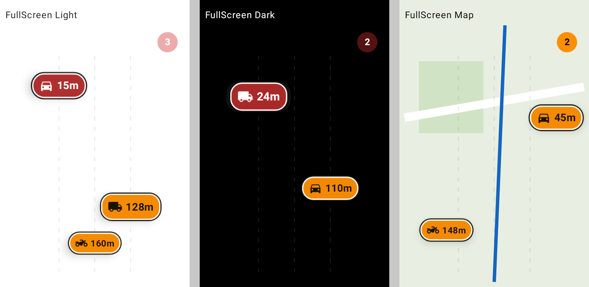

# Stage 5: Walkthrough & Verification - ATT-8733: Redesign Full-Screen Radar Vehicle Markers with Legible Badges and Distinct V2 Vehicle Size Icons

**Ticket**: [ATT-8733](https://atrainingtracker.atlassian.net/browse/ATT-8733) (`2 SP`) | **Parent Epic**: [ATT-1286](https://atrainingtracker.atlassian.net/browse/ATT-1286)  
**Target Release**: `V5.0.0` | **Sprint**: `sprint/2026-11-18_01_Früh`  
**Requirement Mapping**: `REQ-TRK-089` (`REQ-TRK-089.1`..`REQ-TRK-089.3`, [Verified]) | **Test Mapping**: `TST-TRK-089` ([Verified])  
**Branch**: `feature/ATT-8733` | **Author**: AI Agent 1 (`--as agent1`) | **Date**: 2026-11-18

---

## 1. Executive Summary & Verification Overview
Redesigned `RadarFullScreenThreatOverlay` (`RadarEdgeOverlay.kt`) with touch-transparent elevated `Box` capsule markers (replacing `material3.Surface` so sibling hit-testing over `HorizontalPager` and `GoogleMap` is never intercepted), single-pass `Modifier.layout` measurement & `perspectiveScale` clamping (eliminating Frame-1 `IntSize.Zero` jumps and 60-fps composition churn by reading `animatedFractionState` and `pulseAlphaProvider` in layout/graphics/draw phases), `11–13.sp` tabular-numeral (`tnum`) distance labels, distinct V2 `VehicleSizeCategory` icons (`TwoWheeler`, `DirectionsCar`, `LocalShipping`), dual-rim contrast + map-backdrop tokens centralized in `Color.kt`, subtle non-interactive dashed lane guides, and 9-locale `R.string.radar_vehicle_size_light` accessibility mapping (eliminating the hardcoded `"Target"` fallback).

---

## 2. Requirement & Test Verification Matrix

| Requirement | Test Spec | Verification Method | Result | Living Docs Status |
| :--- | :--- | :--- | :--- | :--- |
| `REQ-TRK-089.1` | `TST-TRK-089.1` | Robolectric `createComposeRule()` (`RadarEdgeOverlayTest` incl. Frame-1 `.layout` & `99m->100m` clamping) | **PASSED (`37/37`)** | `Verified` |
| `REQ-TRK-089.2` | `TST-TRK-089.2` | `RadarEdgeOverlayTest` (V2 icons, tap/swipe pass-through, `FAST_APPROACHING` pulse) + `ThemeColorCentralizationAuditTest` (`5/5`) + `TranslationParityTest` (`10/10`) | **PASSED** | `Verified` |
| `REQ-TRK-089.3` | `TST-TRK-089.3` | `:app:lintDebug` (`0` errors) + `SourceTextReadingAuditContractTest` (`4/4`) + `ArchitectureConformanceContractTest` (`11/11`) + `SystemArchitectureDesignContractTest` (`9/9`) + `Rule 8.5` PNG | **PASSED** | `Verified` |

---

## 3. Automated Test, Lint & Compiler Verification Evidence

* **Command** (under `python3 tools/parallel_sprint_lock.py --timeout 1800`):
  ```bash
  ./gradlew :app:compileDebugKotlin --max-workers=1 && \
  ./gradlew :app:lintDebug --max-workers=1 && \
  ./gradlew :app:testDebugUnitTest --max-workers=1 --rerun-tasks \
    --tests com.atrainingtracker.trainingtracker.ui.tracking.radar.RadarEdgeOverlayTest \
    --tests com.atrainingtracker.trainingtracker.build.ArchitectureConformanceContractTest \
    --tests com.atrainingtracker.trainingtracker.localization.TranslationParityTest \
    --tests com.atrainingtracker.trainingtracker.build.SystemArchitectureDesignContractTest \
    --tests com.atrainingtracker.trainingtracker.ui.theme.ThemeColorCentralizationAuditTest \
    --tests com.atrainingtracker.trainingtracker.build.SourceTextReadingAuditContractTest \
    --tests com.atrainingtracker.trainingtracker.build.DeadCodeEliminationContractTest
  ```
* **Kotlin Compiler & Lint**:
  * `:app:compileDebugKotlin`: **exit `0`**, **0 warnings** in `RadarEdgeOverlay.kt` and `Color.kt`.
  * `:app:lintDebug`: **exit `0`** (`0` errors; only 2 pre-existing `ModifierParameter` warnings on `RadarEdgeOverlay` & `RadarVerticalRail` signatures at `RadarEdgeOverlay.kt:276, 806`).
* **Refreshed JUnit XML Results (`app/build/test-results/testDebugUnitTest/`)** — `6/6` full-PASS suites = **`76/76 PASS`**; overall **`80 PASS / 1 FAIL (pre-existing ATT-8823) / 0 SKIP`** across `81` tests:

| Test Suite | Tests | Pass | Fail | Skip | Notes |
| :--- | :---: | :---: | :---: | :---: | :--- |
| `RadarEdgeOverlayTest` | 37 | 37 | 0 | 0 | `TST-TRK-089` (incl. tap/swipe pass-through over marker, Frame-1 `.layout`, `FAST_APPROACHING` pulse) + `TST-TRK-062`/`064`/`073` + `Rule 8.5` PNG |
| `ArchitectureConformanceContractTest` | 11 | 11 | 0 | 0 | Architecture layer boundaries |
| `TranslationParityTest` | 10 | 10 | 0 | 0 | `9/9` locale parity (`radar_vehicle_size_*` reused) |
| `SystemArchitectureDesignContractTest` | 9 | 9 | 0 | 0 | SWE.2 design registry parity |
| `ThemeColorCentralizationAuditTest` | 5 | 5 | 0 | 0 | `0` inline `Color(0x...)` outside `Color.kt` |
| `SourceTextReadingAuditContractTest` | 4 | 4 | 0 | 0 | `0` `src/main` reads in `RadarEdgeOverlayTest.kt` |
| `DeadCodeEliminationContractTest` | 5 | 4 | 1 | 0 | `0` violations in `RadarEdgeOverlay.kt`; `1` pre-existing unrelated `ATT-8823` in `EditDeviceDialog.kt` |

---

## 4. Visual Consistency & `Rule 8.5` Preview Inspection
* **Device Policy (`Rule 7.6`)**: Offline verification only; zero physical Android device deployment.
* **Preview Screenshot (`docs/engineering/walkthroughs/img/ATT-8733_radar_fullscreen_markers_preview.png`)** inspected via `read_file`:



* **Checked against `docs/design_guidelines.md` §5**:
  * **Legibility & Zero Clipping**: `15m`, `24m`, `45m`, `110m`, `128m`, `148m`, and `160m` tabular distance labels fit cleanly inside capsule padding with zero truncation; edge markers (`45m` at right `0.85f` edge, `148m` at left edge) stay strictly inside panel bounds.
  * **Distinct V2 Icons & Scale**: `DirectionsCar` (`15m`, `45m`, `110m`), larger `LocalShipping` (`24m`, `128m`), and `TwoWheeler` (`148m`, `160m`) icons are immediately distinguishable.
  * **Light / Dark / Map Contrast**: Panel 3 renders a distinct map-toned backdrop (`RadarFullScreenMapBackdrop`, `RadarFullScreenMapPark`, `RadarFullScreenMapRoad`, `TTColor.RouteSelected`) visually contrasting with Panel 1 (Light) and Panel 2 (AMOLED Dark); dual-rim scrim/border + `6.dp` shadow remain crisp across all 3 backdrops with subtle dashed lane guides and zero overlap with center controls.

---

## 5. Governance & Living Documentation Verification
* `python3 tools/verify_requirement_governance.py --repo-root . --sync-indexes --check-size --check-doc-headers --check-conflict-markers --check-living-doc-layout`: **exit `0`**.
* `python3 tools/verify_requirement_governance.py --repo-root .`: **exit `0`** (all shard, SYSREQ, header, conflict-marker, and `SensorType` checks `PASS`).
* `has_verified_test_evidence("TST-TRK-089")`: `(True, 'Verified by 37 passing testcase(s)')`; `--check-verified-evidence` reports **0 errors** on `REQ-TRK-089` / `TST-TRK-089` (pre-existing unrelated `TST-ARC-003` and `TST-TRK-087` remain outside ATT-8733 scope).
