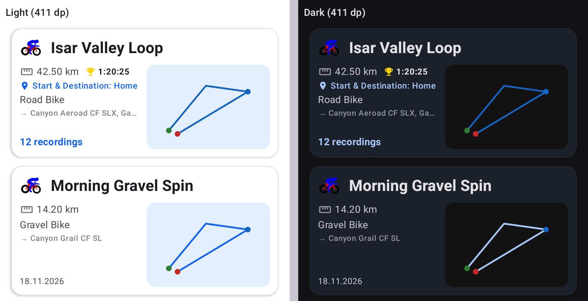

# Stage 5: Walkthrough & Verification - ATT-8748: Enlarge Lieblingsstrecken Card Preview Map to 175x120 dp

**DOC-ID**: `DOC-WLK-ATT-8748` | **Ticket**: [ATT-8748](https://rainerblind.atlassian.net/browse/ATT-8748) (`1 SP`) | **Parent Epic**: [ATT-176](https://rainerblind.atlassian.net/browse/ATT-176)  
**Target Release**: `V5.0.0` | **Active Sprint**: `sprint/2026-11-18_01_Früh` | **Branch**: `feature/ATT-8748`  
**Requirement Mapping**: `REQ-UI-493` (`REQ-UI-493.3`, refining `REQ-UI-244`) | **Test Mapping**: `TST-UI-493`  
**Author**: `--as agent1` | **Date**: 2026-11-18

---

## 1. Executive Summary & Verification Overview
* Unified and enlarged the landscape map preview thumbnail in both `ClusterItem` and `UnclusteredWorkoutItem` (`WorkoutClusterComponents.kt`) via `ClusterMapPreviewThumbnail` (`175.dp × 120.dp`, `12.dp` corner radius, `12.dp` horizontal `Spacer`).
* Added `resolveClusterThumbnailWidthDp(screenWidthDp)` outside `Row(Modifier.height(IntrinsicSize.Min))` (no `BoxWithConstraints` / `SubcomposeLayout` inside `IntrinsicSize.Min`), clamping narrow `360.dp` viewports to `148.dp` (`110.dp` floor) so metadata retains `>= 160.dp`.
* Replaced literal `40` with `THUMBNAIL_BOUNDS_PADDING_PX = 18` (`16..20 px`) inside `try/catch (IllegalStateException)` (removing stale `MagicNumber:WorkoutClusterComponents.kt$40` from `app/detekt-baseline.xml`), and seeded `rememberCameraPositionState` to `bounds.center` (`INITIAL_CAMERA_SEED_ZOOM = 13f`).
* Reused Stage 4 (`f58d8fdf`) Tier 1 JUnit XML results (`151/151` passed, `0` failed, `0` skipped across `26` suites; zero `app/` diffs in Stage 5 per `Rule 7.5`).

---

## 2. Requirement & Test Verification Matrix

| Requirement | Test Spec | Verification Method | Result | Status in Living Docs |
| :--- | :--- | :--- | :--- | :--- |
| `REQ-UI-493.3`, `REQ-PRO-049.1` | `TST-UI-493.3a` | Behavioral Compose UI (`ClusterItemThumbnailComposeTest`, `411.dp` & `360.dp`, `0` `src/main` reads) | **PASSED** (`5/5`) | `Verified` |
| `REQ-UI-493.3`, `REQ-PRO-049.3` | `TST-UI-493.3b` | Contract alignment (`ClusterItemAndFilterPolishTest`, baseline `105` preserved) | **PASSED** (`7/7`) | `Verified` |
| `REQ-UI-493.3` | `TST-UI-493.3c` | `Rule 8.5` Light/Dark PNG (`img/ATT-8748_lieblingsstrecken_preview.png`) | **PASSED** | `Verified` |
| `REQ-UI-493` | `TST-UI-493.5` | Tier 1 Targeted Regression (`26` XML suites: `ui.clusters.*` + map/audit suites) | **PASSED** (`151/151`) | `Verified` |

---

## 3. Automated Test & Governance Evidence (Reused from Stage 4 `f58d8fdf`, Zero `app/` Diffs)
* **Tier 1 Scope (`app/build/test-results/testDebugUnitTest/TEST-*.xml`)**:
  * `ClusterItemThumbnailComposeTest`: `5/5` | `ClusterItemAndFilterPolishTest`: `7/7` | `17` sibling `ui.clusters.*` suites: `110/110`
  * `MapPreviewLiteModeTest`: `6/6` | `DarkMapAntiFlashOverlayTest`: `3/3` | `DarkMapStyleResolutionTest`: `8/8`
  * `GlobalDeleteContextMenuAuditTest`: `3/3` | `SourceTextReadingAuditContractTest`: `4/4` | `ThemeColorCentralizationAuditTest`: `5/5`
  * **Total**: **`151/151` passed, `0` failed, `0` skipped** (`26` suites).
* **Governance & Localization**: `Localization Parity: N/A - no UI strings`. `verify_requirement_governance.py --sync-indexes --check-size --check-doc-headers --check-conflict-markers`, `verify_requirement_governance.py --repo-root .`, and `has_verified_test_evidence('TST-UI-493')` all passed (`exit 0`).

---

## 4. Visual Verification (`Rule 8.5`) & Device Boundary (`Rule 7.6`)

* Inspected via `read_file` by both `agent1` and `agent2`: Light and Dark (`411 dp`) previews render crisp `175×120 dp` rounded thumbnails, `12.dp` spacing, bottom-aligned hit count/date, and single-line ellipsized equipment text without overlap or clipping.
* **Hardware Boundary (`Rule 7.6`)**: Automated verification ran via Robolectric `createComposeRule()` and `@Preview` inspection; physical `Pixel 10` hardware visual sign-off remains strictly reserved for the human Product Owner during Ceremony 2 / `Final Review (Human)`.

---

## 5. Preserved Invariants & Branch Hygiene
1. `GoogleMapOptions().liteMode(true)`, `DarkMapAntiFlashOverlay`, `DarkMapStyle.resolveMapProperties`, TopStart Merge/Delete `DropdownMenu`, `IntrinsicSize.Min` alignment, `KnownLocationsScreen.kt` (`ATT-8749`) isolation, and `ANT-Android-SDKs` (`160000` gitlink) remain intact.
2. `feature/ATT-8748` remains intact (not squashed onto `sprint/2026-11-18_01_Früh` per `Rule 3.3` / `REQ-PRO-125`).
