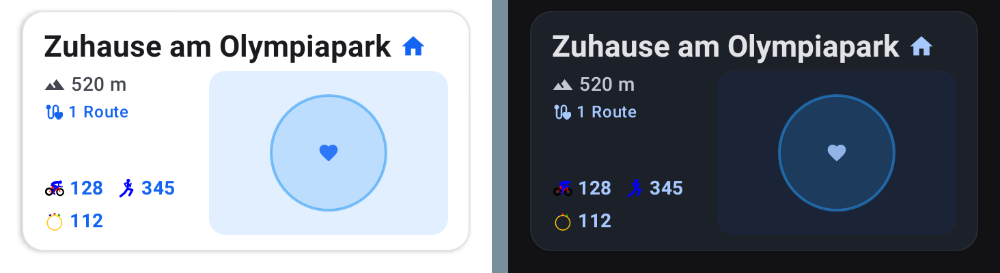

# Stage 5: Walkthrough & Verification - ATT-8749: Enlarge Lieblingsorte Card Preview Map to 175x120 dp & Recalibrate Zoom

**DOC-ID**: `DOC-WLK-ATT-8749` | **Ticket**: [ATT-8749](https://atrainingtracker.atlassian.net/browse/ATT-8749) (`1 SP`) | **Parent Epic**: [ATT-1396](https://atrainingtracker.atlassian.net/browse/ATT-1396)  
**Target Release**: `V5.0.0` | **Sprint**: `sprint/2026-11-18_01_Früh` | **Branch**: `feature/ATT-8749`  
**Requirement Mapping**: `REQ-UI-2785` (`REQ-UI-2785.1`–`.4`) | **Test Mapping**: `TST-UI-2785` (`TST-UI-2785.1`–`.4`)  
**Author**: `--as agent1` | **Date**: 2026-11-18

---

## 1. Executive Summary & Verification Overview
Enlarged `KnownLocationThumbnailMap` in `KnownLocationsScreen.kt` from `116.dp × 80.dp` to `175.dp × 120.dp` (`Spacer` `16.dp -> 12.dp`) and recalibrated `KnownLocationZoomMath.calculateThumbnailZoom` to `DEFAULT_THUMBNAIL_HEIGHT_DP = 120.0` (`+log2(1.5) ≈ +0.585` zoom levels), while adding `maxLines = 1, TextOverflow.Ellipsis` on Altitude text and `FlowRow` wrapping on multi-sport `SportStartsItem` counts for `360.dp` / `130%` font-scale safety. Reused Stage 4 (`ae5a7136`) JUnit XMLs with zero `app/` diffs (`Rule 7.5`).

## 2. Requirement & Test Verification Matrix
| Requirement | Test Spec | Verification Method | Result | Status in Living Docs |
| :--- | :--- | :--- | :--- | :--- |
| `REQ-UI-2785.1` | `TST-UI-2785.2`, `.3` | Layout baseline (`KnownLocationCardLayoutTest` `10/10`) + Compose UI (`KnownLocationCardComposeUiTest` `4/4`) | **PASSED** (`14/14`) | `Verified` |
| `REQ-UI-2785.2` | `TST-UI-2785.1` | Pure JVM unit tests (`KnownLocationZoomMathTest` `7/7`) | **PASSED** (`7/7`) | `Verified` |
| `REQ-UI-2785.3` | `TST-UI-2785.3` | `360.dp` / `130%` font-scale Compose bounds + `Rule 8.5` PNG inspection | **PASSED** (`4/4`) | `Verified` |
| `REQ-UI-2785.4` | `TST-UI-2785.4` | `SourceTextReadingAuditContractTest` (`4/4`, `baseline == 105`) + adjacent `KnownLocation*` (`64/64`) | **PASSED** (`68/68`) | `Verified` |

## 3. Automated Test Evidence (Reused from Stage 4 `ae5a7136`, Zero `app/` Diffs)
* **Tier 1 Targeted Scope** (`app/build/test-results/testDebugUnitTest/TEST-*.xml` on `ae5a7136`):
  * `KnownLocationZoomMathTest` (`7/7`), `KnownLocationCardLayoutTest` (`10/10`), `KnownLocationCardComposeUiTest` (`4/4`, `0` `src/main` reads per `REQ-PRO-049.1`), `SourceTextReadingAuditContractTest` (`4/4`).
  * Adjacent `KnownLocation*` suites (`64/64`): `KnownLocationsViewModelTest` (`18/18`), `KnownLocationsScreenTest` (`14/14`), `KnownLocationsFilterCriteriaTest` (`7/7`), `KnownLocationsScreenDrillDownTest` (`6/6`), `KnownLocationCardRoutesBadgeTest` (`5/5`), `KnownLocationsUnitConversionTest` (`5/5`), `KnownLocationsMergeDialogContractTest` (`4/4`), `KnownLocationHomeContractTest` (`3/3`), `KnownLocationsViewModelRoutesTest` (`2/2`).
  * **Total**: **89/89 passed across 13 suites** (`0` failures, `0` errors, `0` skipped).
* **Localization**: `N/A - no UI strings` (`values*/strings*.xml` untouched).
* **Governance**: `verify_requirement_governance.py --sync-indexes --check-size --check-doc-headers --check-conflict-markers` and `verify_requirement_governance.py` exited `0`; `has_verified_test_evidence("TST-UI-2785")` -> `True (21 passing testcase(s))`.

## 4. Visual & Hardware Verification (`Rule 8.5` & `Rule 7.6`)

* **`Rule 8.5` PNG Audit**: Both `agent1` and `agent2` inspected `docs/engineering/walkthroughs/img/ATT-8749_lieblingsorte_preview.png` via `read_file`: verified `175.dp × 120.dp` landscape map preview, crisp Light/Dark contrast, bottom-aligned `IntrinsicSize.Min` card geometry, and clean `FlowRow` wrapping (`Bike 128`, `Run 345` row 1; `Other 112` row 2) with zero text clipping at `360.dp`.
* **`Rule 7.6` Hardware Boundary**: Offline Compose UI rendering (`LocalInspectionMode`) verified in `KnownLocationCardComposeUiTest`. Per `Rule 7.6`, autonomous agents do not deploy to or fabricate tests on the PO's physical device; live Google Maps Lite Mode tile & geofence rendering on the physical **Pixel 10** (`ANDROID_SERIAL=<physical_serial> ./gradlew installDebug`) remains strictly reserved for **PO Joint Review / Ceremony 2**.

## 5. Branch State & Invariants
* Preserved `RoundedCornerShape(12.dp)`, `liteMode(true)`, `createCenteredHeartGlyphMarker` (`anchor = Offset(0.5f, 0.5f)`), `MIN_ZOOM = 9.7f`/`MAX_ZOOM = 11.7f`, private `@Preview` visibility, `WorkoutClusterComponents.kt` (`110×75 dp`), and `EditKnownLocationDialog.kt`.
* All commits remain intact on `feature/ATT-8749` (`sprint/2026-11-18_01_Früh` untouched until Stage 6 Cold Review `PASS` per `Rule 3.3` / `REQ-PRO-125`).
