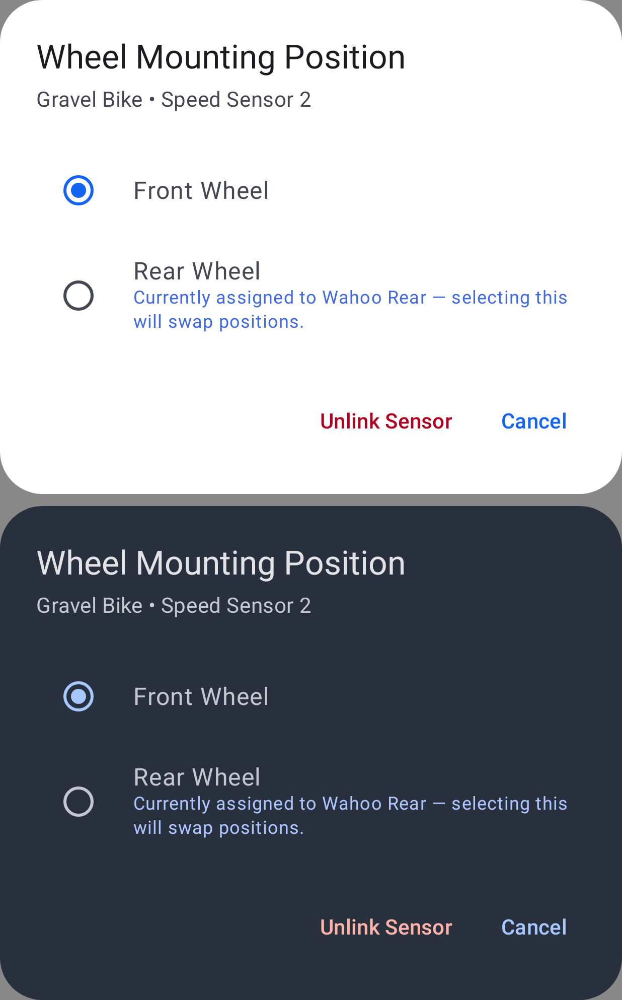

# Stage 5: Walkthrough & Verification - ATT-8859: WheelPositionSelectionDialog Front/Rear Only

**Ticket**: [ATT-8859](https://rainerblind.atlassian.net/browse/ATT-8859)  
**Parent Epic**: [ATT-166](https://rainerblind.atlassian.net/browse/ATT-166) (*Filtering to improve sensor values (especially locations)*)  
**Target Release**: `V5.0.0` | **Active Sprint**: `2026-11-19_02_Spät` | **Branch**: `feature/ATT-8859`  
**Requirement Mapping**: `REQ-SEN-032` (refining `REQ-SEN-029.3`, `REQ-SEN-031.2`) | **Test Mapping**: `TST-SEN-032`  
**Author**: AI Agent 1 (`agent1`) | **Date**: 2026-11-19  

---

## 1. Executive Summary & Verification Overview

Removed `WheelPosition.UNSPECIFIED` (`wheel_position_unspecified`) from `WheelPositionSelectionDialog.kt` (`L83-87`), updated its KDoc (`L47`), and added `private fun` Light/Dark `@Preview` composables (`REQ-ARC-003.5`), leaving `EditDeviceDialog.kt`, `EquipmentSensorMatrixScreen.kt`, `WheelPosition` enum, `EquipmentDbHelper`, and 9-locale `strings_equipment.xml` (`R.string.equipment_wheel_position_unspecified` for legacy summary display) untouched. Per **Rule 7.5**, Stage 5 reuses Gate 4 (`ATT-9145`) verified `35/35` PASS test evidence with zero `app/` code drift since `9e265f02`.

---

## 2. Requirement & Test Verification Matrix

| Requirement / Spec | Test Suite | Scope | Result | Living Docs |
| :--- | :--- | :--- | :--- | :--- |
| `REQ-SEN-032.1`, `.2` / `TST-SEN-032.1` | `WheelPositionSelectionDialogUiTest` | Robolectric `createComposeRule()` (`0` `src/main` reads) | **4/4 PASS** (`0` fail, `0` skip) | `Verified` |
| `REQ-SEN-032.3`, `REQ-SEN-029` | `WheelPositionDialogsTest` | Tier 1 Targeted (`--rerun`) | **4/4 PASS** (`0` fail, `0` skip) | `Verified` |
| `REQ-SEN-031`, `REQ-SEN-032.3` | `EditDeviceEquipmentWheelPositionTest` | Robolectric Compose (`createComposeRule()`) | **5/5 PASS** (`0` fail, `0` skip) | `Verified` |
| `REQ-PRO-129.2`, `REQ-ARC-003.5` | `ArchitectureConformanceContractTest`, `DeadCodeEliminationContractTest` | Tier 1 Contract (`--rerun`) | **11/11** & **5/5 PASS** | `Verified` |
| `REQ-PRO-133`, `REQ-PRO-070` | `SourceTextReadingAuditContractTest`, `verify_requirement_governance.py` | Audit & Governance | **6/6 PASS**, **EXIT 0** (`1077` backed) | `Verified` |

---

## 3. Automated Test Evidence (Gate 4 Reuse — Rule 7.5)

Zero `app/` diff since Gate 4 (`9e265f02`); verified via JUnit XML reports under `app/build/test-results/testDebugUnitTest/`:
```text
WheelPositionSelectionDialogUiTest: 4/4 PASS (failures=0, errors=0, skipped=0)
WheelPositionDialogsTest: 4/4 PASS (failures=0, errors=0, skipped=0)
EditDeviceEquipmentWheelPositionTest: 5/5 PASS (failures=0, errors=0, skipped=0)
ArchitectureConformanceContractTest: 11/11 PASS (failures=0, errors=0, skipped=0)
DeadCodeEliminationContractTest: 5/5 PASS (failures=0, errors=0, skipped=0)
SourceTextReadingAuditContractTest: 6/6 PASS (failures=0, errors=0, skipped=0)
Total: 35/35 PASS (Localization Parity: N/A - no UI strings)
```

---

## 4. Visual Consistency & Legacy Compatibility (Rule 8.5)

| Light & Dark `WheelPositionSelectionDialog` (`ATT-8859`) |
| :---: |
|  |

* **Checked via `read_file`**: Light & Dark Material 3 AlertDialogs render strictly **Front Wheel** and **Rear Wheel** (zero `Unspecified` option), crisp primary/tertiary/error contrast, readable swap hint, and clean single-line `Unlink Sensor` / `Cancel` actions with zero clipping.
* **Legacy `UNSPECIFIED` Compatibility**: `WheelPosition.values().size == 3`, `EquipmentDbHelper` v4 `DEFAULT 'UNSPECIFIED'`, `EditDeviceDialog` legacy summary label (`equipment_wheel_position_unspecified`), and `currentPosition == WheelPosition.UNSPECIFIED` (neither radio selected + `Unlink`/`Cancel`) verified intact.

---

## 5. Invariant & Governance Verification

1. **Zero Production Regressions**: `35/35` PASS across all 6 suites; `verify_requirement_governance.py --check-verified-evidence` exits `0`.
2. **Living Documentation Synchronized**: `REQ-SEN-032` and `TST-SEN-032` promoted to `[Verified]` with `--sync-indexes` parity.
3. **Stage 6 Handover (`REQ-PRO-125`)**: Squashed into 1 clean commit atop `sprint/2026-11-19_02_Spät` (`6927b2f8`) for Stage 6 Cold Review before `--merge-ticket` and `Final Review (Human)`.
