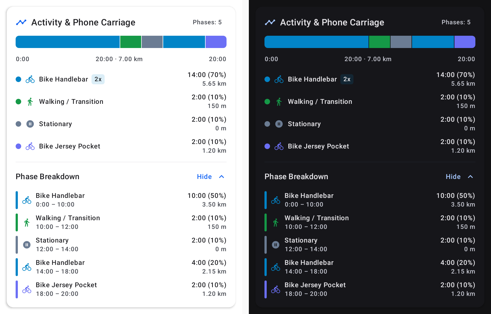

# Stage 5: Walkthrough & Verification - ATT-8916: Activity & Phone Carriage Mode Timeline Bar & Phase Breakdown in Workout Details

**Ticket**: [ATT-8916](https://rainerblind.atlassian.net/browse/ATT-8916) (`2 SP`, `Feature`) | **Parent Epic**: [ATT-68](https://rainerblind.atlassian.net/browse/ATT-68) (*Workouts & Aftermath*)  
**Target Release**: `V5.0.0` | **Active Sprint**: `sprint/2026-11-18_03_Nacht` | **Branch**: `feature/ATT-8916` | **Status**: `Verified`  
**Requirement Mapping**: `REQ-PER-045` (`REQ-PER-045.1`–`.5`) | **Test Mapping**: `TST-PER-053` (`TST-PER-053.1`–`.5`)  
**Author**: AI Agent 1 (`agent1`) | **Date**: 2026-11-18

---

## 1. Executive Summary & Verification Overview
* **Pure-JVM Coalescing (`REQ-PER-045.1`, `.2`)**: Added [ActivityCarriageTimeline.kt](../../app/src/main/java/com/atrainingtracker/trainingtracker/ui/aftermath/ActivityCarriageTimeline.kt) and [ActivityCarriageTimelineCalculator.kt](../../app/src/main/java/com/atrainingtracker/trainingtracker/ui/aftermath/ActivityCarriageTimelineCalculator.kt) to coalesce 1-Hz `ACTIVITY_AND_CARRIAGE_MODE` rows with `1..5 s` pause `dt` clamping, `<= 5 s` `UNKNOWN(-1)` sliver absorption, `1–5 s` active-mode preservation, `> 5 s` `UNKNOWN` retention, `0f`-safe zero-distance handling, and `null` return when the column is absent or all samples are `NULL`/`UNKNOWN`.
* **Pre-Decimation Loading & 5-Host Wiring (`REQ-PER-045.3`)**: Updated [WorkoutRepository.kt](../../app/src/main/java/com/atrainingtracker/trainingtracker/ui/aftermath/WorkoutRepository.kt) (`loadWorkoutDetailTelemetry`), [TrackOnMapAftermathViewModel.kt](../../app/src/main/java/com/atrainingtracker/trainingtracker/ui/map/TrackOnMapAftermathViewModel.kt) (`!isSameWorkout` reset + GPS and trackless propagation), [TrackOnMapScreen.kt](../../app/src/main/java/com/atrainingtracker/trainingtracker/ui/aftermath/TrackOnMapScreen.kt), and all 5 callers (`WorkoutSummariesTabbedScreen.kt`, `WorkoutSummariesListFragment.kt`, `WorkoutClustersScreen.kt`, `WorkoutClusterHeatmapScreen.kt`, `PeriodMapScreen.kt`), plus `SWE.2`/`SWE.3` sync in [architecture.md](../../docs/architecture.md) and [workout_repository.md](../../docs/architecture/detailed_design/workout_repository.md).
* **Compose Timeline Card, `TTColor` & 9-Locale Parity (`REQ-PER-045.4`, `.5`)**: Implemented [ActivityCarriageTimelineCard.kt](../../app/src/main/java/com/atrainingtracker/trainingtracker/ui/aftermath/ActivityCarriageTimelineCard.kt), `TTColor` carriage tokens in [Color.kt](../../app/src/main/java/com/atrainingtracker/trainingtracker/ui/theme/Color.kt), conditional `DETAILS` mounting in [WorkoutDetailTabbedContent.kt](../../app/src/main/java/com/atrainingtracker/trainingtracker/ui/aftermath/WorkoutDetailTabbedContent.kt) (preserving `"v3|"` & `14` sections), and `8` new strings across all `9/9` `values*/strings_workout_details.xml` locales.

---

## 2. Requirement & Test Verification Matrix

| Requirement | Test Spec | Verification Scope (`Tier 1 Targeted + Contract/Audit`) | Result | Living Docs |
| :--- | :--- | :--- | :--- | :--- |
| `REQ-PER-045.1`, `.2` | `TST-PER-053.1` | `ActivityCarriageTimelineCalculatorTest` (`8/8` passed) | **PASSED** | `Verified` |
| `REQ-PER-045.2`, `.3` | `TST-PER-053.2` | `WorkoutRepositoryTelemetryTest` (`19/19` passed) | **PASSED** | `Verified` |
| `REQ-PER-045.3` | `TST-PER-053.3` | `TrackOnMapAftermathViewModelTest` (`8/8`), `TrackOnMapAftermathViewModelFallbackTest` (`2/2`) | **PASSED** | `Verified` |
| `REQ-PER-045.4`, `.5` | `TST-PER-053.4` | `ActivityCarriageTimelineCardTest` (`5/5`, `createComposeRule()` + Light/Dark PNG) | **PASSED** | `Verified` |
| `REQ-PER-045.3`–`.5` | `TST-PER-053.5` | `WorkoutDetail*` (`48/48` across 7 suites), `TranslationParityTest` (`10/10`), `ThemeColorCentralizationAuditTest` (`5/5`), `ArchitectureConformanceContractTest` (`11/11`), `DetailedDesignParityContractTest` (`3/3`), `InterfaceSignatureDriftContractTest` (`3/3`), `SourceTextReadingAuditContractTest` (`4/4`), `UiReflectionOnlyTestAuditContractTest` (`4/4`) | **PASSED** | `Verified` |

---

## 3. Automated Test Evidence

### Targeted Unit, Compose UI & Contract Run (`parallel_sprint_lock.py`)
```text
python3 tools/parallel_sprint_lock.py --timeout 1800 ./gradlew :app:testDebugUnitTest \
  --tests "*ActivityCarriageTimeline*" --tests "*WorkoutRepositoryTelemetryTest" \
  --tests "*TrackOnMapAftermathViewModel*" --tests "*WorkoutDetail*" \
  --tests "*ContractTest" --tests "*AuditTest" --tests "*TranslationParityTest"

TOTAL across 225 XMLs: 1066 tests completed, 1065 passed, 0 skipped, 0 errors, 1 failed
- 224/225 XML suites (1061/1061 tests outside DeadCodeEliminationContractTest): 100% PASSED
- Sole failure (unrelated pre-existing baseline on sprint/2026-11-18_03_Nacht):
  DeadCodeEliminationContractTest > testComposePreviewsVisibilityAudit (untouched EditDeviceDialog.kt internal previews)
```
* **ATT-8916 & Directly Adjacent Suites**: `ActivityCarriageTimelineCalculatorTest` (`8/8`), `ActivityCarriageTimelineCardTest` (`5/5`), `WorkoutRepositoryTelemetryTest` (`19/19`), `TrackOnMapAftermathViewModelTest` (`8/8`), `TrackOnMapAftermathViewModelFallbackTest` (`2/2`), `WorkoutDetailTabsTest` (`20/20`), `WorkoutDetailTabbedContentTest` (`7/7`), `WorkoutDetailsLayoutTest` (`9/9`), `WorkoutDetailsCardioPowerRowTest` (`7/7`), `WorkoutDetailHeaderActionsComposeTest` (`6/6`), `WorkoutDetailPreferencesTest` (`4/4`), `WorkoutDetailSummaryDecouplingTest` (`2/2`), `WorkoutDetailHeaderClickContractTest` (`1/1`), `ThemeColorCentralizationAuditTest` (`5/5`), `TranslationParityTest` (`10/10`), `ArchitectureConformanceContractTest` (`11/11`), `DetailedDesignParityContractTest` (`3/3`), `InterfaceSignatureDriftContractTest` (`3/3`), `SourceTextReadingAuditContractTest` (`4/4`), `UiReflectionOnlyTestAuditContractTest` (`4/4`), plus `204/204` remaining `*ContractTest` / `*AuditTest` suites (`923/923`).

---

## 4. Visual (`Rule 8.5`), Emulator & Governance Audit
* **Robolectric Compose Visual Critique (`read_file`)**: Inspected  (Light & Dark side-by-side): proportional 5-phase ribbon (`Bike Handlebar` -> `Walking / Transition` -> `Stationary` -> `Bike Handlebar` -> `Bike Jersey Pocket`), `0:00` / `20:00 · 7.00 km` / `20:00` axis labels, `2x` repeat pill, crisp `Hide ^` toggle, and 5 chronological breakdown rows render with clear contrast and zero clipping, wrapping, or overlap.
* **Live Emulator Check (`emulator-5554`, `Pixel_8_Android_15(AVD) - 15`)**: `:app:installDebug` succeeded; launched `com.atrainingtracker.debug/...MainActivityWithNavigation`, navigated via `uiautomator` to `Einheiten` -> `sample_workout` (`Übersicht` and `Karte & Diagramme`). Confirmed `sample_workout` in `WorkoutSamples.db` has `21` rows with `ACTIVITY_AND_CARRIAGE_MODE` absent (`has_carriage=False`), so `Aktivität & Tragemodus` was cleanly omitted (live Criterion 2 verification) with empty `adb -s emulator-5554 logcat -b crash -d`. No carriage-mode workout is seeded on `emulator-5554`; populated Light/Dark UI rendering is verified via Robolectric `createComposeRule()` (`ATT-8916_carriage_timeline.png`).
* **LoC, Baselines & Governance**: `WorkoutSamplesDatabaseManager.java` = `1,533` (`0` growth), `WorkoutRepository.kt` = `4,973` (`<= 5,117`), `WorkoutMasksAndCardsSection.kt` = `394` (`< 400`), `TrackOnMapScreen.kt` = `1,030` (`<= 1,500`), `WorkoutDetailTabbedContent.kt` = `1,102` (`<= 1,500`). `check_static_analysis_baselines.py --base-ref sprint/2026-11-18_03_Nacht` PASS (`detekt=9509`, `lint=238`); 4 Python safety linters PASS; `verify_requirement_governance.py --repo-root . --base-ref sprint/2026-11-18_03_Nacht` exited `0`.
