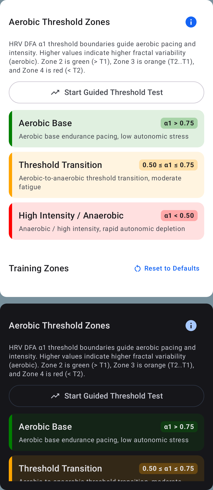

# Stage 5: Walkthrough & Verification - ATT-8951: Move HRV Threshold Test CTA Above Threshold Controls

**DOC-ID**: `DOC-WLK-ATT-8951` | **Ticket**: [ATT-8951](https://rainerblind.atlassian.net/browse/ATT-8951) (`1 SP`)  
**Parent Epic**: [ATT-355](https://rainerblind.atlassian.net/browse/ATT-355) (*Global UI & Design System*) | **Target Release**: `V5.0.0`  
**Sprint**: `sprint/2026-11-19_02_Spät` | **Branch**: `feature/ATT-8951` | **Author**: `--as agent1`  
**Requirement Mapping**: `REQ-TRK-072.7` (`REQ-TRK-072` `[Verified]`, `REQ-TRK-061.4`, `REQ-PRO-129.2`) | **Test Mapping**: `TST-TRK-072.9` (`TST-TRK-072` `[Verified]`)

---

## 1. Executive Summary & Verification Overview
Relocated the Guided Threshold Test CTA (`onOpenHrvTest`) inside `HrvDfaA1SettingsContent` (`ZonesSettingsActivity.kt`) directly below the explanatory intro text (`R.string.hrv_zones_guidance_desc`) and above the zone cards / threshold controls (`HrvZoneBandCard`, `HrvDfaA1RangeSlider`, `HrvThresholdControlRow`) with **Bounce 1/3** defects healed and zero `app/` drift after Gate 4 Bounce 1 SHA `0d4f8a58` (`Rule 7.5` / `ATT-8030`):
* **Monolith LoC Ratchet (`REQ-PRO-129.2`)**: Removed unused `FitnessCenter` import and compacted `HrvGuidedThresholdTestCta` `OutlinedButton`, keeping `ZonesSettingsActivity.kt` at **`1,894` LoC (`<= 1,898` baseline)** without altering `ArchitectureConformanceContractTest.kt`.
* **Layout & Localization**: Preserved `Icons.AutoMirrored.Filled.TrendingUp`, `R.string.hrv_start_guided_ramp_test`, `Arrangement.spacedBy(8.dp)` (keeping `HrvDfaA1RangeSliderCard` visible inside `680.dp`), `contentPadding = PaddingValues(horizontal = 12.dp, vertical = 8.dp)`, and `maxLines = 1, overflow = TextOverflow.Ellipsis` (`Localization Parity: N/A` — zero UI strings changed).
* **Deterministic Screenshot (`Rule 8.5`)**: Reset `TuningPreferencesDataStore` to canonical defaults (`T1 = 0.75f`, `T2 = 0.50f`) in `testCaptureLightAndDarkHrvGuidedTestCtaScreenshot_rule85` and verified regenerated `img/ATT-8951_hrv_cta_above_fold.png`.

## 2. Requirement & Test Verification Matrix
| Requirement | Test Spec | Verification Method | Result | Status |
| :--- | :--- | :--- | :--- | :--- |
| `REQ-TRK-072.7` | `TST-TRK-072.9` | Robolectric `createComposeRule()` (`HrvDfaA1RangeSliderGestureTest`, `0` `src/main` reads) | **PASSED (10/10)** | `Verified` |
| `REQ-TRK-087`, `REQ-TRK-061.4` | `TST-TRK-087.2` | Contract (`HrvDfaA1SettingsContractTest`) | **PASSED (12/12)** | `Verified` |
| `REQ-TRK-072.7`, `REQ-PRO-049.1` | `TST-TRK-072.9` | `HrvRampTestScreenTest` + `SourceTextReadingAuditContractTest` | **PASSED (6/6 + 6/6)** | `Verified` |
| `REQ-PRO-129.2` | `TST-PRO-129.2` | `ArchitectureConformanceContractTest` (`ZonesSettingsActivity.kt = 1,894 <= 1,898`) | **PASSED (11/11)** | `Verified` |

## 3. Automated Test Evidence (Tier 1 Targeted Scope on Unchanged `app/` SHA `0d4f8a58`)
Reused verified Stage 4 / Gate 4 Bounce 1 JUnit XML results directly (`Rule 7.5` zero redundant Gradle re-runs; `git diff 0d4f8a58..HEAD -- app/` is empty):
* **Gradle Command**: `python3 tools/parallel_sprint_lock.py --timeout 1800 ./gradlew :app:testDebugUnitTest --rerun --console=plain --tests "*HrvDfaA1RangeSliderGestureTest" --tests "*HrvDfaA1SettingsContractTest" --tests "*HrvRampTestScreenTest" --tests "*SourceTextReadingAuditContractTest" --tests "*ArchitectureConformanceContractTest"`
* **Gradle Result**: **45/45 tests passed across 5 targeted suites** (`0` failures, `0` errors, `0` skipped; `BUILD SUCCESSFUL in 4m 34s`): `HrvDfaA1RangeSliderGestureTest` (`10/10`), `HrvDfaA1SettingsContractTest` (`12/12`), `HrvRampTestScreenTest` (`6/6`), `SourceTextReadingAuditContractTest` (`6/6`), `ArchitectureConformanceContractTest` (`11/11`).

## 4. Visual Consistency & `Rule 8.5` Verification
| Light & Dark `HrvDfaA1SettingsContent` CTA Above Fold | Notes |
| :---: | :--- |
|  | Inspected via `read_file`: Light & Dark panels both display canonical defaults (`α1 > 0.75`, `0.50 ≤ α1 ≤ 0.75`, `α1 < 0.50`) and place `[↗ Start Guided Threshold Test]` cleanly between `hrv_zones_guidance_desc` and the 3 `HrvZoneBandCard`s + `Training Zones` / `Reset to Defaults` header with single-line rendering and zero clipping. |

* **Checked against `docs/design_guidelines.md`**: shapes [x] spacing [x] colors/themes [x] typography/icons [x] placement [x] | **Deviations**: None.

## 5. Invariant & Governance Verification
1. **Zero `app/` Drift**: `git diff 0d4f8a58..HEAD -- app/` is empty (`ZonesSettingsActivity.kt = 1,894` LoC `<= 1,898`; `app/source-reading-baseline.txt` untouched).
2. **Living Docs & Governance**: `REQ-TRK-072` & `TST-TRK-072` `[Verified]`; `verify_requirement_governance.py --repo-root . --base-ref refs/heads/sprint/2026-11-19_02_Spät --check-verified-evidence` exited `0`.
3. **Branch Preservation (`Rule 3.3` / `REQ-PRO-125`)**: Squashed into strictly 1 commit on `feature/ATT-8951` atop `sprint/2026-11-19_02_Spät` (`b504c3ee`), leaving `sprint/2026-11-19_02_Spät` untouched until Stage 6 `PASS`.
