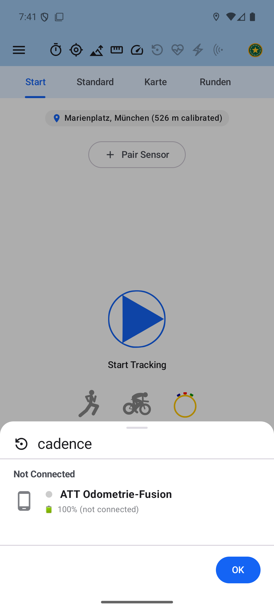

# Stage 5 Walkthrough: ATT-8991 - Capability-Gated Polar Live-IMU HRM Sources & BIKE_POWER Slope/VAM Cleanup

**Ticket**: [ATT-8991](https://rainerblind.atlassian.net/browse/ATT-8991) | **Epic**: [ATT-5910](https://rainerblind.atlassian.net/browse/ATT-5910) | **Target Release**: `V5.0.0` | **Risk Tier**: `tier-a` (`2 SP`, Gate 3 `ATT-9665` PASS)  
**Requirements / Tests**: `REQ-CON-057` (`REQ-CON-057.1`–`.4`) [Verified] / `TST-CON-057` (`TST-CON-057.1`–`.4`) [Verified] (`SYSREQ-TRK-001`)  
**Evidence Bundle**: [`docs/engineering/test_evidence/tickets/ATT-8991/manifest.json`](../test_evidence/tickets/ATT-8991/manifest.json) | **Localization Parity**: `N/A - 0 string changes`  
**Date**: 2026-11-23 | **Author**: Lane 2 Author (`--as agent1`)

---

## 1. Delivered Changes & Gate 3 Guardrails
1. **`HrmSensorCapabilityHelper.kt` (new, `98 / 1,500` LoC, `banalservice/devices/`)**: Single-source `@JvmStatic` Polar Live-IMU capability gate parallel to `BikePowerSensorsHelper`:
   - `CADENCE` & `STRIDES` -> `Protocol.BLUETOOTH_LE` AND (`isPolarH10Device` OR `isPolarVeritySenseDevice`).
   - `VERTICAL_OSCILLATION` & `GROUND_CONTACT_TIME` -> `Protocol.BLUETOOTH_LE` AND `isPolarH10Device` only.
   - `HR`, `RR_INTERVAL`, `HRV_RMSSD`, `HRV_DFA_A1`, `HRV_ARTIFACT_RATE`, `HRV_SDNN` -> all `DeviceType.HRM` devices (`REQ-HRV-050.1`).
   - Incorporates Gate 3 Guardrail 1: accepts nullable inputs, normalizes `orEmpty()`, and wraps `PolarOfflineGattCoordinator` lookups in `runCatching` falling back to `context = null` (matching `PrimaryHrSensorArbitrator.kt:130-146`).
2. **`DeviceType.java` (`269 / 1,500` LoC)**: Added `DeviceType.HRM` to `CADENCE` & `STRIDES`; removed `DeviceType.BIKE_POWER` from `SLOPE`, `VERTICAL_SPEED`, `ASCENT`, and `DESCENT` (preserving `VERTICAL_SPEED_AND_SLOPE` & `ALTITUDE_AND_SLOPE_ATT_FUSED`).
3. **`DevicesDatabaseManager.java` (`1,657 / 1,671` LoC, `0` `.ui.*` imports)**: Added `else if (deviceType == DeviceType.HRM)` gate in `getDeviceIdAndNameLists(SensorType)` using `EnumUtils.safeValueOfOrNull(Protocol.class, ...)` + `>= 0` cursor column-index guards (Gate 3 Guardrail 3).
4. **`SensorSourceDialog.kt` (`601 / 1,500` LoC)**: Applied identical `HrmSensorCapabilityHelper` filter to `DeviceType.HRM` rows in `sortNotConnectedDevices()`, with `normalizeManufacturerForCapabilityCheck()` clearing localized `R.string.devices_unknown_manufacturer` placeholders so un-reconnected Polar sensors keep legacy fallback (Gate 3 Guardrail 2).
5. **Architecture & Living Docs**: Grounded `HrmSensorCapabilityHelper` in `docs/architecture.md` (`v1.0.34`), `docs/system/sysreq_live_tracking.md` (`v1.2.29`), and `docs/system/system_software_traceability.md` (`v1.2.28`); promoted `REQ-CON-057` & `TST-CON-057` to `[Verified]`.

---

## 2. Verification Summary (Tier 1 Targeted + Live Emulator + Static Linters)
- **Gradle Build & Targeted Test Scope (`:app:assembleDebug :app:testDebugUnitTest --rerun --max-workers=2`)**: **`127/127` PASS** (`0` fail, `0` error, `0` skipped, **`0` warnings** across all modified files) across **15 suites**:
  - *Unit & Capability*: `HrmSensorCapabilityHelperTest` (`4/4`), `DeviceTypeSensorMappingTest` (`3/3`), `DevicesDatabaseManagerTest` (`17/17`), `SensorTypeHrvTest` (`5/5`), `MySensorManagerPriorityTest` (`8/8`), `AltitudeSlopePriorityTest` (`3/3`), `PrimaryHrSensorArbitratorTest` (`9/9`), `EditSensorFieldViewModelTest` (`28/28`), `SensorSourceDialogPriorityTest` (`7/7`).
  - *Behavioral Compose UI (`createComposeRule()`)*: `SensorSourceDialogContractTest` (`13/13`, including `testComposeRender_cadenceAndVerticalOscillationCapabilityFilterHrms_TST_CON_057_3`).
  - *Architecture & Governance Contracts*: `ArchitectureConformanceContractTest` (`11/11`), `InterfaceSignatureDriftContractTest` (`3/3`), `DeadCodeEliminationContractTest` (`6/6`), `SourceTextReadingAuditContractTest` (`6/6`), `SystemLiveTrackingRequirementsContractTest` (`4/4`).
- **Static & Governance Checks**: `verify_requirement_governance.py` (`--sync-indexes` + `--check-verified-evidence`) **PASS (`exit 0`)**; `lint_cursor_safety.py`, `lint_lifecycle_safety.py`, `lint_safe_enum.py`, `check_secrets_hygiene.py` **4/4 PASS**.
- **Live `emulator-5554` Smoke & `Rule 8.5` Visual Inspection**: Installed `app-debug.apk` atomically via `agent_emulator.py exec --ensure`, launched `com.atrainingtracker.debug`, verified `CADENCE` `SensorSourceDialog` via deterministic `uiautomator dump` tap `(597, 196)`, confirmed `logcat -b crash` clean (`0` crashes/exceptions), and visually inspected [`ATT-8991_sensor_source.png`](img/ATT-8991_sensor_source.png) via `read_file` (4-point checklist PASS: crisp M3 bottom sheet geometry, clean typography/single-line labels, generous tap targets, zero overlap/clipping).

---

## 3. Invariants Confirmed
- All ANT+ & BLE HRMs remain selectable for `HR`, `RR_INTERVAL`, `HRV_RMSSD`, `HRV_DFA_A1`, `HRV_ARTIFACT_RATE`, and `HRV_SDNN` (`REQ-HRV-050.1`).
- Dual-protocol ANT+ Polar H10, ordinary BLE/ANT+ HRMs, Polar H9, confirmed non-Polar GATT spoofs, and rename-suppressed HRMs are excluded from Live-IMU; Verity Sense is excluded from `VO`/`GCT`; `BIKE_POWER` is excluded from `SLOPE`/`VAM`/`ASCENT`/`DESCENT`.
- `MySensorManager` priority tables, `BikePowerSensorsHelper`, `PolarOfflineCapabilityStore`, `PolarOfflineGattCoordinator`, DB schemas, and 9-locale strings remain untouched.
