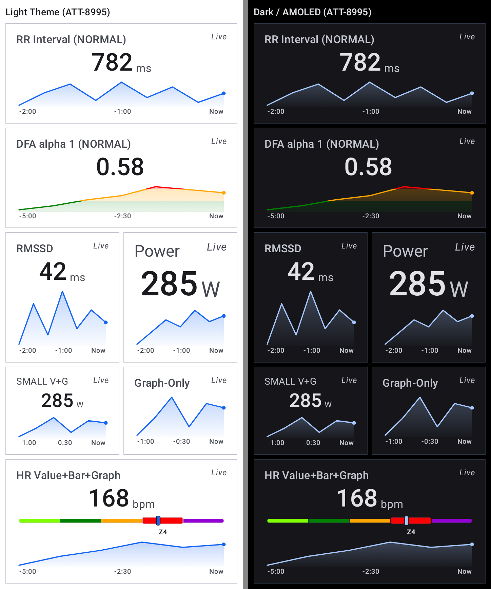

# Stage 5 Verification & Walkthrough: ATT-8995 - Give SensorFieldView Sparkline Canvas Adequate Vertical Height with Value + Graph

**Ticket**: [ATT-8995](https://rainerblind.atlassian.net/browse/ATT-8995) | **Parent Epic**: [ATT-5908](https://rainerblind.atlassian.net/browse/ATT-5908)  
**Target Release**: `V5.0.0` | **Active Sprint**: `2026-11-20_02_Spät` | **Branch**: `feature/ATT-8995`  
**Verified Production SHA**: `a5cbbd1b` (Gate 4 `ATT-9382` PASS; `Rule 7.5` doc-only Stage 5 with `0` `app/` drift: `git diff a5cbbd1b..HEAD -- app/` is empty, `0` redundant Gradle runs, `0` device touches)  
**Requirements / Test Spec**: `REQ-UI-2788` (`REQ-UI-2788.1`..`.3`, `[SWE-Derived]`) / `TST-UI-2788` (`TST-UI-2788.1`..`.3`) — `[Verified]`  
**Date**: 2026-11-20 | **Author**: AI Agent 1 (`--as agent1`)

---

## 1. Root Cause & Summary of Verified Changes
1. **Root Cause**: After `ATT-6695` (`ef243477`) added the `-T / -T/2 / Now` X-axis row below `Canvas(Modifier.weight(1f))`, `resolveSparklineHeight(..., isGraphOnly = false)` (`26/34/44/52.dp`) combined with inherited `16.sp` M3 `labelSmall` leading and `2 * 3.dp` Canvas padding compressed `NORMAL` Value+Graph curves into `~12.dp` net drawing height, while rigid `.height(...)` in `SensorFieldView.kt:505-507` wasted surplus tile height.
2. **`SensorSparklineView.kt` (`REQ-UI-2788.1`)**:
   - Raised `resolveSparklineHeight(viewSize, isGraphOnly = false)` to **`46/52/60/68.dp`** (`<= SMALL`, `NORMAL`, `LARGE`, `>= XLARGE`) and kept `isGraphOnly = true` strictly monotonically taller (**`48/56/68/84.dp`**), guaranteeing `>= 34.dp` measured Canvas height (`>= 28.dp` net curve amplitude) at `ViewSize.NORMAL`.
   - Tightened X-axis `Text` styling to `fontSize = 10.sp`, `lineHeight = 12.sp`, `PlatformTextStyle(includeFontPadding = false)`, `softWrap = false` (`0` deprecation warnings on Compose BOM `2026.09.00`), and tagged the `Canvas` with `Modifier.testTag("sensor_sparkline_canvas")`.
3. **`SensorFieldView.kt:504-508` & `EditSensorFieldDialog.kt:526` (`REQ-UI-2788.2`, `.3`)**:
   - Switched Value+Graph mode to `Modifier.heightIn(min = resolveSparklineHeight(fieldState.viewSize, isGraphOnly = false)).weight(1f).padding(horizontal = 4.dp)` (clean `IntrinsicSize.Min` expansion, surplus-height utilization beside taller neighbors, clip-free shrinking in fixed `132.dp`/`116.dp` cards), and aligned `EditSensorFieldDialog` preview height `44.dp -> 52.dp`.
   - **`0` edits** to `strings*.xml`, `docs/tests/tst_tracking_cockpit.md`, `docs/tests/tst_ui_design_system_part2.md`, or protected monoliths.

---

## 2. Verification Evidence (`Rule 7.5` Reused Gate 4 SHA `a5cbbd1b` — `0` `app/` Drift)
- **Build & Compiler Hygiene**: `:app:assembleDebug` + `:app:testDebugUnitTest --rerun` -> **PASS** (`0` new Kotlin compiler/deprecation warnings across all `ATT-8995` production & test files).
- **Tier 1 Targeted, Compose UI & Contract Suites (`57/57 PASS`, `0` failed, `0` errors, `0` skipped across 11 suites)**:

| Test Suite | Result | Requirement / Scope |
| :--- | :---: | :--- |
| `SensorSparklineViewTest` | `14/14 PASS` | `REQ-UI-2788.1` (`46/52/60/68.dp` vs `48/56/68/84.dp` monotonicity) + dynamic zone / inversion |
| `SensorFieldViewGraphOnlyLayoutTest` | `3/3 PASS` | `REQ-TRK-059.10` & `REQ-UI-2788.1` Graph-only height & monotonicity |
| `SensorFieldViewSparklineLayoutComposeTest` | `4/4 PASS` | `REQ-UI-2788.1`–`.3` (`v2.createComposeRule()` Canvas `>= 34.dp`, surplus expansion, `132/116.dp` safety, `Rule 8.5` PNG) |
| `SensorFieldViewDynamicZoneScreenshotTest` & `EditSensorFieldDialogScreenshotTest` | `3/3 PASS` | Existing dynamic-zone & dialog preview non-regression (`1` + `2`) |
| 6 Contract suites (`UiReflectionOnlyTestAudit`, `ArchitectureConformance`, `DeadCodeElimination`, `DetailedDesignParity`, `InterfaceSignatureDrift`, `SourceTextReadingAudit`) | `33/33 PASS` | Real `createComposeRule()` audit, LoC caps, `0` dead code, `0` `src/main` reads |
| **Total** | **`57/57 PASS`** | **All 11 suites green (`0` failed, `0` skipped)** |

### Verbatim `TST-UI-2788` Method Citations (`6/6` Verified on `a5cbbd1b`)
- `SensorSparklineViewTest#testResolveSparklineHeight`
- `SensorFieldViewGraphOnlyLayoutTest#testResolveSparklineHeight_graphOnlyMode_enforcesStrictlyPositiveHeights`
- `SensorFieldViewSparklineLayoutComposeTest#testNormalValueAndGraphInIntrinsicMinRow_canvasHeightAtLeast34dpAndLabelsVisible_tstUi2788_2`
- `SensorFieldViewSparklineLayoutComposeTest#testMultiColumnRowWithTallerSibling_valueAndGraphSparklineExpandsIntoSurplusHeight_tstUi2788_2`
- `SensorFieldViewSparklineLayoutComposeTest#testFixedHeightCompactCards_preserveUnclippedValueAndXAxisLabels_tstUi2788_2`
- `SensorFieldViewSparklineLayoutComposeTest#testCaptureSparklineValueGraphComparisonScreenshot_tstUi2788_3`

---

## 3. Rule 8.5 Visual PNG Audit & Governance Parity

- **Visual Inspection (`read_file` audited, Light & Dark/AMOLED)**: Confirmed generous sparkline vertical amplitude across stacked `NORMAL` RR Interval & inverted dynamic-zone DFA alpha 1 tiles, vertical surplus expansion on `RMSSD` next to `Power 285 W` (`XLARGE`), clean `SMALL V+G` vs taller `Graph-Only`, and full-amplitude `HR Value+Bar+Graph`, with crisp unclipped `-T / -T/2 / Now` labels and zero mid-word wrapping.
- **4/4 Python Safety Linters & Governance**: `check_secrets_hygiene.py`, `lint_cursor_safety.py`, `lint_lifecycle_safety.py`, `lint_safe_enum.py` -> **PASS**; `verify_requirement_governance.py --sync-indexes`, `--base-ref refs/heads/sprint/2026-11-20_02_Spät`, and `--check-verified-evidence` -> **EXIT `0`**.
- **Branch Preservation (`REQ-PRO-125`)**: `feature/ATT-8995` kept intact and unmerged for Stage 6 Cold Final Review.
