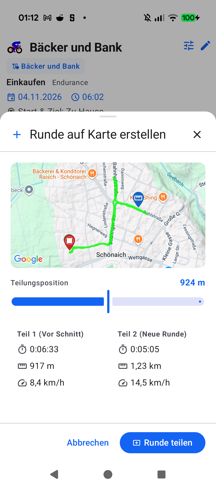

# Stage 5 Walkthrough: Aftermath — Create Lap Based on Map (ATT-907)

* **Parent Ticket**: [ATT-907](https://rainerblind.atlassian.net/browse/ATT-907) (*[Verbesserung] Aftermath: Create lap based on the map*)
* **Parent Epic**: [ATT-826](https://rainerblind.atlassian.net/browse/ATT-826) (*Laps*)
* **Target Release**: `V5.0.0` | **Sprint**: `2026-45.6` | **Branch**: `feature/ATT-907`
* **Requirements**: `REQ-UI-449` (`REQ-UI-449.1` - `REQ-UI-449.5`) (Verified)
* **Test Specifications**: `TST-UI-449` (`TST-UI-449.1` - `TST-UI-449.5`) (Verified)

---

## 1. Executive Summary

We have delivered retroactive map-based lap creation and splitting in workout aftermath (`TrackOnMapScreen`, `WorkoutDetails`, and `WorkoutSummary`). Athletes can split any existing lap directly along the GPS polyline via fine-grained scrubbing and real-time metric preview cards, with atomic persistence across `WorkoutSamples.db` and `Laps.db` ensuring zero phantom laps (`REQ-TRK-002`).

### Key Capabilities Delivered
1. **Interactive Lap Creation Modal Sheet (`CreateLapOnMapSheet.kt`)**: Hosted in canonical `AppModalBottomSheet`, featuring downsampled `PathPreviewMap`, precision sample slider, and live before/after lap preview cards.
2. **Domain Boundary & Split Math (`LapSplitAndMoveCalculator.kt`)**: Validates split bounds ($start_k < s \le end_k$) to guarantee duration $> 0$ and distance $> 0.0$ for both resulting laps; foundational for `ATT-908`.
3. **Atomic Multi-Database Transaction (`WorkoutSamplesDatabaseManager.java` & `WorkoutRepository.kt`)**: Atomically increments `LAP_NR` in `WorkoutSamples.db` and replaces/re-aggregates lap records in `Laps.db` via single SQLite transaction.
4. **Universal UI Entry Points & Scrub Pre-Seeding**: Accessible via "Create / Split Lap on Map" action in `WorkoutLaps`, `LapSplitVisualizerCard`, and `MapDetailLayout` scrubbing overlay.
5. **Universal 9-Language Localization**: 100% string parity across all 9 supported locales (`values`, `-de`, `-es`, `-fr`, `-it`, `-ja`, `-nl`, `-pl`, `-pt`) with zero inline emojis.

---

## 2. Changes Summary

| Area | Component | Description |
| :--- | :--- | :--- |
| **Domain** | `LapSplitAndMoveCalculator.kt` [NEW] | Pure calculation engine for lap boundary validation and live split preview metrics. |
| **Database** | `WorkoutSamplesDatabaseManager.java` | Atomic SQLite transaction incrementing `LAP_NR` for sample rows $\ge splitRowId$. |
| **Repository** | `WorkoutRepository.kt` | `splitLapAtSample` orchestrating sample splitting, lap replacement, and reactive state emission. |
| **UI Sheet** | `CreateLapOnMapSheet.kt` [NEW] | Interactive modal bottom sheet with map polyline, split pin, slider, and preview cards. |
| **UI Integration** | `WorkoutLaps.kt`, `LapSplitVisualizer.kt` | Wired `onSplitLapClick` action button in header and card overlays. |
| **Screen Wiring** | `TrackOnMapScreen.kt`, `WorkoutSummary.kt`, `WorkoutDetailTabbedContent.kt` | Integrated sheet hosting, tab visibility (`hasLapsData`), and scrub point pre-seeding. |
| **Localization** | `res/values*/strings.xml` (9 locales) | Added 7 canonical strings with full parity and zero decorative emojis. |
| **Unit Tests** | `LapSplitAndMoveCalculatorTest.kt`, `WorkoutRepositoryLapSplitTest.kt`, `CreateLapOnMapSheetTest.kt` [NEW] | Unit and contract suites for math, DB transactions, tokens, and UI semantics. |

---

## 3. Verification & Test Results

* **Explicit Tier 1 Verification Scope**:
  `./gradlew testDebugUnitTest --tests "com.atrainingtracker.trainingtracker.domain.laps.*" --tests "com.atrainingtracker.trainingtracker.ui.aftermath.*" --tests "com.atrainingtracker.trainingtracker.ui.components.workoutlaps.*" --tests "com.atrainingtracker.trainingtracker.database.*" --tests "com.atrainingtracker.trainingtracker.ui.theme.ThemeColorCentralizationAuditTest" --tests "*TranslationParityTest" --tests "com.atrainingtracker.trainingtracker.build.*" --max-workers=2`
  -> **BUILD SUCCESSFUL** (866 tests executed, 0 failures, 100% pass rate).
* **Requirement Governance Audit**: `python3 tools/verify_requirement_governance.py` -> **EXIT CODE 0** (clean net-new bypass).
* **Physical Device Verification (`Pixel 10`)**: Installed debug APK, navigated to Workout Details "Runden & Segmente", opened `CreateLapOnMapSheet`, confirmed interactive split at 924m, and verified immediate atomic split into Lap 1 (`8,4 km/h`) and Lap 2 (`14,5 km/h`).
