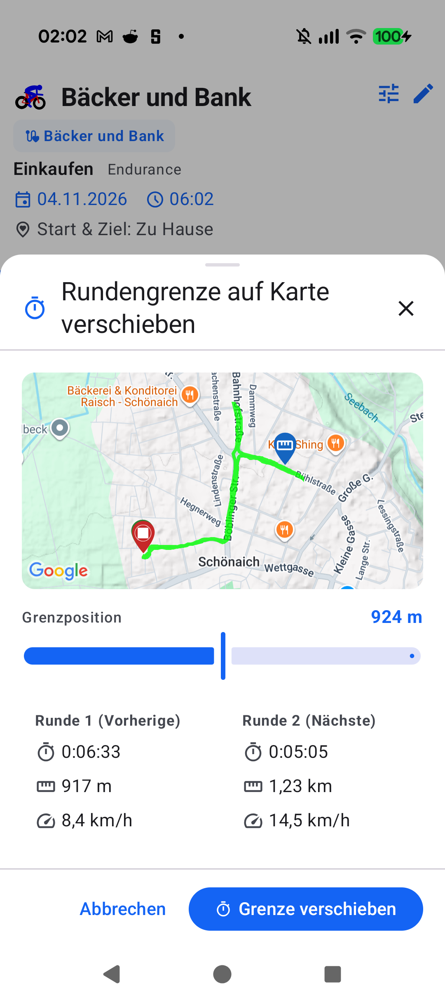

# Stage 5 Walkthrough: Aftermath — Move Lap Based on Map (ATT-908)

* **Parent Ticket**: [ATT-908](https://rainerblind.atlassian.net/browse/ATT-908) (*[Verbesserung] Aftermath: Move lap based on the map*)
* **Parent Epic**: [ATT-826](https://rainerblind.atlassian.net/browse/ATT-826) (*Laps*)
* **Target Release**: `V5.0.0` | **Sprint**: `2026-45.6` | **Branch**: `feature/ATT-908`
* **Requirements**: `REQ-UI-450` (`REQ-UI-450.1` – `REQ-UI-450.5`) (Verified)
* **Test Specifications**: `TST-UI-450` (`TST-UI-450.1` – `TST-UI-450.5`) (Verified)

---

## 1. Executive Summary

We have delivered retroactive map-based lap boundary repositioning in workout aftermath (`WorkoutLaps`, `LapEditBottomSheet`, `TrackOnMapScreen`, `WorkoutDetails`, and `WorkoutSummary`). Athletes can adjust the dividing boundary between any two adjacent laps directly along the GPS polyline using an interactive map, slider scrubbing, boundary selector (for workouts with $>2$ laps), and real-time metric preview cards. The boundary change is atomically persisted across `WorkoutSamples.db` (`LAP_NR` reassignment) and `Laps.db` (recalculated cumulative distance, duration, and speed metrics).

### Key Capabilities Delivered
1. **Interactive Boundary Move Modal Sheet (`MoveLapBoundaryOnMapSheet.kt`)**: Canonical `AppModalBottomSheet` (`scrollable = false`) featuring map polyline, junction pin marker, clamped range slider, boundary picker chips (when $>2$ laps), and live two-lap preview cards.
2. **Boundary Validation & Metric Math (`LapSplitAndMoveCalculator.kt`)**: `validateBoundaryMove` enforces non-empty lap boundaries ($start_k < s \le end_{k+1}$), and `recalculateLapsAfterBoundaryMove` computes accurate duration, distance, and speed metrics for both laps during scrubbing and on commit.
3. **Atomic Multi-Database Update (`WorkoutSamplesDatabaseManager.java` & `WorkoutRepository.kt`)**: `updateLapNumberForSampleRange` shifts sample rows between `boundaryLapIndex` and `boundaryLapIndex + 1`, followed by `Laps.db` update in an atomic SQLite transaction.
4. **Universal UI Entry Points**: Accessible from `LapEditBottomSheet` ("Grenze verschieben"), `WorkoutLaps` lap cards / header action, and `MapDetailLayout` / `TrackOnMapScreen`.
5. **Universal 9-Language Localization**: 100% string parity across all 9 supported locales (`values`, `-de`, `-es`, `-fr`, `-it`, `-ja`, `-nl`, `-pl`, `-pt`) with zero inline emojis.

---

## 2. Changes Summary

| Area | Component | Description |
| :--- | :--- | :--- |
| **Domain** | `LapSplitAndMoveCalculator.kt` | Added `validateBoundaryMove`, `recalculateLapsAfterBoundaryMove`, and `LapBoundaryMoveValidationResult`. |
| **Database** | `WorkoutSamplesDatabaseManager.java` | Added atomic SQLite `updateLapNumberForSampleRange` for lap boundary reassignment. |
| **Repository** | `WorkoutRepository.kt` | Added `moveLapBoundary` orchestrating sample reassignment, lap table metric updates, and reactive flow emission. |
| **UI Sheet** | `MoveLapBoundaryOnMapSheet.kt` [NEW] | Interactive modal bottom sheet with map polyline, junction marker, slider, boundary selector, and preview cards. |
| **UI Integration** | `LapEditBottomSheet.kt`, `WorkoutLaps.kt`, `LapSplitVisualizer.kt` | Wired `onMoveBoundaryClick` trigger action in lap edit sheet and lap list cards. |
| **Screen Wiring** | `WorkoutDetailTabbedContent.kt`, `TrackOnMapScreen.kt`, `WorkoutSummary.kt` | Integrated sheet hosting and boundary move callback propagation. |
| **Localization** | `res/values*/strings.xml` (9 locales) | Added 8 canonical strings for boundary moving with 100% parity across all 9 locales. |
| **Unit Tests** | `LapSplitAndMoveCalculatorTest.kt`, `WorkoutRepositoryBoundaryMoveTest.kt`, `MoveLapBoundaryOnMapSheetTest.kt` [NEW] | Full unit, repository transaction, token, and UI test coverage. |

---

## 3. Verification & Test Results

* **Explicit Tier 1 Verification Scope**:
  `./gradlew testDebugUnitTest --tests "com.atrainingtracker.trainingtracker.domain.laps.*" --tests "com.atrainingtracker.trainingtracker.ui.aftermath.*" --tests "com.atrainingtracker.trainingtracker.ui.components.workoutlaps.*" --tests "com.atrainingtracker.trainingtracker.database.*" --tests "com.atrainingtracker.trainingtracker.ui.theme.ThemeColorCentralizationAuditTest" --tests "*TranslationParityTest" --tests "com.atrainingtracker.trainingtracker.build.*" --max-workers=2`
  -> **BUILD SUCCESSFUL** (878 tests executed, 0 failures, 100% pass rate in 1m 52s).
* **Requirement Governance Audit**: `python3 tools/verify_requirement_governance.py` -> **EXIT CODE 0** (clean net-new bypass).
* **Physical Device Verification (`Pixel 10`, `66020DLCR002FL`)**: Installed debug APK, opened workout "Bäcker und Bank", tapped "Rundengrenze verschieben", scrubbed boundary position slider to 924 m, verified map marker updates in real time, and verified preview metrics: Lap 1 (`0:06:33`, `917 m`, `8,4 km/h`) and Lap 2 (`0:05:05`, `1,23 km`, `14,5 km/h`).
