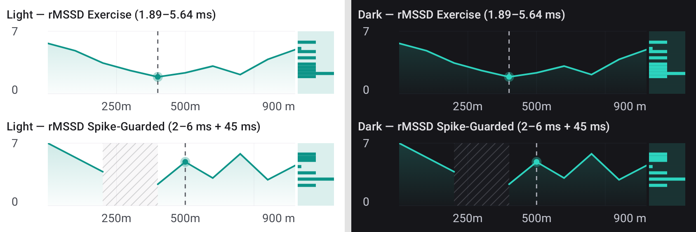

# Stage 5: Walkthrough & Verification - ATT-9171: Dynamic Outlier-Resilient rMSSD Telemetry Graph Y-Axis Scaling

**Ticket**: [ATT-9171](https://rainerblind.atlassian.net/browse/ATT-9171) | **Parent Epic**: [ATT-3539](https://rainerblind.atlassian.net/browse/ATT-3539)  
**Target Release**: `V5.0.0` | **Active Sprint**: `2026-11-19_03_Nacht` | **Branch**: `feature/ATT-9171`  
**Gate 4 Verified Code SHA**: `c2979843` + Bounce 1 test traceability `13984550` (`0` `app/` code drift — `git diff 13984550 -- app/` empty)  
**Requirement Mapping**: `REQ-HRV-047` (`REQ-HRV-047.1`..`REQ-HRV-047.4`, refines `REQ-PER-035.1`) | **Test Mapping**: `TST-HRV-047` (`TST-HRV-047.1`..`TST-HRV-047.4`) | **Date**: 2026-11-19

---

## 1. Executive Summary & Surgical 2-File Fix
- **`TelemetryZoneMath.kt` (`539` LoC `<= 1,500` ceiling)**: Added `MIN_HRV_RMSSD_Y_CEILING` (`5.0 ms`), `calculateHrvRmssdYAxisBounds(values)` (filters finite values `>= 0.0`, evaluates nearest-rank `P95` spike-ratio guard when `N >= 5 && p95 > 0.0 && max > p95 * 2.0`, guards extreme `Double.MAX_VALUE` overflow, enforces `>= max * 1.15` zero-clipping on resting `40..180+ ms` recordings, and rounds upward to clean nice steps `1/2/5/10/20`), and `formatHrvRmssdAxisLabel(value, locale)` (`-0.0`/non-finite -> `"0"`, clean integer without decimals, `%.1f` for fractional values).
- **`TelemetryMetricGraph.kt` (`1,836` LoC `<= 1,965` ceiling; `129` LoC headroom)**: Added `pathPoints` & `rawValues` to `(dataMin, dataMax)` `remember(...)` keys, replaced hardcoded `.coerceAtLeast(100.0)` with artifact-excluded `HRV_RMSSD` bounds (`cleanPrimary.ifEmpty { validValues } + overlayValues` skipping `hrvArtifactRate > 5.0` primary points), wired `formatHrvRmssdAxisLabel` into `maxLabel`/`minLabel`, and added `private fun TelemetryMetricGraphRmssdDynamicPreview()` (`@Preview`).
- **Preserved Invariants**: `0` edits to `TelemetryMetricUtils.kt` (`408` LoC), `TelemetryHistogramCalculator.kt` (`468` LoC), `WorkoutSummary.kt`, `values*/strings_*.xml` (`Localization Parity: N/A - no UI strings`), historical `ATT-8710_dfa_a1_zone_graph.png` / `ATT-8953_dfa_a1_inverted_yaxis.png`, and `ANT-Android-SDKs`.

## 2. Requirement & Test Verification Matrix

| Requirement | Test Spec | Verification Method (Exact Suites & Methods) | Result | Living Docs |
| :--- | :--- | :--- | :--- | :--- |
| `REQ-HRV-047.1`, `.2` | `TST-HRV-047.1` | `TelemetryZoneMathTest` (`22/22`: `testCalculateHrvRmssdYAxisBounds_dynamicOutlierResilientAndEdgeCases_TST_HRV_047`, `testFormatHrvRmssdAxisLabel_cleanIntegerFractionalAndDefensive_TST_HRV_047`) | **PASSED** | `Verified` |
| `REQ-HRV-047.2`, `.3` | `TST-HRV-047.2`, `.3` | `TelemetryMetricGraphHrvUiTest` (`5/5`, `createComposeRule()`: `testRmssdGraph_dynamicYAxisLightDarkPngAndSpatialSpread_TST_HRV_047`, `testRmssdGraph_landscapeHistogramAndRestingScaling_TST_HRV_047`) | **PASSED** | `Verified` |
| `REQ-HRV-047.3`, `.4` | `TST-HRV-047.4` | `TelemetryMetricGraphHrvTest` (`3/3`), `TelemetryMetricGraphZoneTest` (`7/7`), `ArchitectureConformanceContractTest` (`11/11`), `DeadCodeEliminationContractTest` (`5/5`), `SourceTextReadingAuditContractTest` (`6/6`, `0` `src/main` reads) | **PASSED** | `Verified` |

## 3. Automated Test Evidence (Rule 7.5 Gate 4 Evidence Reuse)
- **Zero Redundant Gradle Re-Run (`Rule 7.5`)**: Stage 5 Bounce 1 updates strictly the walkthrough atop Gate 4 Bounce 1 verified SHA `13984550` (`ATT-9201` PASS, `+4` hyphenated `TST-HRV-047` traceability comments in `TelemetryZoneMathTest.kt` & `TelemetryMetricGraphHrvUiTest.kt` for clean-checkout `REQ-PRO-099.3` parity); `git diff 13984550 -- app/` is completely empty (`0` `app/` code drift).
- **Tier 1 Targeted & Contract Suite Scope (`59/59 PASS` full targeted matrix @ `c2979843` + `33/33 PASS` Bounce 1 affected-suite re-run @ `13984550`; `0` failed, `0` skipped; full suite deferred to Tier 2 `Schichtwechsel` Gate; `strings*.xml` & `androidTest/` untouched)**:
  - `TelemetryZoneMathTest`: **22/22 PASS** | `TelemetryMetricGraphHrvUiTest`: **5/5 PASS** | `TelemetryMetricGraphHrvTest`: **3/3 PASS** | `TelemetryMetricGraphZoneTest`: **7/7 PASS** | `ArchitectureConformanceContractTest`: **11/11 PASS** | `DeadCodeEliminationContractTest`: **5/5 PASS** | `SourceTextReadingAuditContractTest`: **6/6 PASS**.
- **Governance & Clean-Checkout Check**: `verify_requirement_governance.py --repo-root . --sync-indexes`, clean-checkout `--base-ref refs/heads/sprint/2026-11-19_03_Nacht --check-verified-evidence --test-results-dir /tmp/empty_check_9171_s5` (`extract_test_code_tags()` finds 9 `TST-HRV-047` tags), and full `--base-ref` governance all **EXIT 0**.

## 4. Visual Consistency (`Rule 8.5` & `docs/design_guidelines.md`)

- **Inspected via `read_file` (4-Point Visual Audit)**:
  1. *Orientation & Geometry*: Top row (`1.89–5.64 ms` exercise run) scales cleanly to `0 .. 7` with the TEAL curve spanning ~27%–81% vertical plot height, aligned scrub cursor dot/halo at `400m`, and ~9 populated bars across the right-hand marginal histogram. Bottom row (`2–6 ms` steady-state + `45.5 ms` warmup spike + `62.0 ms` `9%` artifact dropout) stays at `0 .. 7`, clipping the warmup spike at the top edge while rendering crisp 45-degree diagonal hatching across the `> 5%` artifact gap (`REQ-PER-035.2`).
  2. *Color Mapping & Contrast*: Crisp `TelemetryGraphColor.TEAL` Light/Dark tokens, subtle vertical area-fill gradient, and translucent histogram tracks on both Light and Dark surfaces with zero contrast or color-bleed defects.
  3. *Typography & Label Alignment*: Clean integer Y-axis labels (`7` top, `0` bottom) with zero decimal clutter, truncation, or collision against X-axis milestone labels (`250m`, `500m`, `900 m`).
  4. *Layout & Asset Hygiene*: Preserves `50.dp` left / `52.dp` right padding (`Rule 64`) and leaves `ATT-8710_dfa_a1_zone_graph.png` and `ATT-8953_dfa_a1_inverted_yaxis.png` 100% untouched.

## 5. Invariant & Governance Summary
1. **Feature Branch Preserved Intact (`REQ-PRO-125`)**: `feature/ATT-9171` remains unmerged for Stage 6 Cold Final Review before post-PASS atomic `--merge-ticket` onto `sprint/2026-11-19_03_Nacht`.
2. **Living Documentation & Human Gate**: `REQ-HRV-047` & `TST-HRV-047` promoted to `[Verified]` with synced master indexes; parent ticket advances to `Final Review (Agent)` and terminates at `Final Review (Human)` (`Rule 3.1`).
