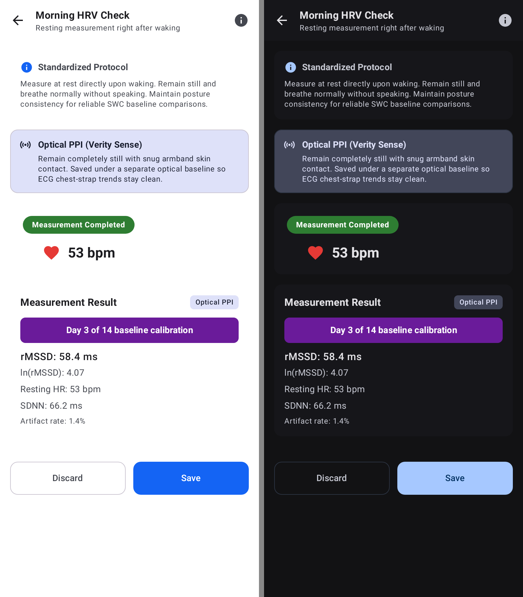

# Walkthrough — ATT-9177: Polar Verity Sense Optical PPI in Morning HRV Check & Baseline Isolation

- **Jira Ticket**: `ATT-9177` (`2 SP`, Epic `ATT-3539`)
- **Living Specs**: `REQ-HRV-049` (`REQ-HRV-049.1`..`REQ-HRV-049.4`) & `TST-HRV-049` (`TST-HRV-049.1`..`TST-HRV-049.4`) — promoted to `[Verified]`
- **Code Commit (Gate 4 Bounce 1 Certified)**: `0d5c89aa` on `feature/ATT-9177` (building on Gate 4 baseline `88c46b60`; `Rule 7.5` doc-only Stage 5 Bounce 1: `git diff 0d5c89aa -- app/` is empty)
- **Prerequisite Boundary (`ATT-9176`)**: `ATT-9176` (`PolarOnlineStreamingBridge` optical PPI acquisition) remains cleanly decoupled; `ATT-9177` defines the backward-compatible `@JvmOverloads` `RrBeatEvent.isOpticalPpi: Boolean = false` contract (plus a 6-arg Java `copy(...)` overload preserving `isOpticalPpi`) so `ATT-9176` plugs straight in without breaking Java callers (`DeviceManager.java`, `ANTHeartRateDevice.java`).

## 1. Summary of Implemented Pillars
1. **Optical PPI Beat Contract & Signal Quality Mode (`REQ-HRV-049.1`)**:
   - `RrBeatEvent.kt` adds `@JvmOverloads constructor(..., isOpticalPpi: Boolean = false)` and a 6-arg Java-compatible `copy(...)` overload preserving `this.isOpticalPpi` when `DeviceManager.java:617` clamps timestamps (`0` edits to `DeviceManager.java` or `ANTHeartRateDevice.java`).
   - `HrvSignalQualityAnalyzer.kt` adds `@JvmOverloads` with `isOpticalPpi: Boolean = false` on `analyze(...)` and `analyzeBeats(...)`: optical PPI sessions bypass ECG-specific `QUANTIZED_SYNTHETIC` and `SMOOTHED_STREAM` gates while strictly enforcing `INSUFFICIENT_DATA` (`< 30` beats) and `HIGH_ARTIFACTS` (`> 5.0%`).
2. **Non-Sticky Morning HRV Optical UX, Start-Screen Eligibility & 9-Locale Parity (`REQ-HRV-049.2`)**:
   - `MorningHrvCheckViewModel.kt` updates `isOpticalPpiSession = event.isOpticalPpi` non-stickily in `READY`/`STABILIZING` (immediately clearing optical mode if switching Verity Sense -> Polar H10), derives `isOpticalPpiSession = currentBeats.any { it.isOpticalPpi }` during `MEASURING`/`completeMeasurement()`, passes `isOpticalPpi` to `HrvSignalQualityAnalyzer.analyzeBeats(...)`, and scopes pre-save preview readiness strictly to `modality`.
   - `MorningHrvOpticalCards.kt` (`176` LoC) + `MorningHrvCheckScreen.kt` (`1,388` LoC `<= 1,450` target / `<= 1,500` ceiling) surface `OpticalPpiGuidanceCard`, optical armband contact/stillness artifact copy when `highArtifactWarning && isOpticalPpiSession`, and `OpticalPpiProvenanceBadge` on `ReadinessResultCard` (`private fun` `@Preview` composables).
   - `ControlTrackingViewModel.kt` (`0` production edits) paired Polar Verity Sense (`DeviceType.HRM`) eligibility & hide-after-optical-save verified via `ControlTrackingViewModelTest`.
   - **9-Language Localization Parity**: All 6 new keys (`morning_hrv_optical_guidance_title`, `morning_hrv_optical_guidance_desc`, `morning_hrv_optical_artifact_warning_desc`, `hrv_modality_ecg_short`, `hrv_modality_optical_ppi_short`, `hrv_modality_optical_ppi_badge`) translated across all 9 `res/values*/strings_hrv.xml` files (`en, de, es, fr, it, ja, nl, pl, pt`) with concise single-line segmented labels (`EKG` / `Optisch (PPI)`, etc.), verified by `TranslationParityTest` (`11/11`) and `HrvReadinessTrendCardTest` (`2/2`).
3. **`HrvSensorModality`, SQLite v2->v3 Migration, `.attbackup` Parity & Per-Modality Primary Isolation (`REQ-HRV-049.3`)**:
   - Added `HrvSensorModality` (`ECG`, `OPTICAL_PPI`; legacy default `ECG`) and upgraded `HrvReadinessDbHelper.DB_VERSION` `2 -> 3` placing `sensor_modality TEXT NOT NULL DEFAULT 'ECG'` as exact 20th column (`cid = 19`) for 100% `onCreate(v3) == v1->v3 == v2->v3` `PRAGMA table_info` & index parity (`Rule 64`), symmetric `toContentValues`/`fromCursor`/`fromCursorBatch` (`Rule 20`), and automatic `.attbackup` parity via `DatabaseSchemaRegistry` (`Rule 62`).
   - Scoped `recomputePrimaryForDayInternal` by `(date_iso, posture, sensor_modality)`, added old-cohort recompute in `updateEntry`, and added SQL `AND sensor_modality = ?` filtering to `getPrimaryEntriesInWindow` / `getPrimaryEntryForDate` / `getAllEntries`.
4. **ECG vs Optical SWC Baseline Isolation & `HrvReadinessTrendCard` Segmented Selector (`REQ-HRV-049.4`)**:
   - `HrvReadinessCalculator`, `HrvReadinessRepository`, and `HrvReadinessTrendMath` isolate 7d rolling averages and 60d SWC corridors by `(posture, sensorModality)`, defaulting optical-only athletes to `OPTICAL_PPI`.
   - `HrvReadinessTrendCard.kt` (`808` LoC) renders a `SingleChoiceSegmentedButtonRow` (`icon = {}`, `maxLines = 1, softWrap = false, overflow = TextOverflow.Ellipsis`) when both cohorts exist, displays an `Optical PPI` provenance pill when active, and resets `scrubbedPoint` / `pointerInput` on `(series.posture, series.sensorModality, series.metricMode)` changes with **`0` edits to `AthleteProfileScreen.kt` (`1,975/1,975` LoC)**.

## 2. Rule 8.5 Visual Verification (Light & Dark Side-by-Side)

- **Contrast & Theme Parity**: Crisp Material 3 `secondaryContainer`/`onSecondaryContainer` contrast on both `Optical PPI (Verity Sense)` guidance banner and right-aligned `Optical PPI` provenance pill across Light and Dark themes.
- **Text Clipping / Wrapping / Overlap**: Zero clipping, truncation, or overlapping elements across top bar, protocol card, optical guidance card, measurement completed card, result card, and Discard/Save action bar.
- **Domain Correctness**: Displays isolated optical baseline progress (`Day 3 of 14 baseline calibration`), `Artifact rate: 1.4%`, `rMSSD: 58.4 ms`, zero misleading ECG smoothed-stream warnings, and standard primary `Save` button hierarchy.

## 3. Verified Test Evidence (`133/133 PASS` across 16 Suites at Gate 4 SHA `88c46b60`)

| Test Suite | Result | Key `TST-HRV-049` Verbatim Methods |
| :--- | :---: | :--- |
| `HrvSignalQualityAnalyzerTest` | 10/10 PASS | `testOpticalPpiMode_bypassesSmoothedAndQuantizedFlagsWhileEnforcingArtifactAndBeatGates_TST_HRV_049` |
| `HrvReadinessEntryTest` | 5/5 PASS | `sensorModality_roundTripsSymmetricallyAndDefaultsLegacyCursorToEcg_TST_HRV_049` |
| `HrvReadinessDatabaseManagerTest` | 15/15 PASS | `schemaUpgrade_v1ToV3_and_v2ToV3_matchOnCreateV3ExactParity_TST_HRV_049`, `sameDayEcgAndOpticalEntries_maintainIndependentPrimariesAndFilteredWindowQueries_TST_HRV_049` |
| `DatabaseSchemaRegistryHrvTest` | 3/3 PASS | `databaseSchemaRegistry_referencesHrvReadinessDbVersionDirectly_Rule62` (`v1..v3` supported, `v4` rejected) |
| `HrvReadinessCalculatorTest` | 7/7 PASS | `calculateReadiness_strictlyIsolatesEcgAndOpticalPpiSwcBaselines_TST_HRV_049` |
| `HrvReadinessRepositoryTest` | 2/2 PASS | `repositoryCalculateReadiness_isolatesOpticalFromEcgCohort_TST_HRV_049` |
| `MorningHrvCheckViewModelTest` | 17/17 PASS | `testOpticalPpiNonStickyMode_andIsolatedPersistenceWithoutSmoothedEcgFalsePositive_TST_HRV_049`, `testOpticalPpiHighArtifactSession_triggersHighArtifactWarning_TST_HRV_049` |
| `MorningHrvOpticalPpiUiTest` | 3/3 PASS | `testOpticalPpiMorningHrv_showsGuidanceProvenanceAndOpticalArtifactAdvice_TST_HRV_049`, `testTrendCard_segmentedModalitySelectorSwitchesBetweenEcgAndOpticalCohorts_TST_HRV_049`, `testCaptureOpticalPpiMorningHrvLightDarkPng_TST_HRV_049` |
| `MorningHrvCheckScreenTest` | 10/10 PASS | Full regression (`0` legacy PNGs modified) |
| `HrvReadinessTrendMathTest` | 11/11 PASS | `calculateTrendSeries_isolatesEcgAndOpticalCohortsAndDefaultsOpticalOnlyAthletes_TST_HRV_049` |
| `HrvReadinessTrendCardTest` | 2/2 PASS | `testNineLocaleLocalizationParity_allHrvReadinessTrendStringsPresent` (all 6 new keys across 9 locales) |
| `ControlTrackingViewModelTest` | 15/15 PASS | `isMorningHrvCheckVisible_whenPolarVeritySensePaired_remainsEligibleAndHidesAfterOpticalSave_TST_HRV_049` |
| `TranslationParityTest` | 11/11 PASS | 9-locale `strings_hrv.xml` parity (`en, de, es, fr, it, ja, nl, pl, pt`) |
| `ArchitectureConformanceContractTest` | 11/11 PASS | `MorningHrvCheckScreen.kt = 1,388 <= 1,450`; `AthleteProfileScreen.kt = 1,975` untouched |
| `DeadCodeEliminationContractTest` | 5/5 PASS | `private fun` `@Preview` composables verified |
| `SourceTextReadingAuditContractTest` | 6/6 PASS | `0` `src/main` reads in tests |

- **Clean-Checkout Governance**: `18` static hyphenated `TST-HRV-049` tags indexed across 11 test files; both `verify_requirement_governance.py --base-ref` and clean-checkout `--check-verified-evidence --test-results-dir /tmp/empty_check_9177_s5b1` pass with **EXIT 0**.

## 4. Stage 6 Bounce 1/3 Healing Summary (`0d5c89aa`)
- **`HrvReadinessTrendMath.kt`**: Fixed `maxWithOrNull(...)` tie-breaker (`.thenBy` instead of `.thenByDescending`) so equal ECG vs Optical PPI counts deterministically select `ECG`, verified by a new equal-count tie-break assertion in `HrvReadinessTrendMathTest`.
- **`HrvReadinessTrendCard.kt`**: Updated Training Load legend pill guard from `series.maxTrainingLoad > 0.0` to `displayedSeries.maxTrainingLoad > 0.0` (`testTag("hrv_trend_training_load_legend")`), verified by ECG ↔ Optical PPI toggle assertions in `MorningHrvOpticalPpiUiTest`.
- **`MorningHrvCheckScreen.kt` (`1,389` LoC `<= 1,450`) & `MorningHrvOpticalCards.kt` (`178` LoC)**: Added `Arrangement.spacedBy(8.dp)` + `Modifier.weight(1f)` on `ReadinessResultCard` title `Text` and `maxLines = 1, softWrap = false` on `OpticalPpiProvenanceBadge` (`0` edits to `AthleteProfileScreen.kt` `1,975/1,975`).
- **Bounce 1 Verification**: **37/37 PASS** across all 5 affected suites (`ArchitectureConformanceContractTest` 11/11, `HrvReadinessTrendCardTest` 2/2, `HrvReadinessTrendMathTest` 11/11, `MorningHrvCheckScreenTest` 10/10, `MorningHrvOpticalPpiUiTest` 3/3) + **133/133 PASS** full 16-suite matrix; Rule 8.5 PNG re-inspected with `0` legacy PNG churn.
