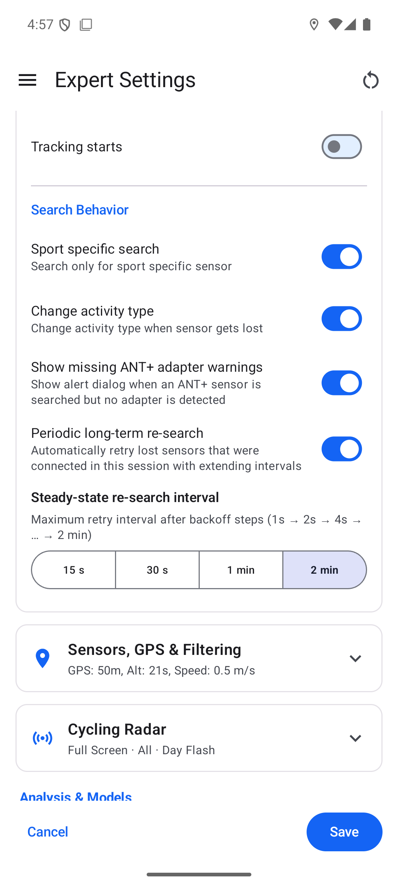
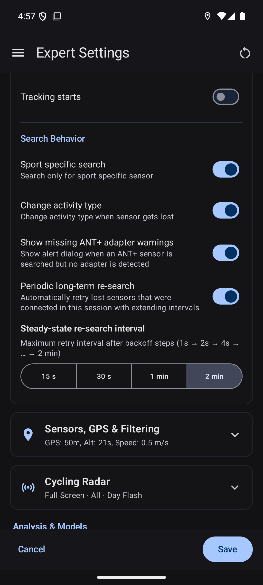

# Stage 5 Walkthrough — ATT-9178: Lost/MIA-Only Sensor Periodic Re-Search & 15s/30s/1m/2m Presets

- **Ticket**: `ATT-9178` (`tier-a`, `3 SP`, `severity-major`, Epic `ATT-5910`, `ATT-8965` follow-up)
- **Target Release**: `V5.0.0`
- **Branch**: `feature/ATT-9178` (off `sprint/2026-11-24_02_Spät`)
- **Gate 3 Subtask**: `ATT-9686` (`GATE_PASSED`)
- **Requirements / Tests Promoted**: `REQ-CON-052` (`.1`–`.3`) `[Verified]`, `TST-CON-052` (`.1`–`.3`) `[Verified]`
- **Evidence Bundle**: [docs/engineering/test_evidence/tickets/ATT-9178/](../test_evidence/tickets/ATT-9178/)

## 1. Implementation Summary
1. **Tighter Presets & Legacy Clamping (`REQ-CON-052.1`, `.3`)**: Updated `SensorSearchSettings` (`15 / 30 / 60 / 120 s`, default `60 s = 1 min`), `SensorReconnectBackoffPolicy` (`DEFAULT_FINAL_PERIOD_MS = 60_000L`), `prefs_search.xml` (`min=15`, `max=120`, `defaultValue=60`), `SearchSettingsDialog`, `SensorSearchTuningSection`, and all 9 `res/values*/strings_devices.xml` locales (`15 s / 30 s / 1 min / 2 min`; legacy `300`/`600` clamp cleanly to `120 s`).
2. **MIA-Only Session Tracking & Clean Give-Up (`REQ-CON-052.2`)**:
   - `MyRemoteDevice` (`186` LoC) & `MyANTDevice` (`459` LoC): added `hasConnectedInSession()`, `markConnectedInSession()`, and `resetSessionConnectionState()`.
   - `DeviceSearchPeriodicRetryCoordinator` (`291` LoC): schedules periodic retries strictly for `hasConnectedInSession() == true`; gives up never-connected sensors with `0` timers; enforces `device === current` identity guard; cancels retries and resets only disconnected (`!isReceivingData`) devices on `TRACKING|PAUSED -> READY|IDLE`; guards `TrainingApplication.getTrackingMode()` in `try/catch`.
   - `DeviceManager` (`1,681 / 1,708` LoC): eagerly instantiates `mPeriodicRetryCoordinator` and calls `onTrackingModeChanged()` unconditionally before `READY`/`IDLE` check.
   - `MyBTLEDevice` (`1,494 / 1,500` LoC): unconditionally releases active searches via `notifyStopSearching(false)` on `STATE_DISCONNECTED`/GATT-133 (preventing mid-workout & MIA search-queue deadlock), blocks `READY` never-connected reconnect loops, atomically captures/clears `mBluetoothGatt` under `mGattLock` in `resetSessionConnectionState()` before closing outside lock (eliminating `STATE_CONNECTED` TOCTOU), preserves `REQ-SET-123` passive workout `autoConnect = true` & reflection/constant contracts, and keeps `mSearchTimeoutRunnable` intact during `SEARCHING`.
   - `PolarOnlineStreamingBridge` (`1,472 / 1,500` LoC): gates `shouldKeepAliveOnSearchTimeout()` on `hasConnectedInSession() || isOfflineGattYielded()` and all 6 reconnect triggers on `hasConnectedInSession()`; disconnects in-flight background reconnects under `gattActionLock` in `resetSessionConnectionState()` without cancelling active `isSearching` timeout.
3. **SWE.2 / SWE.3 Docs**: Updated `docs/architecture.md` (`v1.0.36`), `banal_service.md` (`v1.0.11`), and `my_btle_device.md` (`v1.0.15`).
4. **Stage 6 Bounce 1/5 Heals**:
   - `MyBTLEDevice.java:689-705`: captured `stopInitialSearch = isSearching()` unconditionally under `!mIsShutDown && !mIsGattPaused` so mid-workout/MIA GATT-133 releases `DeviceManager` search queue cleanly; verified by `BLEReconnectRobustnessTest#testMidWorkoutAndMiaGatt133DuringActiveSearch_releasesSearchQueueAndSchedulesBackoff`.
   - `DeviceSearchPeriodicRetryCoordinator.kt:50-54`: removed redundant `?: TrackingMode.READY` Elvis operator (`0` new Kotlin compiler warnings).
   - `MyBTLEDevice.java:1160-1192`: atomically captured & cleared `mBluetoothGatt`/`mCurrentGattAutoConnect`/GATT queues under `mGattLock` when `DISCONNECTED && !isSearching() && !mIsGattPaused` and invoked `closeGattSafely()` outside lock (`MyBTLEDevice.java = 1,494 / 1,500` LoC).

## 2. Targeted Verification Results (`155 / 155` PASS, `0` fail/err/skip, `0` new Kotlin warnings)
Executed via incremental `./gradlew :app:testDebugUnitTest --rerun` (`+ :app:assembleDebug` PASS & `auto_gate.py --write-bundle`):
- `SensorReconnectBackoffPolicyTest`: `6/6` PASS
- `DeviceSearchPeriodicRetryCoordinatorTest`: `9/9` PASS
- `DeviceManagerSearchQueueTest`: `8/8` PASS
- `BLEReconnectRobustnessTest`: `19/19` PASS (incl. Bounce 1 GATT-133 search-queue release & `CONNECTED_TO_GATT` atomic reset assertions)
- `MyBTLEDeviceLifecycleTest`: `16/16` PASS
- `PolarOnlineStreamingBridgeTest`: `58/58` PASS
- `SearchSettingsDialogTest`: `3/3` PASS | `SensorSearchTuningSectionTest`: `1/1` PASS | `SensorSearchTuningContractTest`: `6/6` PASS
- `SystemLiveTrackingRequirementsContractTest`: `4/4` PASS | `ArchitectureConformanceContractTest`: `11/11` PASS | `DetailedDesignParityContractTest`: `3/3` PASS | `TranslationParityTest`: `11/11` PASS

## 3. Live `emulator-5554` Visual Verification (`Rule 8.5` & `Rule 9.3`)
- **Light Mode**:  (`md5: a73061d3d355ba054847ac1319dd4dbe`)
- **Dark Mode**:  (`md5: f827af84f2320483f36953e3b7aa3198`)
- **4-Point Visual Audit (`read_file` verified, `0` crashes in `logcat -b crash -d`)**:
  1. *Layout & Text Integrity*: Zero clipping/truncation/overlap; `"Periodic long-term re-search"` MIA summary and `"Steady-state re-search interval"` (`1s → 2s → 4s → … → 2 min`) wrap cleanly; all 4 buttons (`15 s`, `30 s`, `1 min`, `2 min`) sit evenly on one row (`icon = {}`).
  2. *Theme Parity & Contrast*: True Material 3 Light & Dark surfaces/inks with distinct active segment tint and crisp border contrast.
  3. *Visual Hierarchy & Alignment*: Toggle and full-width `TuningSegmentedButtonRow` align cleanly with sibling `TuningToggleItem` rows and accordion cards.
  4. *Functional Completeness*: Live legacy preference migration observed directly on emulator — prior `300 s` (`5 min`) value clamped cleanly to `2 min` (`120 s`) with `2 min` highlighted.
