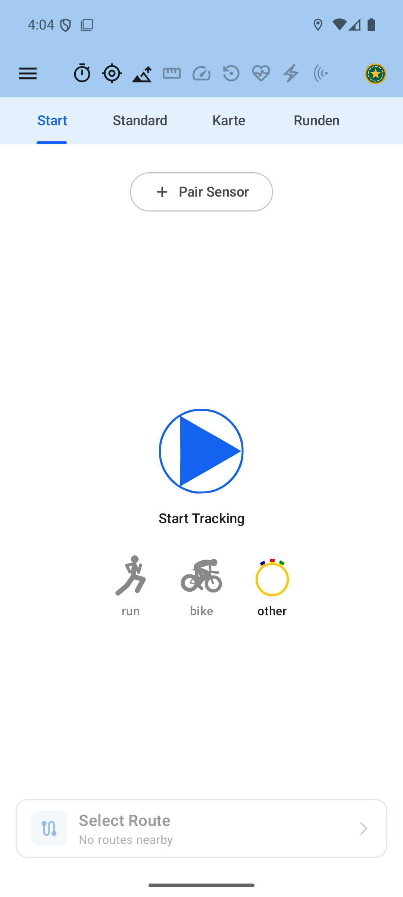

# Stage 5 Walkthrough — ATT-9469: Fast `STATIONARY` Exit on Unambiguous Motion in `PhoneCarriageClassifier`

- **Ticket**: `ATT-9469` (`2 SP`, Bug, `tier-a`, Epic `ATT-166`) | **Target Release**: `V5.0.0` | **Branch**: `feature/ATT-9469` (off `sprint/2026-11-23_03_Nacht` @ `8a996640`)
- **Gate 3**: `ATT-9674` (`GATE_PASSED`) | **Living Docs**: `REQ-FIL-043` (`req_tracking_cockpit_part3.md` `v1.0.24`, `[Verified]`) <-> `TST-FIL-043` (`tst_tracking_cockpit_part2.md` `v1.0.26`, `[Verified]`)
- **Evidence Bundle**: [`docs/engineering/test_evidence/tickets/ATT-9469/manifest.json`](../test_evidence/tickets/ATT-9469/manifest.json) | **Localization Parity**: `N/A - 0 string changes`

## 1. Summary of Changes

- **`app/src/main/java/com/atrainingtracker/banalservice/odometry/PhoneCarriageClassifier.kt`** (`1,175 -> 1,264 / 1,500` LoC, `0` new Kotlin warnings, `0` edits to `SpeedAndLocationDevice_ATTFused.kt`):
  - **Accuracy Trust & Position-Buffer Gating (`REQ-FIL-043.3`)**: Added `isAccuracyTrusted(acc) = acc == null || (acc.isFinite() && acc > 0.0 && acc <= 20.0)` (preserving omitted `null` compatibility for speed-only callers & `triggerDecayTick`, while rejecting `NaN`, `±Infinity`, `0.0`, `< 0.0`, and `> 20.0 m`). Persisted raw monotonic-guarded `lastGnssAccuracyMeters` (cleared in `reset()`), gated `positionSamples.addLast(...)` on `isAccuracyTrusted(accuracyMeters)` so coarse/invalid coordinate jumps never poison `isPositionStagnant(nowMs)`, and added `poorGnssAccuracy = gnssFresh && !isAccuracyTrusted(lastGnssAccuracyMeters)` to the `quietImu` stationary guard.
  - **Continuous Non-Stationary Dwell & `<= 1.0 s` Fast Exit (`REQ-FIL-043.1`, `REQ-FIL-043.2`)**: Added `RawEvaluation(mode, unambiguousMotionExit)`, `nonStationarySinceMs`, and `hasConfirmedDisplacement(nowMs)` (`positionSamples.size >= 2`, `(nowMs - last.timestampMs) <= STALENESS_MS`, `>= 10.0 m` spread). While `committedMode == STATIONARY`, subclass shifts (`WALKING_TRANSITION -> BIKE_JERSEY_BACK -> BIKE_FRONT_POCKET`) never reset `nonStationarySinceMs`, unambiguous motion (`wheelActiveMoving` or `effectiveSpeed >= 3.2 m/s` + trusted GNSS + `!positionStagnant` + `(!quietImu || hasConfirmedDisplacement)`) shortens exit dwell to `minOf(dismountHysteresisMs, 1_000L)`, `UNKNOWN`/return-to-`STATIONARY`/glance/`reset()` clear `nonStationarySinceMs`, and exit commits synchronize `candidateMode = rawCandidate` and `candidateSinceMs = Long.MIN_VALUE`.
- **`app/src/test/java/com/atrainingtracker/banalservice/odometry/PhoneCarriageClassifierTest.kt`**:
  - Added `testBankStopDeparture_continuousNonStationaryDwellAndFastExitWithinOneSecond_TST_FIL_043_1`, `testCrossDeviceStationaryFastExit_baroFreeWheelFreeWheelActiveAndRigidHandlebar_TST_FIL_043_2`, and `testStationaryIndoorMultipathSpikeAndLaggedTimestamp_preservesStationaryImmunity_TST_FIL_043_3`.

## 2. Verification Evidence

| Check | Result | Scope / Details |
|---|---|---|
| **Targeted JVM Unit & Contract Suites (`--rerun`)** | **149 / 149 PASS** (`0` fail/err/skip) | `PhoneCarriageClassifierTest` (`19/19`), `SpeedAndLocationDevice_ATTFusedTest` (`42/42`), `SpeedAndLocationDevice_ATTFusedBANALServiceIntegrationTest` (`3/3`), `SpeedAndLocationDeviceStationaryJitterTest` (`15/15`), `SpeedAndLocationDeviceDecayTest` (`14/14`), `SpeedAndLocationDeviceIndoorAndRestCouplingTest` (`11/11`), `MultisportTransitionDetectorTest` (`10/10`), `BANALServiceMultisportTransitionTest` (`4/4`), `KinematicSportTypeDiscriminatorTest` (`6/6`), `OfflineTelemetryReplayHarnessTest` (`11/11`), `ArchitectureConformanceContractTest` (`11/11`), `InterfaceSignatureDriftContractTest` (`3/3`) |
| **Static Safety Linters** | **3 / 3 PASS** | `lint_cursor_safety.py`, `lint_lifecycle_safety.py`, `lint_safe_enum.py` |
| **Requirement Governance** | **EXIT 0** | `python3 tools/verify_requirement_governance.py --base sprint/2026-11-23_03_Nacht` (`100%` parity, `0` orphans) |
| **Live `emulator-5554` Smoke (`Rule 7.6`, `Rule 8.5`)** | **PASS (`0` crashes)** | Locked `agent_emulator.py exec --ensure` `:app:installDebug` + cold start `MainActivityWithNavigation` (`Status: ok`, clean `logcat -b crash`, visually verified via `read_file`: [`ATT-9469_emulator_smoke.png`](img/ATT-9469_emulator_smoke.png)) |

## 3. Emulator Smoke Screenshot (`Rule 8.5`)

